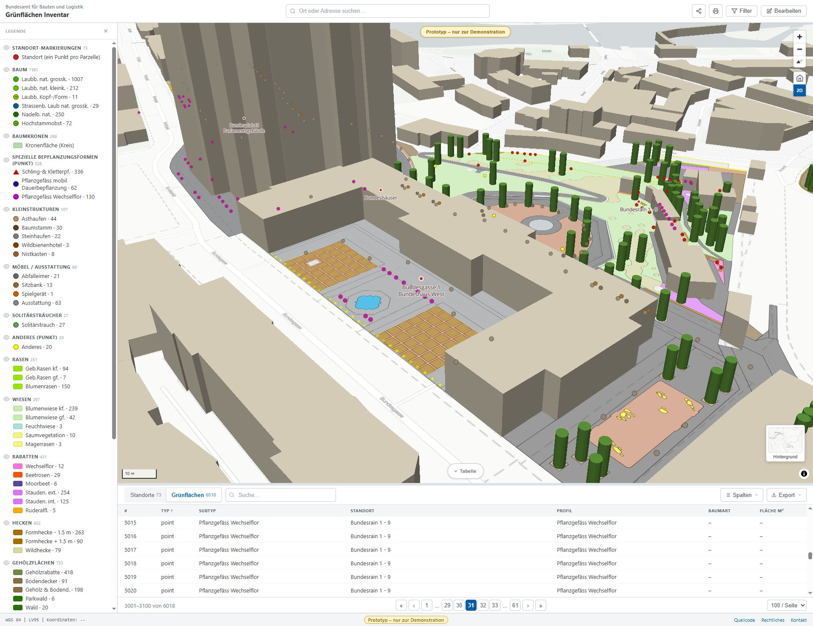
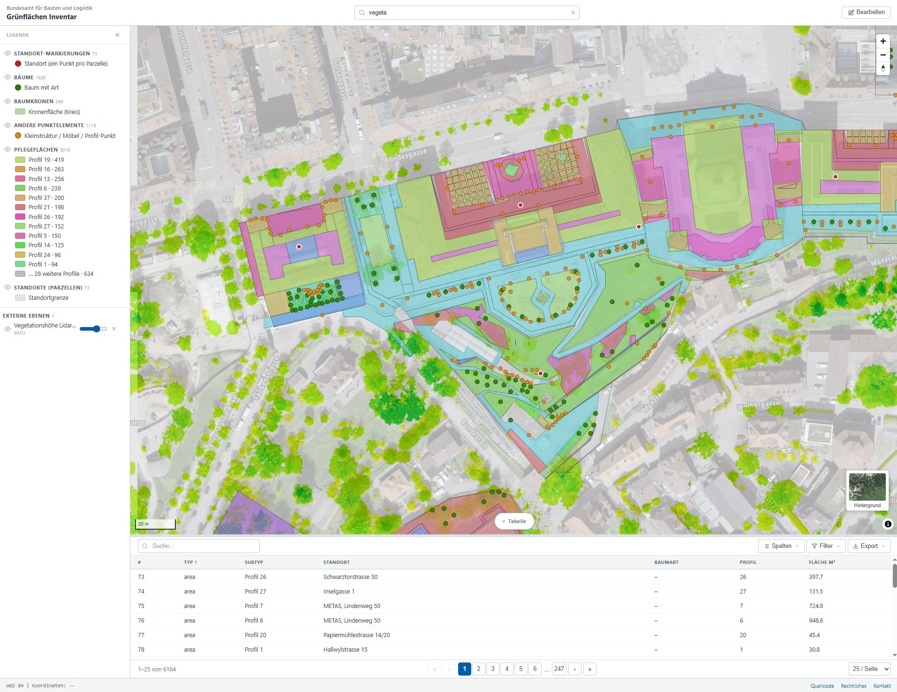

# Green Inventory — Main App (Green Areas)

> **Unofficial mockup.** Fictional data, not for production use. Part of the [`green-inventory`](../README.md) repo.

GDB-backed inventory of **73 sites (Standorte)** and **~6 000 green-area features** (areas, trees, small structures) on a MapLibre GL map, with care-profile classification, attribute filtering, a scoped table view, a detail page per Standort, and identify against external swisstopo layers.

<p align="center">
  
  
</p>

## Live app

https://bbl-dres.github.io/green-inventory/prototype-main/

The repository root [`/`](https://bbl-dres.github.io/green-inventory/) redirects here.

## Features

### Map
- **MapLibre GL JS** map with four basemaps: CARTO Positron / Dark Matter / Voyager + **swisstopo Luftbild** (vector tiles).
- **2D / 3D toggle** — camera pitches to 60°; OSM building footprints extrude (via [OpenFreeMap](https://openfreemap.org) `render_height`, 8 m default); each tree renders as a 12-gon cylinder.
- **Home button** resets to the data bbox; full-screen zoom range to z22.
- **Points at overview zooms** — below zoom 14 (a country, a region, a city) the Standorte are drawn as points only; perimeters, parcels, areas, trees and point elements appear from zoom 14. The Standort points and names are the topmost layers, so a name wins over the parcel labels around it.
- **Labels in the basemap's font** — glyphs come from each basemap's own font server, so the Standort and parcel labels take a font stack the active style uses (a font the server lacks would fail whole map tiles).
- **Identify on click** for external swisstopo layers via the federal MapServer API; results returned as GeoJSON in LV95 and re-projected client-side.
- **Grundstücke** (cadastral parcels) from the official cadastral survey — Amtliche Vermessung via the federal OpenData-AV service, keyed by EGRID — as a dashed layer, labelled from zoom 16 with the EGRID and, where matched, the ERP key at each parcel's pole of inaccessibility; the surveyors' Standort perimeters (Pflegeperimeter) are drawn as well and can be hidden in the legend.

### Legend (floating card)
The legend decides **what is drawn**; the filter (below) narrows by attributes.
- A card floating over the map's top-left corner, so the map always uses the full width; collapses to a «Legende» pill. On phones it opens as a bottom sheet, with quick chips for the three groups that have the most features in view.
- **BBL Standard Grünflächenunterhalt profile grouping** — Standort / Grundstück, Bäume, Rasen, Wiesen, Rabatten, Hecken, Gehölzflächen, Spezielle Bepflanzungsformen, Beläge, Wasserflächen, Kleinstrukturen, Möbel / Ausstattung, Anderes. One group is open at a time; no counts.
- **Visibility per group and per profile** — the group eye has three states (all on · some on · all off). Profiles with nothing in the current map view are greyed and tagged «ausserhalb»; the list never reorders while panning.
- **Colours and patterns from the printed plan**; two profiles never share both. The pattern (dots, stripes, cross-hatch) is drawn in the legend and on the map (`fill-pattern` images generated at runtime).
- **ⓘ per profile** opens an info dialog: what the profile is (BBL Standard chapter), its swatch, and six metadata rows after the geocat.ch profile (Quelle, Format, Metadaten, Datenbezug, Thematisches Geoportal, Datenstand).

### Feature card
- Click a feature: a compact card docks in the map's top-right corner (bottom sheet on phones) — type, title and a few facts in one fixed order (Standort · Grundstück ERP · Grundstück AV · Adresse · Profil · Pflegeklasse · Verantwortlich · Los · Fläche). Everything else sits behind «Weitere Attribute».
- **Pager for stacked objects** — a click that hits several features («3 Objekte an dieser Stelle») pages through them: points first, then areas by size, parcels, Standort perimeters. ← / → work while the card has focus.
- One primary action, **«Standort-Details»**, opens the detail page (new tab; same tab on phones); a second button zooms to the object.
- **Selecting never moves the map** — neither a click on the map nor a table row nor a search result. Only the card's zoom button frames the object, and never closer than zoom 18.5.

### Standort detail page
[`standort.html?id=<Objektnummer>`](standort.html?id=2052) — the complete view of one Standort (`?fid=<feature id>` where the Objektnummer is not unique):
- KPI tiles (Pflegefläche, Pflegeelemente, Bäume), the **Situationsplan**, the **Stammdaten** in two cards (Identifikation · Zuständigkeit und Pflege with Erfassung), and the **Pflegekalender** — one row per care profile with quantities and a month grid, expandable to the care tasks (solid = month stated in the BBL Standard, hatched = estimated).
- The **Situationsplan** is a live map of the Standort across the page width with the main map's controls (zoom / north, home, 3D, scale, basemap; right-click for coordinates), the main map's **legend** — collapsed to its pill until asked for, with the same groups and eye toggles, limited to what the Standort has — and the same **feature card** on selection (without the «Standort-Details» link). On phones the card and the legend, as a plain key, sit below the map instead of covering it; the printed page carries the key in full.
- **Exportieren**: Pflegebericht (PDF), Excel (Stammdaten · Pflegeelemente · Pflegekalender), GeoJSON (perimeter + elements), Drucken.
- «Zur Karte» opens the map on the Standort (`index.html?site=<Objektnummer>`); the geo.admin.ch link opens the national map at the Standort.

### Filter sidebar (right drawer)
- Attributes only: Standort / Los / Pflegeklasse / Eigentümer / Verantwortlich / Gemeinde / Baumart. Elements inherit Pflegeklasse and Verantwortlich from their Standort. (Profil and Typ are switched in the legend; old `?pr=` / `?ent=` links are translated.)
- Active filters as removable pills at the top; search-within-filters auto-expands matching groups; per-group active-count badge; "Alle zurücksetzen" link.

### Table panel
- **Standorte / Grundstücke / Pflegeelemente tabs** — segmented control filters the table to sites (73), cadastral parcels (153) or maintenance elements (~6 000: polygons + points); per-tab column-visibility defaults.
- Search, sort, configurable columns, 100/200/500 rows-per-page pagination, CSV / GeoJSON / Excel export (all data or filtered set).
- Selecting a row opens the feature's card (the map stays where it is; the card's zoom button frames the feature); row hover highlights the feature on the map.

### Prototype banner
- A red strip across the top of both pages — «Prototyp – nur zur Demonstration», white on red — on every screen size and on the printed detail page.

### Coordinates & header actions
- Footer shows live **WGS 84** + **LV95** (Swiss-grid) coordinates as the cursor moves; right-click (long-press on touch screens) opens a menu that leads with the clicked point in LV95 and WGS 84 (a click copies the row), followed by measure distances / areas, share the location and report a problem.
- **Filter** (active-count badge), **Share** (Web Share API + clipboard fallback), **Drucken** (`preserveDrawingBuffer` print pipeline), 2D/3D toggle.
- All view state round-trips through URL parameters: `center`, `zoom`, `sel` (selection), `ext` (external layers), `scope` (table tab), the filter keys (`sn`, `lo`, `pk`, `eg`, `pv`, `gm`, `ba`), `hide` (legend rows switched off, e.g. `hide=area:6,tree:1,parcel`) and `lg` (legend card open / collapsed, written only when it differs from the default for the screen size). `site=<Objektnummer>` opens the map on a Standort.

### Responsive layout
- Three layout tiers: **wide** (≥ 1100 px: legend card open, filter docked), **medium** (700–1099 px: legend starts as a pill; legend card and docked filter one at a time) and **compact** (phones in portrait *and* landscape: legend, feature card and table as bottom sheets — one at a time —, the filter as a drawer, and a ⋯ menu for Share / Print / links).
- Touch screens get 44 px targets and 16 px inputs; the notch and home indicator are respected; map controls and popups adapt to the map's own size (container queries).
- Device review and measurements: [`docs/RESPONSIVE-REVIEW.md`](docs/RESPONSIVE-REVIEW.md). Re-run the measurements with [`tools/responsive-audit`](tools/responsive-audit/README.md).

## Data pipeline

The map data lives in [`data/data.geojson`](data/data.geojson) (~16 MB, 6 164 features). It's generated from a Bundesgärtnerei FileGDB by [`scripts/gdb_to_geojson.py`](scripts/gdb_to_geojson.py), which:

1. Reads three GDB layers via **pyogrio** + the bundled GDAL FileGDB driver.
2. Extracts **17 field-domain codelists** (idPPy polygon profiles, idPP point profiles, idBa species list, etc.) via `ctypes` against the GDAL OGR field-domain API.
3. Reprojects **LV03 → LV95** (CHENyx06 NTv2 grid, 0.2 m accuracy) **→ WGS 84** (1.0 m accuracy, the published ceiling for non-Reframe transforms).
4. Validates geometry (`make_valid`), simplifies high-vertex outliers at 5 cm in LV95, enforces RFC 7946 right-hand winding.
5. Embeds all codelists, accuracy info, attribution, and `bbox` into the output metadata.

The **data model** (conceptual model, output schema, Care-Profile catalogue, terminology) is documented in [`docs/DATAMODEL.md`](docs/DATAMODEL.md); the **source GDB schema, codelists and conversion pipeline** live in [`docs/SOURCE-GDB.md`](docs/SOURCE-GDB.md).

### Per-entity files (what the app loads)

The frontend no longer reads `data.geojson` directly. Two scripts derive the per-entity files in [`data/`](data/) (model: [`docs/DATAMODEL.md`](docs/DATAMODEL.md)):

1. [`scripts/fetch_parcels.mjs`](scripts/fetch_parcels.mjs) fetches the **cadastral parcels** (Grundstücke, keyed by EGRID) that the maintenance elements stand on from the federal OpenData-AV service (`api3.geo.admin.ch`, layer `ch.swisstopo-vd.amtliche-vermessung`) and writes `land_parcels.geojson`. It also joins the ERP real-estate export by EGRID when one is passed with `--erp <path>` (the export is internal and stays outside the repository; parking-space rows and rows without an EGRID, i.e. the portfolio abroad, are skipped). Cantons without open survey data (today Vaud) yield no parcels; the affected Standorte are listed in the file's metadata.
2. [`scripts/split_entities.mjs`](scripts/split_entities.mjs) splits `data.geojson` into `sites.geojson` (Standorte with their drawn Pflegeperimeter), `maintenance_polygons.geojson` and `maintenance_points.geojson` (every element with its *assigned* `site_fid` from the survey and its *located* `parcel_fid`, computed by point-in-polygon against the parcels), `care_profiles.json` (Care Tasks nested) and `codelists.json`.

At load time [`js/data.js`](js/data.js) fetches these, joins them (element → Standort, element → parcel, element → Care Profile) and decodes the codelists into the in-memory FeatureCollection the map, table and report render from. `data.geojson` stays as the upstream source. Actor / Assignment, Cost rate and Image are intentionally not emitted (see [`docs/DATAMODEL.md`](docs/DATAMODEL.md) §4).

```bash
node scripts/fetch_parcels.mjs    # OpenData-AV → data/land_parcels.geojson (needs the network)
node scripts/split_entities.mjs   # data.geojson → data/sites.geojson, maintenance_*.geojson, *.json
```

## Tech stack

| Technology | Version | Usage |
|---|---|---|
| Vanilla JavaScript | ES6+ | Application logic |
| MapLibre GL JS | v4.7 | Map rendering (WebGL) |
| CSS3 | Modern | Design tokens + flex/grid layouts, container queries |
| GeoJSON | RFC 7946 | Geospatial data format |
| swisstopo MapServer | v3 | External-layer search + identify |
| OpenFreeMap | planet | 3D OSM building tiles |
| pyogrio + GDAL | 0.12 / 3.11 | FileGDB read + field-domain extraction (Python pipeline) |
| pyproj | 3.x | CRS reprojection (CHENyx06 grid) |
| shapely | 2.x | Geometry validation + simplification |

No build tools or frameworks for the frontend; pure static files.

## Running

Static files only — no build step. From the repo root:

```bash
python -m http.server 8000   # → http://localhost:8000/prototype-main/
npx http-server
```

Then open <http://localhost:8000/prototype-main/> (or the repo root, which redirects here).

To regenerate the data from a fresh GDB, run the two stages in order:

```bash
pip install pyogrio pyproj shapely pandas
python scripts/gdb_to_geojson.py    # GDB → data/data.geojson
node scripts/fetch_parcels.mjs      # cadastral parcels for the elements → data/land_parcels.geojson
node scripts/split_entities.mjs     # data.geojson → per-entity files the app loads
```

Edit the `GDB_PATH` constant at the top of the Python script if your GDB lives elsewhere.

## Layout

```
prototype-main/
├── index.html              # Map app
├── standort.html           # Standort detail page (?id=<Objektnummer>)
├── js/
│   ├── config.js           # Design tokens for JS, legend groups, profile styles, table columns, basemaps
│   ├── data.js             # Load + join the per-entity files into one FeatureCollection
│   ├── util.js             # Shared helpers: formatting, coordinates, icons, swatches, dialog, exports
│   ├── mapkit.js           # Shared map building blocks: inventory layers + filters, selection, hit-testing, patterns, 3D, basemap switcher
│   ├── mappanels.js        # Shared panels: legend list, feature card
│   ├── map.js              # Map app: legend state, selection, identify, measure, search
│   ├── table.js            # Table widget: tabs, scope, attribute filters, export
│   ├── standort.js         # Detail page: KPIs, Situationsplan, Stammdaten, Pflegekalender, exports
│   └── report.js           # Per-Standort Pflegebericht (PDF)
├── css/
│   ├── tokens.css          # Design tokens (colours, spacing, shadows, …)
│   ├── styles.css          # Component styles (map app + shared components)
│   └── standort.css        # Page layout of the detail page
├── data/                   # ← what the app loads (per-entity, normalized)
│   ├── sites.geojson       # Standorte: attributes + drawn Pflegeperimeter
│   ├── land_parcels.geojson         # Cadastral parcels (Amtliche Vermessung, EGRID)
│   ├── maintenance_polygons.geojson # Areas, incl. the circular ones (site_fid assigned, parcel_fid located)
│   ├── maintenance_points.geojson   # Trees + point features (likewise)
│   ├── care_profiles.json  # Care Profiles with nested Care Tasks
│   ├── codelists.json      # 17 field-domain codelists
│   └── data.geojson        # Upstream source the split is derived from (6 164 features)
├── scripts/
│   ├── gdb_to_geojson.py   # GDB → data.geojson conversion pipeline
│   ├── fetch_parcels.mjs   # OpenData-AV → land_parcels.geojson (+ optional ERP export join)
│   ├── split_entities.mjs  # data.geojson → per-entity files
│   └── lib/geo.mjs         # Shared planar helpers (LV95, point-in-polygon, areas)
├── docs/
│   ├── DATAMODEL.md        # Data model: conceptual model, output schema, Care Profiles, terminology
│   ├── SOURCE-GDB.md       # Source GDB schema, codelists, conversion pipeline
│   ├── wireframes/         # Design study behind the legend, feature card and detail page; design review
│   ├── reviews/            # Code reviews (findings, what was fixed, what is open)
│   └── RESPONSIVE-REVIEW.md # Responsive / mobile design review
├── tools/
│   └── responsive-audit/   # Playwright device-matrix audit behind the review
└── assets/
    ├── basemaps/           # Basemap thumbnails (SVG)
    ├── images/             # Preview screenshots (used by this README)
    └── switzerland.svg     # Outline for the report's locator map
```

## License

[MIT](../LICENSE)
