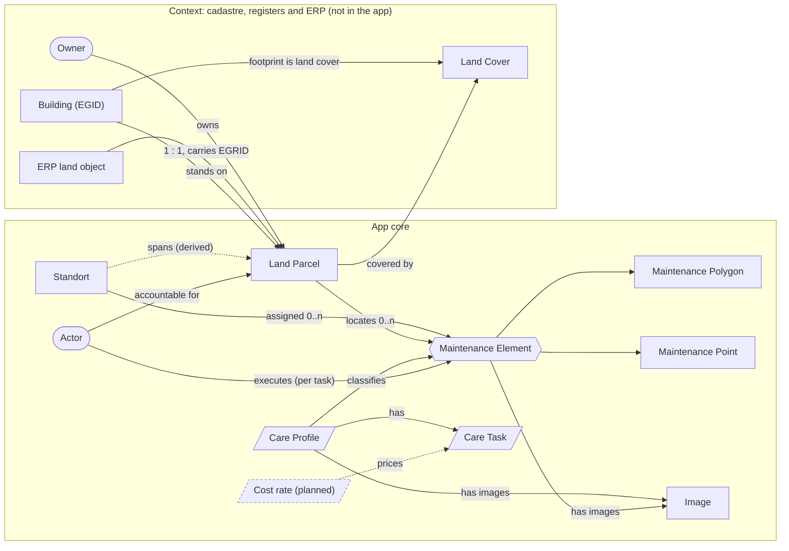
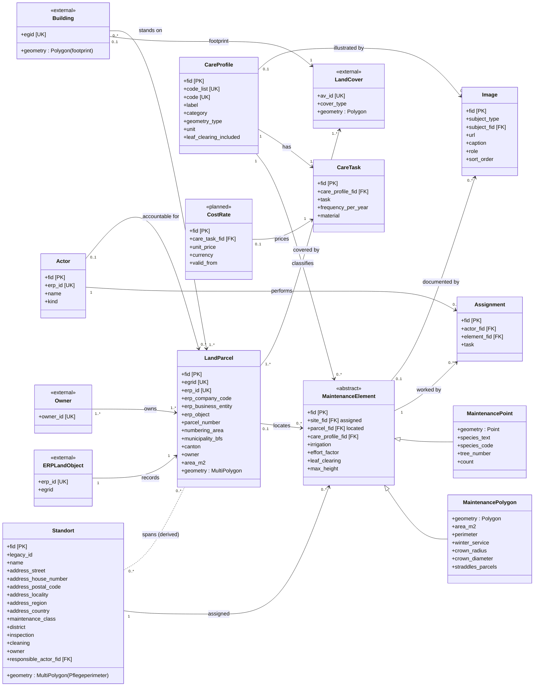

# Green Inventory — Data Model

## 1. Goal

This document defines the data model behind the Green Inventory app: the
entities, their attributes, and how they relate. It is the shared reference
for developers, BG staff and downstream consumers. The main use-case is data
export for tenders (bills of quantities for green-space maintenance).

- Section 2 is the conceptual model: one diagram and one table, enough to
  grasp the whole picture in a minute.
- Section 3 documents each entity in detail (attributes).
- Section 4 lists the gaps between this reference model and today's data.
- Section 5 is the enumerations (controlled vocabularies).
- Section 6 is reference material: detailed UML, standards, terminology, links.

### 1.1 Principles

- Tidy data: one fact per field, atomic values, no concatenation. Composite
  real-world values are split into components (for example an address into
  street, house number, postal code and locality); repeating values become
  rows, not comma-separated lists.
- Identity: every entity has a `fid` (feature id) — the surrogate primary key
  the app maintains and the target of all foreign keys. It must be stable
  across data refreshes. External identifiers are named after the register
  that issues them, never after their role: `egrid` (land registry), `egid`
  (building register), `municipality_bfs` (Federal Statistical Office),
  `erp_id` (the organisation's ERP). An entity may carry several of them; none
  is ever the app's own join key. A generic `system_id` is not used, because it
  hides which system issued the value and breaks as soon as an entity carries
  keys from two systems — which the Land Parcel does.
- Solution-neutral: a master system names who owns the data, not a product.
  The operational ERP / master-data system is the organisation's choice (the
  Swiss federal government happens to use SAP, whose real-estate module keys a
  land object by company code, business entity and object number). The
  cadastral masters are fixed national authorities: the land registry for
  EGRID and ownership, the building register for EGID, and the official
  cadastral survey for geometry.
- Assignment is not location: a Maintenance Element records which Standort
  cares for it (an assignment made by people when the inventory was surveyed)
  and which Land Parcel it stands on (a location computed from the cadastre).
  These are two different facts; neither is derived from the other.
- English-first model: entity names carry their German equivalent (EN / DE);
  attributes stay English, since most are self-explanatory. The full glossary
  is the terminology reference (Section 6.4), and the physical German field
  names are in the source document ([`SOURCE-GDB.md`](SOURCE-GDB.md)). French
  and Italian are planned.
- Conform to authorities: cadastral facts (parcel, ownership, land cover,
  building) follow the Swiss registers; the app does not redefine them.

---

## 2. Conceptual data model

The app maintains the green spaces of Swiss federal real estate, run by the
federal nursery service (BG) within the Federal Office for Buildings and
Logistics (BBL). The core has three entities: the **Standort** (the unit of a
maintenance tender, defined by the BG), the **Land Parcel** (the legal unit of
ground, defined by the cadastre) and the **Maintenance Element** (what is
cared for). An element is *assigned* to one Standort and *located* on one
parcel; Standort and parcel are related only through their elements. Around
the core sit reference data (Care Profile, Care Task, Actor, and the planned
Cost rate) and contextual entities from the Swiss cadastre, the registers and
the ERP that the app does not store but the data depends on.

Diagram shapes:

- Rectangle: an entity.
- Hexagon: an abstract entity that has subtypes (Maintenance Element).
- Parallelogram: reference data, a controlled vocabulary (Care Profile, Care
  Task, Cost rate).
- Rounded box: a party or actor (Actor, Owner).
- Dashed: planned, not yet implemented (Cost rate), or derived rather than
  stored (Standort spans parcels).

The two boxed groups separate the app's core entities from contextual entities
held in external systems.

| Entity (EN) | Entity (DE) | Scope | Master system | What it is |
|---|---|---|---|---|
| Standort | Standort | core | BG (this app) | The unit of a green-space maintenance tender: the set of elements one party is responsible for, named and delimited by the BG. Not a legal boundary and not an ERP object. May span several parcels, parts of parcels and third-party ground. Carries the Pflegeperimeter drawn for the tender plans as a display outline. |
| Land Parcel | Grundstück | core | land registry (identity, EGRID); cadastral survey (geometry); ERP (one land object per parcel) | One cadastral parcel. Includes third-party parcels on which elements are maintained (street trees, leased ground). |
| Maintenance Element | Pflegeelement | core | BG survey | A cared-for feature, assigned to one Standort and located on one parcel. Abstract: every element is either a Polygon or a Point. |
| Maintenance Polygon | Pflegepolygon | core | BG survey | Subtype of Maintenance Element. Polygon feature: lawn, bed, hedge, path, surface. |
| Maintenance Point | Pflegepunkt | core | BG survey | Subtype of Maintenance Element. Point feature: tree, planter, bench, structure. |
| Care Profile | Pflegeprofil | core (reference) | BBL standard | What an element is; groups the maintenance tasks that apply to it. |
| Care Task | Pflegemassnahme | core (reference) | BBL standard | A single maintenance task of a Care Profile, with its yearly frequency and material. |
| Actor | Akteur | reference (planned) | ERP / directory | A party that performs maintenance. Several actors may work the same element (for example winter versus summer), so the key relation is Actor to Maintenance Element. Not part of this MVP — no actor data is held. |
| Assignment | Pflegeauftrag | relationship (planned) | BG / ERP | Links one Actor to one Maintenance Element for a task (shown as the "executes" edge). Not part of this MVP — no assignment data is held. |
| Cost rate | Einheitspreis | core (reference, planned) | price catalogue | Planned. Unit price for a Care Task; with element measures it yields tender costs. |
| Image | Bild | core | app / media store | A picture (URL) attached to a Care Profile (standard illustration) or a Maintenance Element / Standort (field photo); several allowed. |
| ERP land object | Grundstück (ERP) | context | ERP | The ERP's record of a parcel, exactly one per cadastral parcel, keyed by company code / business entity / object number and carrying the EGRID. Business entity (Wirtschaftseinheit) and company code (Buchungskreis) are components of that key, used for finance; they are not entities and are not georeferenced. |
| Owner | Eigentümer | context | land registry | Legal owner of a Land Parcel. |
| Land Cover | Bodenbedeckung | context | cadastral survey | Official surface classification: building, paved, vegetation, water, forest, rock, and so on. |
| Building | Gebäude | context | building register + cadastral survey | A building keyed by EGID; its footprint is a Land-Cover polygon. A parcel may carry several buildings. |

**Delivered files.** The app loads one file per core entity from `data/`
(Section 6.3). They are produced from two sources: the survey GDB, converted
to `data.geojson`, and the official cadastral survey, fetched by EGRID or by
location from the federal OpenData-AV service. The conceptual entities map to
the sources as follows:

| Conceptual entity | Source | Delivered as |
|---|---|---|
| Standort | GDB layer `Objekt`: attributes plus the drawn Pflegeperimeter | `sites.geojson` |
| Land Parcel | OpenData-AV (`ch.swisstopo-vd.amtliche-vermessung`), parcels that host at least one element; ERP keys and further federal parcels from the RE-FX export (pending) | `land_parcels.geojson` |
| Maintenance Polygon | GDB `Pflegeelement_polygon`; `site_fid` from the survey's object link, `parcel_fid` computed | `maintenance_polygons.geojson` |
| Maintenance Point | GDB `Pflegeelement_point`; likewise | `maintenance_points.geojson` |
| Care Profile, Care Task | GDB code lists plus the BBL standard | `care_profiles.json` |
| Code lists | GDB field domains | `codelists.json` |
| Actor, Assignment, Cost rate, Image, Land Cover, Building | not delivered | — |

---

## 3. Entities

Each entity has an attribute table. Columns: the attribute id; Key (PK =
primary key `fid`, UK = unique key, FK = foreign key); Type (basic format);
Enum (enumeration constraining the value, see Section 5); and a short
description. Foreign keys reference the parent's `fid`. Where an attribute is a
foreign key in the target model but only a coarse code today, the Enum column
names today's code list. The German source field names are in
[`SOURCE-GDB.md`](SOURCE-GDB.md) Section 2.

### 3.1 Standort

The unit of a maintenance tender: a named set of maintenance elements for
which one party is responsible, as the BG defines it for its Ausschreibungen.
The BG — and therefore this app — is its master. A Standort has no legal
boundary: it may span several parcels, parts of parcels and ground the Bund
does not own. It is not an ERP object either; its relation to business
entities (Wirtschaftseinheiten) is derived through the parcels its elements
stand on and is many-to-many.

Its geometry is the **Pflegeperimeter** the surveyors drew for the tender
plans. That outline is a plan frame, not a boundary: across the 73 Standorte
the maintained polygons cover a median 39 % of it, it reaches onto streets and
neighbouring parcels, and in three cases the maintained area exceeds it. It is
kept for display (shown by default, switchable in the legend) and never used
for area or cost figures. A representative point inside it is derived for
markers and labels.

| Attribute | Key | Type | Enum | Description |
|---|---|---|---|---|
| fid | PK | integer | — | Feature id maintained by the app (today the survey's object id) |
| legacy_id | | string | — | The surveyors' object number (Objektnummer). Traceability only: not unique (one value appears twice), mixed formats (`2001BW`, `7282GR`, `TN 1086/5177`); often coincides with a business-entity number but is not an ERP key |
| legacy_parcel_numbers | | string | — | The parcel number(s) the surveyors noted, verbatim. Superseded by the located parcels (Section 3.2); kept because 3 of 62 no longer match the cadastre |
| name | | string | — | Standort name |
| address_street | | string | — | Display address, street. The authoritative address is the Building's (GWR) |
| address_house_number | | string | — | House number (may be alphanumeric) |
| address_postal_code | | string | — | Postal code |
| address_locality | | string | — | Town or city |
| address_region | | string | — | Region or canton (state / province abroad) |
| address_country | | string | — | Country (ISO 3166-1); the portfolio is worldwide |
| maintenance_class | | integer | idPk | Intensity tier, PK 1 to 3 |
| district | | string | — | Operational region: DLZ 1 to 5; nationwide catch-all; legacy |
| inspection | | integer | idJn | Inspection flag (yes / no) |
| cleaning | | integer | idJn | Cleaning flag (yes / no) |
| owner | | integer | idEg | Owner category as surveyed per Standort (Bund / Dritte). Transitional: ownership is a parcel fact (Section 3.2) and will come from the ERP export and the land registry |
| responsible_actor_fid | FK | integer | idPv | Accountable party as surveyed per Standort (Actor.fid); a coarse code today. Transitional, see Section 3.2 |
| created_year | | integer | — | Year of construction. Strictly a building fact; kept for display |
| surveyed_at | | date | — | Survey date |
| remarks | | string | — | Free text |
| geometry | | geometry | — | The Pflegeperimeter (MultiPolygon). Display only |
| lv95_east, lv95_north | | double | — | Derived representative point inside the perimeter (LV95), for markers and labels |
| perimeter_area_m2, perimeter_length_m | | double | — | Derived from the perimeter. Shown as "Standort m²"; not a maintained area |

### 3.2 Land Parcel (Grundstück)

One cadastral parcel (a Liegenschaft or a selbständiges und dauerndes Recht)
as the land registry identifies it, with geometry from the official cadastral
survey. The EGRID is its identity. The ERP keeps one land object per
cadastral parcel and stores the EGRID on it, so the ERP key is a second unique
key and the two systems join without any name or number matching. In
practice the export is not perfectly 1:1: in the October 2026 list 13 of
1 558 EGRIDs carry several objects — rights of use recorded beside the owned
parcel (parking rental, ramps, light wells, pavement use), partial areas of
one parcel, or plain duplicates. The join prefers the owned object (ownership
type 1) and keeps the other keys in `erp_alternatives`, so `erp_id` stays one
value per parcel. Rows that describe parking spaces are excluded, and rows
without an EGRID — the whole portfolio abroad and some domestic rights — never
join.

The parcel list has two sources. The ERP export yields every parcel in the
federal portfolio, owned or rented. The elements yield the parcels the BG
maintains on without holding them — third-party ground such as street verges
with Strassenbäume. A parcel is delivered when at least one element is located
on it or the ERP lists it. Geometry is retrieved from the federal OpenData-AV
service by EGRID (refresh, ERP parcels) or by location (first load); cantons
that do not publish their survey as open data have no geometry in the app
until a cantonal source is added (today: Vaud).

| Attribute | Key | Type | Enum | Description |
|---|---|---|---|---|
| fid | PK | integer | — | Feature id maintained by the app; the numeric part of the EGRID, so it is stable across refreshes |
| egrid | UK | string | — | EGRID, the parcel's key in the land registry (`CH` + 12 digits) |
| erp_id | UK | string | — | The ERP land-object key, derived as `company_code/business_entity/object` (for example `1086/2000/01`). Unique because the ERP keeps one object per parcel. Null until the ERP export is joined |
| erp_company_code | | string | — | ERP company code (Buchungskreis); component of `erp_id` |
| erp_business_entity | | string | — | ERP business entity (Wirtschaftseinheit); component of `erp_id`; the finance grouping |
| erp_object | | string | — | ERP object number within the business entity; component of `erp_id` |
| erp_name | | string | — | The ERP object's designation (Bez. Grundstück), for display |
| erp_ownership_type | | string | — | ERP ownership type code (Eigent.art): 1 observed on owned parcels, 3 on rented ground and rights of use, 5 on other rights; meaning to be confirmed with the ERP owners |
| erp_historic_garden | | string | — | ERP historic-garden rating (Hist.Gart.), where set |
| erp_alternatives | | string[] | — | Further ERP object keys recorded on the same EGRID (see above); null when the parcel has one object |
| erp_match_method | | string | — | How the ERP key was found: `egrid` (key join), or `designation+address` for an ERP row without EGRID whose designation names this parcel number in this municipality and whose street matches a Standort on the parcel (applied only when unique) |
| parcel_number | | string | — | Cadastral parcel number; unique only within its numbering area |
| numbering_area | | string | — | Numbering area (Nummerierungsbereich, `identnd`); a municipality may have several |
| municipality_bfs | | integer | — | Municipality (BFS) number |
| municipality_name | | string | — | Municipality name, for display |
| canton | | string | — | Canton abbreviation |
| geoportal_url | | string | — | Link to the cantonal geoportal entry, where delivered |
| owner | | integer | idEg | Coarse owner category; null until the ERP export (presence and object type) or the land registry supply it. Today's surveyed value sits on the Standort. Conceptual ownership is the n:m relation to Owner (co-ownership), Section 3.8 |
| responsible_actor_fid | FK | integer | idPv | Accountable party (Actor.fid); null today, see Standort |
| area_m2 | | double | — | Parcel area, computed in LV95 from the survey geometry |
| perimeter_m | | double | — | Parcel perimeter, computed in LV95 |
| geometry_source | | string | — | `av` (official survey, OpenData-AV) — the only value delivered |
| fetched_at | | date | — | When the geometry was retrieved |
| label_lon, label_lat | | double | — | Presentation only: label anchor, the pole of inaccessibility of the parcel, computed once in the pipeline (the map labels parcels with EGRID and `erp_id` there) |
| geometry | | geometry | — | Parcel polygon (MultiPolygon), as surveyed |

A parcel carries no address (addresses belong to buildings) and no Standort
foreign key: the Standorte a parcel serves follow from the elements located on
it, and a parcel can serve more than one.

### 3.3 Maintenance Element (Pflegeelement)

A cared-for feature. Abstract: every element is either a Maintenance Polygon
or a Maintenance Point. The two use different Care-Profile code lists (`idPPy`
versus `idPP`); a subtype's `care_profile_fid` must point to a Care Profile in
the matching code list.

Every element carries two independent links. `site_fid` is the **assigned**
Standort: the tender unit whose party cares for the element, recorded by the
surveyors. `parcel_fid` is the **located** parcel: the cadastral parcel the
element stands on, computed by point-in-polygon against the survey geometry
(a point by its coordinate, a polygon by an interior point) and recomputed
whenever the cadastre changes. The first is an operational decision, the
second a legal fact; one is never derived from the other.

Shared attributes:

| Attribute | Key | Type | Enum | Description |
|---|---|---|---|---|
| fid | PK | integer | — | Feature id maintained by the app |
| site_fid | FK | integer | — | Assigned Standort (Standort.fid); null for elements the survey left unassigned |
| parcel_fid | FK | integer | — | Located Land Parcel (LandParcel.fid); null where no survey geometry is available |
| straddles_parcels | | boolean | — | Polygon only: its vertices fall into more than one parcel. Relevant once costs are split by owner |
| care_profile_fid | FK | integer | — | Care Profile (CareProfile.fid) |
| irrigation | | integer | idBw | Irrigation regime |
| effort_factor | | double | — | Care-effort multiplier, 0.5 to 5.0 (weights tender cost) |
| leaf_clearing | | integer | — | Leaf-clearing scope flag (Lauben): 0, 1 or 2 |
| max_height | | double | — | Max plant or tree height, where measured |
| remarks | | string | — | Free text |

Maintenance Polygon (Pflegepolygon) adds:

| Attribute | Key | Type | Enum | Description |
|---|---|---|---|---|
| geometry | | geometry | — | Polygon |
| area_m2 | | double | — | Area in square metres (LV95-projected); the tender measure for area profiles |
| perimeter | | double | — | Perimeter in metres |
| winter_service | | integer | Winterdienst | Winter-service treatment |
| crown_radius | | double | — | Crown radius (circular polygons only) |
| crown_diameter | | double | — | Crown diameter (circular polygons only) |

Maintenance Point (Pflegepunkt) adds:

| Attribute | Key | Type | Enum | Description |
|---|---|---|---|---|
| geometry | | geometry | — | Point (Swiss-grid, centimetre precision) |
| species_text | | string | — | Free-text species; its presence classifies the row as a tree |
| species_code | | integer | idBa | Species code |
| tree_number | | integer | — | Per-Standort tree number |
| count | | integer | — | Number of items; the tender measure for point profiles (usually 1) |

### 3.4 Care Profile and Care Task (Pflegeprofil, Pflegemassnahme)

A Care Profile is what a feature is and how it is maintained, from the BBL
green-space maintenance standard (2020): 33 profiles in 10 categories (the
authoritative list is in Section 5.1). Its business key is `(code_list, code)`,
because a bare code is unique only within its code list.

| Attribute | Key | Type | Enum | Description |
|---|---|---|---|---|
| fid | PK | integer | — | Feature id maintained by the app |
| code_list | UK | string | — | Domain: idPP (points) or idPPy (areas); part of the business key |
| code | UK | integer | — | Profile code within its code list; part of the business key |
| label | | string | — | Profile name |
| category | | string | — | BBL grouping (lawn, meadow, bed, and so on) |
| geometry_type | | string | — | Capture geometry of the elements it classifies: polygon (idPPy) or point (idPP) |
| unit | | string | — | Unit of capture: square metres (areas) or count (points) |
| description | | string | — | What the profile is (from the standard) |
| leaf_clearing_included | | boolean | — | Whether the profile includes leaf clearing (Lauben) |
| style | | object | — | Presentation only — rendering style `{ fill, swatchClass? }`; see note below |

`geometry_type` mirrors the Maintenance Element subtype split and matches
`code_list` (idPPy → polygon, idPP → point). `style` is a **presentation
attribute**, not part of the conceptual model: `fill` is the feature colour and
`swatchClass` names an optional CSS pattern class (in `css/styles.css`). It is
carried in `care_profiles.json`, which the app reads as the single source for
every feature colour (map fill, point/tree symbols, legend, popup, PDF). The
values are seeded from the frontend's curated catalogue (`js/config.js`,
`AREA_PROFILE_STYLE` / `POINT_PROFILE_STYLE`).

A Care Task is one maintenance activity of a profile (its Haupttätigkeit), with
the yearly frequency that defines the standard.

| Attribute | Key | Type | Enum | Description |
|---|---|---|---|---|
| fid | PK | integer | — | Feature id maintained by the app |
| care_profile_fid | FK | integer | — | Parent Care Profile (CareProfile.fid) |
| task | | string | — | The activity (for example mowing, pruning, leaf clearing) |
| frequency_per_year | | double | — | Passes per year (below 1 means a multi-year cycle) |
| material | | string | — | Equipment or material used |

Care Profiles and Tasks are delivered as `data/care_profiles.json` — one record
per profile (business key `(code_list, code)`) with its Care Tasks nested, so a
task's `care_profile_fid` is implicit in the nesting. The maintenance schedule
itself is still authored in `js/config.js` (`CARE_CATALOG_*`) and seeded into
that file. Each profile would also carry one or more illustrative images from
the standard (modelled as Image, Section 3.7), not yet delivered.

### 3.5 Actor and Assignment (Akteur, Pflegeauftrag)

An Actor is a party that performs or is accountable for maintenance: the BG, an
external contractor, the city, a depot crew. The important relation is Actor to
Maintenance Element, and it is many-to-many: a single element may involve
several actors, often split by task (for example one party for winter
service and another for summer care). That relation is the Assignment.
Parcel-level accountability is a separate, simpler link (one responsible Actor
per parcel, see Section 3.2).

Actor:

| Attribute | Key | Type | Enum | Description |
|---|---|---|---|---|
| fid | PK | integer | — | Feature id maintained by the app |
| erp_id | UK | string | — | Business-partner key in the ERP or directory that masters the actor, where available |
| name | | string | — | Organisation, crew or person |
| kind | | string | — | organisation / crew / individual |

Assignment (one Actor working one element, scoped by task):

| Attribute | Key | Type | Enum | Description |
|---|---|---|---|---|
| fid | PK | integer | — | Feature id maintained by the app |
| actor_fid | FK | integer | — | The actor (Actor.fid) |
| element_fid | FK | integer | — | The maintenance element (MaintenanceElement.fid) |
| task | | string | — | Specific task scope, where applicable |

Grain: one row per actor, element and scope. Today the source has neither
Actor nor Assignment: just two coded attributes, responsibility on the Standort
(idPv) and execution on the element (idPd), a flat simplification of the above.
The Standort itself already encodes one level of responsibility — the tender
party — which is why the BG delimited its Standorte the way it did.

### 3.6 Cost rate (Einheitspreis, planned)

Planned, not yet implemented. The main use-case is data export for tenders: a
bill of quantities lists, per Maintenance Element, the maintenance tasks to be
priced. A Cost rate is the unit price for a Care Task. The tender position cost
is derived: the element's measure (area or count) times the task
`frequency_per_year` times `effort_factor` times `unit_price`. Through the
located parcel and its `erp_id`, every position also resolves to a business
entity and company code for cost allocation.

| Attribute | Key | Type | Enum | Description |
|---|---|---|---|---|
| fid | PK | integer | — | Feature id maintained by the app |
| care_task_fid | FK | integer | — | The priced Care Task (CareTask.fid) |
| unit_price | | double | — | Price per unit (m² or count) for one pass |
| currency | | string | — | Currency (for example CHF) |
| valid_from | | date | — | Start of the price's validity |
| source | | string | — | Price catalogue or tender reference |

### 3.7 Image (Bild)

A picture attached to an entity, stored as a URL (not a blob); an entity may
have several. Care Profiles carry illustrations from the standard that show
what a profile is; Maintenance Elements and Standorte carry field photos. The
link is polymorphic: `subject_type` plus `subject_fid` name the entity the
image belongs to.

| Attribute | Key | Type | Enum | Description |
|---|---|---|---|---|
| fid | PK | integer | — | Feature id maintained by the app |
| subject_type | | string | — | Entity the image belongs to: care_profile, maintenance_element, site, ... |
| subject_fid | FK | integer | — | The subject's fid (polymorphic, paired with subject_type) |
| url | | string | — | Image location (URL) |
| caption | | string | — | Caption or alt text |
| role | | string | — | photo (field) or illustration (from the standard) |
| sort_order | | integer | — | Display order when several images apply |

### 3.8 Contextual entities

Swiss cadastre, registers and the ERP; not stored by the app, but the data
conceptually depends on them. They are keyed by their master identifier; the
app assigns no `fid` to them.

| Entity | Key | Master | Geometry | Notes |
|---|---|---|---|---|
| ERP land object | erp_id (company code / business entity / object) | ERP | — | One per cadastral parcel; carries the EGRID. Its key components give the finance grouping (business entity) and legal entity (company code) of every parcel, and through the located parcel of every element. Not georeferenced. |
| Owner (Eigentümer) | land-registry owner id | land registry | — | Ownership is recorded per parcel; a parcel may have several owners (co-ownership). The app keeps only a coarse code. |
| Land Cover (Bodenbedeckung) | AV object id | cadastral survey | Polygon | `cover_type` from the AV land-cover catalogue: building, paved, vegetation, water, forest, rock. Tiles every parcel. |
| Building (Gebäude) | egid | building register + cadastral survey | Polygon (footprint) | Footprint is a Land-Cover polygon of type building. Relevant for green roofs and facades, and the authority for addresses. |

---

## 4. Gaps & open points

The deltas between the reference model (Sections 1-3) and today's data, roughly
by impact. Source- and conversion-level limitations (WGS84 accuracy, empty or
sentinel code lists) are in [`SOURCE-GDB.md`](SOURCE-GDB.md) Section 7.

### 4.1 Gaps to close

- ERP keys are loaded for the parcels the ERP knows. The October 2026
  export joins by EGRID onto 83 inventory parcels and by designation and
  address onto one more. The 52 parcels left without an `erp_id` appear in
  the export under no key at all — no EGRID, no coordinate inside them, no
  current or surveyed parcel number — so they are either federal parcels
  missing from the ERP land-object list or ground the Bund does not hold;
  which it is per parcel is being checked with the ERP data management.
  Three of them belong to Standorte the surveyors flagged as third-party.
  Owned federal parcels at the inventoried sites that host no element are
  added from the export; the rest of the nationwide portfolio is out of scope
  for this app. The export is internal data and stays outside the repository
  (Section 6.3). The ownership-type codes still need confirmation before
  `owner` is derived from them.
- No parcel geometry for canton Vaud. The federal OpenData-AV service has no
  coverage there, so the three Standorte in Nyon, Penthaz and Payerne have no
  located parcels; their elements carry `parcel_fid = null` and the
  Pflegeperimeter is their only outline. A cantonal source is required.
- `fid` is positional for elements. The conversion assigns ids by array
  position ([`SOURCE-GDB.md`](SOURCE-GDB.md) Section 4), which changes on every
  run. Standorte use the survey's object id and parcels the EGRID, so those two
  are stable; carrying the GDB object id onto elements would close the gap.
- 32 elements have no assigned Standort. They could be assigned to the
  Standort whose perimeter contains them, pending BG confirmation that the
  perimeter reflects responsibility there.
- The surveyors' parcel numbers are stale. Of the 62 Standorte with a value,
  59 agree with the cadastre at the representative point and 3 do not
  (renumbering since the survey). The located parcels replace them; the text is
  kept on the Standort for traceability only.
- Elements that straddle a parcel boundary. A hedge along a boundary is one
  element on two parcels; today it is located on the parcel containing its
  interior point and flagged. Costs split by owner will need either a majority
  rule or an area split.
- Ownership is coarse, surveyed per Standort, and not n:m. The model treats
  ownership as a parcel fact and the n:m relation to Owner (co-ownership).
  Accountability (`responsible_actor_fid`, idPv) is likewise a coarse code per
  Standort.
- No Actor entity or per-task assignment. Execution is a single coded value per
  element (idPd); the model expects a many-to-many Assignment scoped by task.
- Care-Profile / Care-Task dataset delivered, schedule still seeded from code.
  `data/care_profiles.json` holds one record per profile with its tasks nested,
  but the schedule (task, frequency, material) is authored in frontend code
  (`CARE_CATALOG_*`) and seeded in; and the crosswalk from the wider source
  code lists (44 `idPPy`, 22 `idPP`) to the 33 standard profiles is open.
  Categorisation also drifts (for example wild hedge sits under hedges in the
  app but under woody areas in the standard).
- Images are not delivered. Illustrations and field photos are modelled
  (Section 3.7) but no image URLs exist in the data yet.
- Cost is planned, not implemented (Section 3.6).
- Addresses are display values on the Standort. The authoritative address is
  the Building's; the link to the GWR by EGID is not made.
- The portfolio is worldwide. EGRID, EGID and the Swiss registers apply only
  to domestic sites; sites abroad use the ERP key alone. `address_country`
  distinguishes them. All 73 Standorte delivered today are in Switzerland.
- `tree_canopy` is a misnomer; most are decorative circles, not crowns.
  Renaming the delivered `entity_type` is a backlog item.

### 4.2 Open design decisions

- Does one tender equal one Standort on the ground? The surveyors defined the
  Standorte as tender units, and the BG doubts that this mirrors who actually
  maintains what. Revising Standort boundaries is a BG decision; the model
  does not depend on it, because elements, not perimeters, define scope.
- Parcels serving several Standorte. Such a parcel is one row with several
  derived memberships; the table shows the Standort with most elements on it.
  Whether tender positions should instead be grouped by parcel owner is open.
- Maintenance class granularity. It is modelled at Standort level because the
  source barely sets it on individual elements; per-element classes would
  need a real source.
- No linear feature subtype. The source reserves an empty `idPL` code list for
  linear elements (edges, hedgerows as lines). If line geometry comes into
  scope, Maintenance Element needs a third subtype.
- Tree as its own subtype. Trees are modelled as a Maintenance Point with species
  set; given their domain weight (protection, individual inventory), promoting
  Tree to a subtype is an option.
- Maintenance Polygon versus Land Cover. Both describe the ground surface (BG
  survey versus cadastral survey); whether the inventory should derive from, or
  reconcile with, the official land cover is not modelled.
- No temporal or condition dimension. The model has no validity period,
  history or plant condition (Zustand); fine for an inventory snapshot, noted
  here so it is a deliberate omission.

---

## 5. Enumerations

### 5.1 Care Profiles (BBL standard)

The Care-Profile vocabulary is the BBL standard catalogue: 33 profiles in 10
categories. Areas are captured in square metres, point features as a count
(Stk.). "Ref." is the profile's chapter in the standard (the standard itself is
listed in Section 6.2). The source GDB code lists (`idPPy`, 44 entries; `idPP`,
22) are wider supersets; the crosswalk from those codes to these profiles is an
open item (Section 4).

| Category | Profile (EN) | Profile (DE) | Geometry | Unit | Ref. |
|---|---|---|---|---|---|
| Lawn | Utility lawn, small-area | Gebrauchsrasen kleinflächig | polygon | m² | 2.1.1 |
| Lawn | Flowering lawn | Blumenrasen | polygon | m² | 2.1.2 |
| Meadows | Flowering meadow, small-area | Blumenwiese kleinflächig | polygon | m² | 2.2.1 |
| Meadows | Flowering meadow, large-area | Blumenwiese grossflächig | polygon | m² | 2.2.2 |
| Meadows | Wet meadow | Feuchtwiese | polygon | m² | 2.2.3 |
| Meadows | Margin vegetation / hedge margins | Saumvegetation / Säume von Hecken | polygon | m² | 2.2.4 |
| Meadows | Nutrient-poor grassland | Magerrasen | polygon | m² | 2.2.5 |
| Beds | Bedding roses | Beetrosen | polygon | m² | 2.3.1 |
| Beds | Bog bed | Moorbeet | polygon | m² | 2.3.2 |
| Beds | Extensive perennial planting | Extensivstaudenpflanzung | polygon | m² | 2.3.3 |
| Beds | Intensive perennial planting | Intensivstaudenpflanzung | polygon | m² | 2.3.4 |
| Hedges | Formal hedge, up to 1.5 m | Formhecke, - 1.5 m | polygon | m² | 2.4.1 |
| Hedges | Formal hedge, over 1.5 m | Formhecke + 1.5 m | polygon | m² | 2.4.2 |
| Woody areas | Shrub bed | Gehölzrabatte | polygon | m² | 2.5.1 |
| Woody areas | Ground cover | Bodendecker | polygon | m² | 2.5.2 |
| Woody areas | Shrub bed with ground cover | Gehölzrabatte mit Bodendecker | polygon | m² | 2.5.3 |
| Woody areas | Wild hedge | Wildhecke | polygon | m² | 2.5.4 |
| Special planting forms | Climbing plant | Schling- und Kletterpflanze | point | count | 2.6.1 |
| Special planting forms | Roof, extensive planting | Dach, extensiv bepflanzt | polygon | m² | 2.6.2 |
| Special planting forms | Mobile planter, permanent | Mobiles Pflanzgefäss Dauerbepflanzung | point | count | 2.6.3 |
| Surfaces | Concrete slabs, interlocking, natural stone | Betonplatten, Verbund-, Natursteine | polygon | m² | 2.7.1 |
| Surfaces | Gravel surfacing | Chaussierung | polygon | m² | 2.7.2 |
| Surfaces | Grass pavers | Rasengittersteine | polygon | m² | 2.7.3 |
| Surfaces | Gravel strips and river stones | Geröllstreifen und Bollensteine | polygon | m² | 2.7.4 |
| Surfaces | Sand | Sand | polygon | m² | 2.7.5 |
| Water | Water body, still, near-natural | Gewässer, ruhend, naturnah | polygon | m² | 2.8.5 |
| Water | Fountain | Brunnen | polygon | m² | 2.8.6 |
| Trees | Deciduous tree, small-crowned / large shrub | Laubbaum, kleinkronig, Grossstrauch | point | count | 2.9.5 |
| Trees | Conifer | Nadelgehölze | point | count | 2.9.6 |
| Small structures | Brush pile | Asthaufen | point | count | 2.10.1 |
| Small structures | Logs | Baumstämme | point | count | 2.10.2 |
| Small structures | Stone pile / stone lens | Steinhaufen / Steinlinsen | point | count | 2.10.3 |
| Small structures | Wild-bee hotel | Wildbienenhotel | point | count | 2.10.4 |

### 5.2 Operational and cadastral enumerations

The coded attributes in Section 3 draw on these code lists. Full tables are
delivered in `data/codelists.json`; the source detail is in
[`SOURCE-GDB.md`](SOURCE-GDB.md) Section 3.

Maintenance class (`idPk`) — backs `maintenance_class`:

| Code | Value (EN) | Value (DE) |
|---|---|---|
| 0 | not recorded | nicht erfasst |
| 1 | PK 1 | PK 1 |
| 2 | PK 2 | PK 2 |
| 3 | PK 3 | PK 3 |

Responsibility (`idPv`) — backs `responsible_actor_fid` (coarse code today):

| Code | Value (EN) | Value (DE) |
|---|---|---|
| 0 | not recorded | nicht erfasst |
| 1 | internal | intern |
| 2 | external | extern |
| 3 | internal and external | intern / extern |

Execution (`idPd`) — the source's coded execution party; in the model this is
the Assignment to an Actor (no single attribute):

| Code | Value (EN) | Value (DE) |
|---|---|---|
| 1 | federal nursery service | BG |
| 2 | external | extern |
| 3 | unknown | unbekannt |
| 4 | city of Bern | Stadt Bern |
| 5 | third party | Dritte |
| 6 | tree-care contractor | Baumpfleger |
| 7 | DLZ 2 | DLZ 2 |
| 8 | depot | Werkhof |
| 9 | internal | intern |

Irrigation (`idBw`) — backs `irrigation`:

| Code | Value (EN) | Value (DE) |
|---|---|---|
| 1 | automatic | automatisch |
| 2 | by hand | von Hand |
| 3 | not needed | nicht erforderlich |

Owner (`idEg`) — backs `owner` (coarse code today):

| Code | Value (EN) | Value (DE) |
|---|---|---|
| 0 | not recorded | nicht erfasst |
| 1 | federal | Bund |
| 2 | third party | Dritte |

Inspection / Cleaning (`idJn`) — backs `inspection`, `cleaning`:

| Code | Value (EN) | Value (DE) |
|---|---|---|
| 0 | not recorded | nicht erfasst |
| 1 | yes | ja |
| 2 | no | nein |

Winter service (`Winterdienst`) — backs `winter_service`:

| Code | Value (EN) | Value (DE) |
|---|---|---|
| 1 | black clearing | Schwarzräumung |
| 2 | walkway, about 2 m wide | Gehweg, ca. 2 m breit |

Tree species (`idBa`) — backs `species_code`: 430 entries (Latin / German);
not listed here — see `codelists.json`, domain `idBa`.

Land cover (`cover_type`) — backs Land Cover: the AV land-cover catalogue
(building, paved, vegetation, water, forest, rock, and so on).

---

## 6. References

### 6.1 Detailed model (UML)

Full class diagram with attributes, specialisation and cardinalities (the
Section 2 flowchart is the readable summary of this):

### 6.2 Standards and sources

- BBL green-space maintenance standard (Standard Grünflächenunterhalt, 2020),
  by EFD / BBL / Bundesgärtnerei. The Care-Profile authority (Section 5.1);
  profiles are based on the VSSG catalogue (Association of Swiss Municipal
  Parks Departments), adapted by nateco, with 2020 biodiversity revisions.
- Official cadastral survey (Amtliche Vermessung, AV): source of Land Parcel
  boundaries and Land Cover. Delivered to the app through the federal
  OpenData-AV service on api3.geo.admin.ch (layer
  `ch.swisstopo-vd.amtliche-vermessung`, attribution "AV", cadastre.ch),
  which covers the cantons that publish their survey as open data.
- Land registry (Grundbuch): EGRID and ownership. Building and dwelling
  register (GWR): EGID and authoritative addresses.
- ERP real-estate module (SAP RE-FX at the federal administration): the land
  object per parcel, keyed by company code / business entity / object number,
  carrying the EGRID.
- RFC 7946: GeoJSON (output format).
- Coordinate systems: LV95 (`EPSG:2056`), LV03 (`EPSG:21781`),
  WGS84 (`EPSG:4326`).

### 6.3 Delivered file structure

The app loads the per-entity files in [`data/`](../data/) and joins them in
the browser (`js/data.js`). All GeoJSON is RFC 7946 (WGS84, right-hand
winding, no `crs` member).

| File | Entity | Produced by |
|---|---|---|
| `sites.geojson` | Standort (attributes, Pflegeperimeter, representative point) | `scripts/split_entities.mjs` from `data.geojson` |
| `land_parcels.geojson` | Land Parcel (survey geometry, EGRID; ERP keys when the export is present) | `scripts/fetch_parcels.mjs` from OpenData-AV, located by the elements in `data.geojson` |
| `maintenance_polygons.geojson` | Maintenance Polygon (`site_fid` assigned, `parcel_fid` located) | `scripts/split_entities.mjs` |
| `maintenance_points.geojson` | Maintenance Point (likewise) | `scripts/split_entities.mjs` |
| `care_profiles.json` | Care Profile with nested Care Tasks | `scripts/split_entities.mjs` |
| `codelists.json` | the 17 GDB field domains | `scripts/split_entities.mjs` |
| `_manifest.json` | counts and provenance of the above | `scripts/split_entities.mjs` |
| ERP export (outside the repository) | optional input: the ERP real-estate list of land objects, either the RE-FX list print (BuKr, WE, Grundstk, Bez. Grundstück, L/R, Rg, E-GRID, Eigent.art, Hist.Gart.) or a delimited file (`egrid`, `company_code`, `business_entity`, `object`, …); passed as `--erp <path>`, never committed | provided by BBL; read by `fetch_parcels.mjs` |
| `data.geojson` | upstream: the converted survey GDB (Section 4 of [`SOURCE-GDB.md`](SOURCE-GDB.md)) | `scripts/gdb_to_geojson.py` |

Pipeline order: `gdb_to_geojson.py` → `fetch_parcels.mjs` → `split_entities.mjs`.
The fetch step is the only one that needs the network; its output is committed
so the app and the split stay reproducible offline.

### 6.4 Terminology (EN to DE)

Entity, attribute and concept names map to their German source terms as
follows (profile names are in Section 5.1).

| EN | DE |
|---|---|
| Standort (site) | Standort |
| Land Parcel | Grundstück |
| Maintenance perimeter | Pflegeperimeter |
| Maintenance Element | Pflegeelement |
| Maintenance Polygon | Pflegepolygon |
| Maintenance Point | Pflegepunkt |
| Care Profile | Pflegeprofil |
| Care Task | Pflegemassnahme (Haupttätigkeit) |
| Actor | Akteur |
| Assignment | Pflegeauftrag |
| Cost rate | Einheitspreis |
| Image | Bild |
| Tender | Ausschreibung |
| Owner | Eigentümer |
| Land Cover | Bodenbedeckung |
| Building | Gebäude |
| ERP land object | Grundstück (ERP) |
| Business entity | Wirtschaftseinheit |
| Company code | Buchungskreis |
| Numbering area | Nummerierungsbereich |
| Maintenance class | Pflegeklasse |
| Responsibility | Pflegeverantwortung |
| Execution | Pflegedurchführung |
| Irrigation | Bewässerung |
| Winter service | Winterdienst |
| Leaf clearing | Lauben |
| Effort factor | Aufwandsfaktor |
| Land registry | Grundbuch |
| Cadastral survey | Amtliche Vermessung |
| Building register | Gebäude- und Wohnungsregister (GWR) |
| Federal nursery service | Bundesgärtnerei (BG) |
| Region / canton | Kanton |
| Depot / yard | Werkhof |

Abbreviations: EGRID (federal parcel id); EGID (federal building id, from the
GWR); AV (cadastral survey); BBL (Federal Office for Buildings and Logistics);
DLZ (regional service centre); PK (maintenance class); BFS (Federal
Statistical Office, issuer of municipality numbers).

### 6.5 Links & literature

- Swiss geodata portal: <https://geo.admin.ch> (cadastral survey, imagery,
  cadastre). OpenData-AV service: <https://api3.geo.admin.ch> (REST, layer
  `ch.swisstopo-vd.amtliche-vermessung`); cadastre: <https://www.cadastre.ch>.
- GeoJSON, RFC 7946: <https://www.rfc-editor.org/rfc/rfc7946>.
- Source GDB and conversion pipeline: [`SOURCE-GDB.md`](SOURCE-GDB.md).
- VSSG (Association of Swiss Municipal Parks Departments): basis of the
  profile catalogue.
- BBL green-space maintenance standard (2020): internal PDF.
