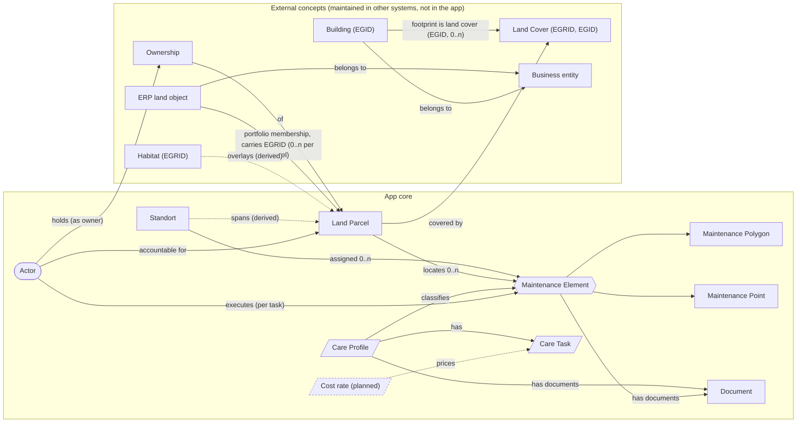

# Green Inventory — Data Model

## 1. Goal

This document defines the data model behind the Green Inventory app: the
entities, their attributes, and how they relate. It is the shared reference
for developers, BG staff and downstream consumers. The main use-case is data
export for tenders (bills of quantities for green-space maintenance).

- Section 2 is the conceptual model: one diagram and one table, enough to
  grasp the whole picture in a minute.
- Section 3 documents each entity in detail (attributes).
- Section 4 lists the gaps between this reference model and today's data.
- Section 5 is the enumerations (controlled vocabularies).
- Section 6 is reference material: detailed UML, standards, terminology, links.

### 1.1 Principles

- Tidy data: one fact per field, atomic values, no concatenation. Composite
  real-world values are split into components (for example an address into
  street, house number, postal code and locality); repeating values become
  rows, not comma-separated lists.
- Identity: every entity has a `fid` (feature id) — the surrogate primary key
  the app maintains and the target of all foreign keys. It must be stable
  across data refreshes. External identifiers are named after the register
  that issues them, never after their role: `egrid` (land registry), `egid`
  (building register), `municipality_bfs` (Federal Statistical Office),
  `erp_id` (the organisation's ERP). An entity may carry several of them; none
  is ever the app's own join key. A generic `system_id` is not used, because it
  hides which system issued the value and breaks as soon as an entity carries
  keys from two systems — which the Land Parcel does.
- A master system names the register or system that holds the value (land registry, GWR, SAP RE-FX); a derived value has no master of its own.
  The operational ERP / master-data system is the organisation's choice (the
  Swiss federal government happens to use SAP, whose real-estate module keys a
  land object by company code, business entity and object number). The
  cadastral masters are fixed national authorities: the land registry for
  EGRID and ownership, the building register for EGID, and the official
  cadastral survey for geometry.
- Assignment is not location: a Maintenance Element records which Standort
  cares for it (an assignment made by people when the inventory was surveyed)
  and which Land Parcel it stands on (a location computed from the cadastre).
  These are two different facts; neither is derived from the other.
- English-first model: entity names carry their German equivalent (EN / DE);
  attributes stay English, since most are self-explanatory. The full glossary
  is the terminology reference (Section 6.4), and the physical German field
  names are in the source document ([`SOURCE-GDB.md`](SOURCE-GDB.md)). French
  and Italian are planned.
- Conform to authorities: cadastral facts (parcel, ownership, land cover,
  building) follow the Swiss registers; the app does not redefine them.

---

## 2. Conceptual data model

The app maintains the green spaces of Swiss federal real estate, run by the
federal nursery service (BG) within the Federal Office for Buildings and
Logistics (BBL). The core has three entities: the **Standort** (the unit of a
maintenance tender, defined by the BG), the **Land Parcel** (the legal unit of
ground, defined by the cadastre) and the **Maintenance Element** (what is
cared for). An element is *assigned* to one Standort and *located* on one
parcel; Standort and parcel are related only through their elements. Around
the core sit reference data (Care Profile, Care Task, Actor, and the planned
Cost rate) and contextual entities from the Swiss cadastre, the registers and
the ERP that the app does not store but the data depends on.

Diagram shapes:

- Rectangle: an entity.
- Hexagon: an abstract entity that has subtypes (Maintenance Element).
- Parallelogram: reference data, a controlled vocabulary (Care Profile, Care
  Task, Cost rate).
- Rounded box: a party (Actor).
- Dashed: planned, not yet implemented (Cost rate), or derived rather than
  stored (Standort spans parcels).

The two boxed groups separate the app's core entities from contextual entities
held in external systems.

| Entity (EN) | Entity (DE) | Scope | Master system | What it is |
|---|---|---|---|---|
| Standort | Standort | core | Bundesgärtnerei | The unit of a green-space maintenance tender: the set of elements one party is responsible for, named and delimited by the BG. Not a legal boundary and not an ERP object. May span several parcels, parts of parcels and third-party ground. Carries the Pflegeperimeter drawn for the tender plans as a display outline. |
| Land Parcel | Grundstück | core | land registry (identity, EGRID); cadastral survey (geometry) | One cadastral parcel. Includes third-party parcels on which elements are maintained (street trees, leased ground). |
| Maintenance Element | Pflegeelement | core | Bundesgärtnerei | A cared-for feature, assigned to one Standort and located on one parcel. Abstract: every element is either a Polygon or a Point. |
| Maintenance Polygon | Pflegepolygon | core | Bundesgärtnerei | Subtype of Maintenance Element. Polygon feature: lawn, bed, hedge, path, surface. |
| Maintenance Point | Pflegepunkt | core | Bundesgärtnerei | Subtype of Maintenance Element. Point feature: tree, planter, bench, structure. |
| Care Profile | Pflegeprofil | core (reference) | BBL guideline | What an element is; groups the maintenance tasks that apply to it. |
| Care Task | Pflegemassnahme | core (reference) | BBL guideline | A single maintenance task of a Care Profile, with its yearly frequency and material. |
| Actor | Akteur | reference (planned) | SAP MDG | A party that performs maintenance. Several actors may work the same element (for example winter versus summer), so the key relation is Actor to Maintenance Element. Not part of this MVP — no actor data is held. |
| Assignment | Pflegeauftrag | relationship (planned) | Bundesgärtnerei | Links one Actor to one Maintenance Element for a task (shown as the "executes" edge). Not part of this MVP — no assignment data is held. |
| Cost rate | Einheitspreis | core (reference, planned) | price catalogue | Planned. Unit price for a Care Task; with element measures it yields tender costs. |
| Document | Dokument | core | document store | A document of any kind (photo, plan, report, contract, PDF or Word file) attached to a Care Profile, a Maintenance Polygon or Point or a Standort; any number per object. |
| ERP land object | Grundstück (ERP) | context | SAP RE-FX | The ERP's record of a parcel, normally one per cadastral parcel (13 EGRIDs carry several), keyed by company code / business entity / object number and carrying the EGRID. Business entity (Wirtschaftseinheit) and company code (Buchungskreis) are components of that key, used for finance; they are not entities and are not georeferenced. The ERP only records which parcels belong to the BBL portfolio; identity and EGRID come from the land registry. |
| Business entity | Wirtschaftseinheit | context | SAP RE-FX | The ERP's grouping of real-estate objects (parcels and buildings) by business management criteria (SAP RE-FX); keyed by company code and business entity number. A parcel and a building belong to at most one. |
| Ownership | Eigentum | context | land registry | The right of one actor to one parcel: share and form of ownership (sole, co-ownership, joint ownership). Makes the n:m relation between Land Parcel and Actor explicit. |
| Land Cover | Bodenbedeckung | context | cadastral survey | Official surface classification of the cadastral survey (DMAV Bodenbedeckung, 26 types, Section 5.3). Objects of type Gebäude carry the EGID; every polygon also lies on one or more parcels (EGRID, derived). |
| Habitat | Lebensraum | context | habitat mapping (BAFU / WSL) | A mapped area of a habitat type of the Swiss habitat typology TypoCH (Section 5.4); lies on one or more parcels (EGRID, derived). |
| Building | Gebäude | context | building register (GWR) + cadastral survey | A building keyed by EGID with the attributes of the GWR and its address; the footprint is the Land Cover polygon(s) of type Gebäude with the same EGID. |

**Delivered files.** The app loads one file per core entity from `data/`
(Section 6.3). They are produced from two sources: the survey GDB, converted
to `data.geojson`, and the official cadastral survey, fetched by EGRID or by
location from the federal OpenData-AV service. The conceptual entities map to
the sources as follows:

| Conceptual entity | Source | Delivered as |
|---|---|---|
| Standort | GDB layer `Objekt`: attributes plus the drawn Pflegeperimeter | `sites.geojson` |
| Land Parcel | OpenData-AV (`ch.swisstopo-vd.amtliche-vermessung`), parcels that host at least one element; ERP keys and further federal parcels from the RE-FX export (pending) | `land_parcels.geojson` |
| Maintenance Polygon | GDB `Pflegeelement_polygon`; `site_fid` from the survey's object link, `parcel_fid` computed | `maintenance_polygons.geojson` |
| Maintenance Point | GDB `Pflegeelement_point`; likewise | `maintenance_points.geojson` |
| Care Profile, Care Task | GDB code lists plus the BBL guideline | `care_profiles.json` |
| Code lists | GDB field domains | `codelists.json` |
| Actor, Assignment, Cost rate, Document, Land Cover, Building | not delivered | — |

---

## 3. Entities

Each entity has an attribute table. Columns: the attribute id; Key (PK =
primary key `fid`, UK = unique key, FK = foreign key); Type (basic format);
Enum (enumeration constraining the value, see Section 5); and a short
description. Foreign keys reference the parent's `fid`. Where an attribute is a
foreign key in the target model but only a coarse code today, the Enum column
names today's code list. The German source field names are in
[`SOURCE-GDB.md`](SOURCE-GDB.md) Section 2.

Conventions. An attribute id carries no unit; the unit is the suffix (`_m2`, `_m`, `_cm`) or stated in the description (heights and crown measures in metres). Geometries are in the Swiss grid LV95 (EPSG:2056) unless the description says otherwise; `wgs84_lon` and `wgs84_lat` are in EPSG:4326. A type with `[]` is a list. Every attribute is single-valued and nullable unless the description says "required" or the key column says PK; a value computed from other attributes or geometry is marked "derived" or "computed" in its description. The master system of an attribute is the system that holds the value; a derived attribute has no master of its own.

### 3.1 Standort

The unit of a maintenance tender: a named set of maintenance elements for
which one party is responsible, as the BG defines it for its Ausschreibungen.
The BG — and therefore this app — is its master. A Standort has no legal
boundary: it may span several parcels, parts of parcels and ground the Bund
does not own. It is not an ERP object either; its relation to business
entities (Wirtschaftseinheiten) is derived through the parcels its elements
stand on and is many-to-many.

Its geometry is the **Pflegeperimeter** the surveyors drew for the tender
plans. That outline is a plan frame, not a boundary: across the 73 Standorte
the maintained polygons cover a median 39 % of it, it reaches onto streets and
neighbouring parcels, and in three cases the maintained area exceeds it. It is
kept for display (shown by default, switchable in the legend) and never used
for area or cost figures. A representative point inside it is derived for
markers and labels.

| Attribute | Key | Type | Enum | Description |
|---|---|---|---|---|
| fid | PK | integer | — | Feature id maintained by the app (today the survey's object id) |
| legacy_id | | string | — | The surveyors' object number (Objektnummer). Traceability only: not unique (one value appears twice), mixed formats (`2001BW`, `7282GR`, `TN 1086/5177`); often coincides with a business-entity number but is not an ERP key |
| legacy_parcel_numbers | | string | — | The parcel number(s) the surveyors noted, verbatim. Superseded by the located parcels (Section 3.2); kept because 3 of 62 no longer match the cadastre |
| name | | string | — | Standort name |
| responsible_actor_fid | FK | integer | idPv | Accountable party as surveyed per Standort (Actor.fid); a coarse code today. Transitional, see Section 3.2 |
| owner | | integer | idEg | Owner category as surveyed per Standort (Bund / Dritte). Transitional: ownership is a parcel fact (Section 3.2) and will come from the ERP export and the land registry |
| created_year | | integer | — | Year of construction. Strictly a building fact; kept for display |
| maintenance_class | | integer | idPk | Intensity tier, PK 1 to 3 |
| inspection | | integer | idJn | Inspection flag (yes / no) |
| cleaning | | integer | idJn | Cleaning flag (yes / no) |
| district | | string | District | Operational region of the survey field `Lose` (Section 5.7): regional service centre DLZ 1 to 5, the nationwide catch-all or legacy |
| remarks | | string | — | Free text |
| surveyed_at | | date | — | Survey date |
| address_full | | string | — | The surveyed address as one string (`Adresse`): a locating text of the Standort, not a postal address, because a Standort can comprise several parcels and buildings. The address of a parcel is on the Land Parcel, that of a building on the Building. `sites.geojson` still delivers the parsed components (street, house number, locality, ...); only 1 of 73 postal codes is filled, region and country are empty |
| perimeter_area_m2, perimeter_length_m | | double | — | Derived from the perimeter. Shown as "Standort m²"; not a maintained area |
| lv95_east, lv95_north | | double | — | Derived representative point inside the perimeter (LV95), for markers and labels; only for sites in Switzerland |
| wgs84_lon, wgs84_lat | | double | — | The same representative point in WGS84 (EPSG:4326), for every site, also abroad (the portfolio is worldwide) |
| geometry | | geometry | — | The Pflegeperimeter (MultiPolygon). Display only |

### 3.2 Land Parcel (Grundstück)

One cadastral parcel (a Liegenschaft or a selbständiges und dauerndes Recht)
as the land registry identifies it, with geometry from the official cadastral
survey. The EGRID is its identity. The ERP keeps a land object (Section 3.8, ERP
land object) for it and stores the EGRID on that object, so the two systems join
without any name or number matching. The ERP attributes live on the ERP land
object, not on the parcel: one parcel can have several ERP objects. In
practice the export is not perfectly 1:1: in the October 2026 list 13 of
1 558 EGRIDs carry several objects — rights of use recorded beside the owned
parcel (parking rental, ramps, light wells, pavement use), partial areas of
one parcel, or plain duplicates — and each of them has its own ownership type,
portfolio and business entity. All objects are kept as ERP land objects; `erp_id`
on the parcel names the preferred one (the owned object, ownership type 1). Rows
that describe parking spaces are excluded, and rows without an EGRID — the whole
portfolio abroad and some domestic rights — never join to a parcel.

The parcel list has two sources. The ERP export yields every parcel in the
federal portfolio, owned or rented. The elements yield the parcels the BG
maintains on without holding them — third-party ground such as street verges
with Strassenbäume. A parcel is delivered when at least one element is located
on it or the ERP lists it. Geometry is retrieved from the federal OpenData-AV
service by EGRID (refresh, ERP parcels) or by location (first load); cantons
that do not publish their survey as open data have no geometry in the app
until a cantonal source is added (today: Vaud).

| Attribute | Key | Type | Enum | Description |
|---|---|---|---|---|
| fid | PK | integer | — | Feature id maintained by the app; the numeric part of the EGRID, so it is stable across refreshes |
| egrid | UK | string | — | EGRID, the parcel's key in the land registry (`CH` + 12 digits). Optional in the register itself (cantonally led registers, copies) |
| parcel_number | | string | — | Cadastral parcel number; unique only within its numbering area |
| parcel_number_suffix | | string | — | Addition to the parcel number (eGRIS `NummerZusatz`), where the register uses one. Not delivered yet |
| sub_district | | string | — | Sub-district within which the number is unique (eGRIS `SubKreis`), where the register uses one; this is the nearest eGRIS concept to a land-registry district. Not delivered yet |
| numbering_area | | string | — | Numbering area (`NBIdent` of the cadastral survey, `identnd`) in which the parcel number is unique; a municipality may have several. Not a land-registry district |
| responsible_actor_fid | FK | integer | idPv | Accountable party (Actor.fid); null today, see Standort |
| erp_id | | string | — | Key of the parcel's preferred ERP land object (ERP land object, Section 3.8), derived from its EGRID: the owned object (ownership type 1) where several exist. Null until the ERP export is joined |
| geoportal_url | | string | — | Link to the cantonal geoportal entry, where delivered |
| parcel_type | | string | Grundstuecksart | Kind of parcel according to Art. 943 ZGB (Section 5.7). Not delivered yet: the survey data holds only the surveyed Liegenschaften |
| is_building_right | | boolean | — | For a selbständiges und dauerndes Recht: true if it is a Baurecht (DMAV `IstBaurecht`). A Baurecht has its own EGRID and lies on the Liegenschaft of its carrier; its owner is not the owner of that parcel. Not delivered yet |
| owner | | integer | idEg | Coarse owner category; null until the ERP land object (ownership type) or the land registry supply it. Today's surveyed value sits on the Standort. Conceptual ownership is the n:m relation to the owning actors (co-ownership), Section 3.8 |
| geometry_source | | string | — | `av` (official survey, OpenData-AV) — the only value delivered |
| fetched_at | | date | — | When the geometry was retrieved |
| municipality_bfs | | integer | — | Municipality (BFS) number |
| municipality_name | | string | — | Municipality name, for display |
| canton | | string | — | Canton abbreviation; follows from municipality_bfs, kept for display |
| address_street | | string | — | Street, without house number, postal code or locality |
| address_postal_code | | string | — | Postal code, Swiss or foreign |
| address_locality | | string | — | Place name (eCH `town`) |
| address_region | | string | — | Canton abbreviation in Switzerland, otherwise region, state or province |
| address_country | | string | Land | Country as ISO 3166-1 alpha-2 code, also CH for Swiss addresses |
| area_m2 | | double | — | Parcel area, computed in LV95 from the delivered geometry; not the official figure |
| area_official_m2 | | double | — | Official area of the parcel as the cadastral survey states it (`Flaechenmass`, m²); for a selbständiges und dauerndes Recht only if it is surveyed. Not delivered yet |
| perimeter_m | | double | — | Parcel perimeter, computed in LV95 |
| label_lon, label_lat | | double | — | Presentation only: label anchor, the pole of inaccessibility of the parcel, computed once in the pipeline (the map labels parcels with EGRID and `erp_id` there) |
| geometry | | geometry | — | Parcel polygon (MultiPolygon), as surveyed |

A parcel carries an address without house number (the house number belongs to the building), no Standort foreign key and no ERP attributes other than `erp_id` (they belong to the ERP land object): the Standorte a parcel serves follow from the elements located on
it, and a parcel can serve more than one.

### 3.3 Maintenance Element (Pflegeelement)

A cared-for feature. Abstract: every element is either a Maintenance Polygon
or a Maintenance Point. The two use different Care-Profile code lists (`idPPy`
versus `idPP`); a subtype's `care_profile_fid` must point to a Care Profile in
the matching code list.

Every element carries two independent links. `site_fid` is the **assigned**
Standort: the tender unit whose party cares for the element, recorded by the
surveyors. `parcel_fid` is the **located** parcel: the cadastral parcel the
element stands on, computed by point-in-polygon against the survey geometry
(a point by its coordinate, a polygon by an interior point) and recomputed
whenever the cadastre changes. The first is an operational decision, the
second a legal fact; one is never derived from the other.

The 32 elements without Standort are flagged `_link_status = unassigned` in the delivered files (an internal flag, not part of the model).

Shared attributes:

| Attribute | Key | Type | Enum | Description |
|---|---|---|---|---|
| fid | PK | integer | — | Feature id maintained by the app |
| site_fid | FK | integer | — | Assigned Standort (Standort.fid); null for elements the survey left unassigned |
| parcel_fid | FK | integer | — | Located Land Parcel (LandParcel.fid); null where no survey geometry is available |
| building_egid | FK | integer | — | EGID of the building the element belongs to (green roof, façade greening, planter on a building); empty for elements on open ground. Not delivered yet |
| care_profile_fid | FK | integer | — | Care Profile (CareProfile.fid) |
| max_height | | double | — | Max plant or tree height, where measured |
| effort_factor | | double | — | Care-effort multiplier, 0.5 to 5.0 (weights tender cost) |
| irrigation | | integer | idBw | Irrigation regime |
| leaf_clearing | | integer | — | Leaf-clearing scope flag (Lauben): 0, 1 or 2 |
| remarks | | string | — | Free text |
| straddles_parcels | | boolean | — | Polygon only: its vertices fall into more than one parcel. Relevant once costs are split by owner |

Maintenance Polygon (Pflegepolygon) adds:

| Attribute | Key | Type | Enum | Description |
|---|---|---|---|---|
| crown_radius | | double | — | Crown radius (circular polygons only) |
| crown_diameter | | double | — | Crown diameter (circular polygons only) |
| winter_service | | integer | Winterdienst | Winter-service treatment |
| area_m2 | | double | — | Area in square metres (LV95-projected); the tender measure for area profiles |
| perimeter | | double | — | Perimeter in metres |
| geometry | | geometry | — | Polygon |

Maintenance Point (Pflegepunkt) adds:

| Attribute | Key | Type | Enum | Description |
|---|---|---|---|---|
| species_code | | integer | idBa | Species code |
| species_text | | string | — | Free-text species; its presence classifies the row as a tree |
| tree_number | | integer | — | Per-Standort tree number |
| planting_year | | integer | — | Year of planting. Not in the survey data yet |
| trunk_circumference_cm | | integer | — | Trunk circumference in cm at 1 m height, the usual tree-register measure. Not in the survey data yet |
| is_protected | | boolean | — | The tree is protected by public law (in the cadastral survey: Einzelobjekt `wichtiger_Einzelbaum`). Not in the survey data yet |
| count | | integer | — | Number of items; the tender measure for point profiles (usually 1) |
| lv95_east, lv95_north | | double | — | The point in LV95, delivered beside the geometry; only in Switzerland |
| wgs84_lon, wgs84_lat | | double | — | The point in WGS84 (EPSG:4326), for every point, also abroad |
| geometry | | geometry | — | Point (Swiss-grid, centimetre precision) |

### 3.4 Care Profile and Care Task (Pflegeprofil, Pflegemassnahme)

A Care Profile is what a feature is and how it is maintained, from the BBL
green-space maintenance standard (2020): 33 profiles in 10 categories (the
authoritative list is in Section 5.1). Its business key is `(code_list, code)`,
because a bare code is unique only within its code list.

| Attribute | Key | Type | Enum | Description |
|---|---|---|---|---|
| fid | PK | integer | — | Feature id maintained by the app |
| code_list | UK | string | — | Domain: idPP (points) or idPPy (areas); part of the business key |
| code | UK | integer | — | Profile code within its code list; part of the business key |
| label | | string | — | Profile name |
| category | | string | — | BBL grouping (lawn, meadow, bed, and so on) |
| geometry_type | | string | — | Capture geometry of the elements it classifies: polygon (idPPy) or point (idPP) |
| unit | | string | — | Unit of capture: square metres (areas) or count (points) |
| leaf_clearing_included | | boolean | — | Whether the profile includes leaf clearing (Lauben) |
| style | | object | — | Presentation only — rendering style `{ fill, swatchClass? }`; see note below |
| description | | string | — | What the profile is (from the standard) |

`geometry_type` mirrors the Maintenance Element subtype split and matches
`code_list` (idPPy → polygon, idPP → point). `style` is a **presentation
attribute**, not part of the conceptual model: `fill` is the feature colour and
`swatchClass` names an optional CSS pattern class (in `css/styles.css`). It is
carried in `care_profiles.json`, which the app reads as the single source for
every feature colour (map fill, point/tree symbols, legend, popup, PDF). The
values are seeded from the frontend's curated catalogue (`js/config.js`,
`AREA_PROFILE_STYLE` / `POINT_PROFILE_STYLE`).

A Care Task is one maintenance activity of a profile (its Haupttätigkeit), with
the yearly frequency that defines the standard.

| Attribute | Key | Type | Enum | Description |
|---|---|---|---|---|
| fid | PK | integer | — | Feature id maintained by the app |
| care_profile_fid | FK | integer | — | Parent Care Profile (CareProfile.fid) |
| task | | string | — | The activity (for example mowing, pruning, leaf clearing) |
| frequency_per_year | | double | — | Passes per year (below 1 means a multi-year cycle) |
| material | | string | — | Equipment or material used |

Care Profiles and Tasks are delivered as `data/care_profiles.json` — one record
per profile (business key `(code_list, code)`) with its Care Tasks nested, so a
task's `care_profile_fid` is implicit in the nesting. The maintenance schedule
itself is still authored in `js/config.js` (`CARE_CATALOG_*`) and seeded into
that file. Each profile would also carry one or more illustrative documents from
the standard (modelled as Document, Section 3.7), not yet delivered.

### 3.5 Actor and Assignment (Akteur, Pflegeauftrag)

An Actor is a party that performs or is accountable for maintenance: the BG, an
external contractor, the city, a depot crew. The important relation is Actor to
Maintenance Element, and it is many-to-many: a single element may involve
several actors, often split by task (for example one party for winter
service and another for summer care). That relation is the Assignment.
Parcel-level accountability is a separate, simpler link (one responsible Actor
per parcel, see Section 3.2).

Actor, the one party concept: organisation, crew or individual. Owner, responsible party and contractor are roles of an actor (Section 3.8 Ownership,
`responsible_actor_fid`, Assignment). The attributes follow eCH-0098, eCH-0108, eCH-0044, eCH-0046 and eCH-0010 in a reduced form; the address is the postal address
of the party (the address of a parcel or building is a location, not a recipient address).

| Attribute | Key | Type | Enum | Description |
|---|---|---|---|---|
| fid | PK | integer | — | Feature id maintained by the app |
| erp_id | UK | string | — | Business-partner key in the ERP or directory that masters the actor, where available (eCH-0098 `localSenderId`, persons eCH-0044 `localPersonId`) |
| uid | UK | string | — | Company identification number (UID, eCH-0108 `uid`), stored without separators as CHE and nine digits with a modulo-11 check digit, shown as CHE-123.456.789; organisations only |
| land_registry_owner_id | | string | — | Id of the owner in the land register (eGRIS); organisations only, never for private persons |
| name | | string | — | Name of the organisation, or surname of the person (eCH-0098 `organisationName`, eCH-0044 `officialName`) |
| additional_name | | string | — | Addition to the name or organisational unit (eCH-0098 `organisationAdditionalName`) |
| first_name | | string | — | First name; only for individuals (eCH-0044 `firstName`) |
| parent_actor_fid | FK | integer | — | Superordinate actor: the organisation of a crew or of a contact person, the head office of a branch (eCH-0108 `mainUid`) |
| kind | | string | ActorKind | Organisation, crew or individual (Section 5.8) |
| legal_form | | string | LegalForm | Legal form as four-digit code (eCH-0108 `legalForm`, I14Y code list), Section 5.8; organisations only |
| email | | string | — | Business e-mail address (eCH-0046 `emailAddress`) |
| phone | | string | — | Business phone number (eCH-0046 `phoneNumber`) |
| website | | string | — | Website (eCH-0098 `internetAddress`) |
| address_street | | string | — | Street, without house number, postal code or locality |
| address_house_number | | string | — | House number, may be alphanumeric |
| address_postal_code | | string | — | Postal code, Swiss or foreign |
| address_locality | | string | — | Place name (eCH `town`) |
| address_region | | string | — | Canton abbreviation in Switzerland, otherwise region, state or province |
| address_country | | string | Land | Country as ISO 3166-1 alpha-2 code, also CH for Swiss addresses |
| address_line | | string | — | Address line for the recipient, for example c/o (eCH-0108 `careOfAddressLine`); postal address only |
| address_po_box | | string | — | Post office box (eCH-0010 `postOfficeBoxNumber`); postal address only |

Data protection: the inventory does not store the AHV number, date of birth, sex, salutation, private address, private phone or e-mail, bank data or the names of
private owners; private persons who own land are represented by one collective actor without name and address. Sole proprietorships (legal form 0101) count as
personal data. Actors of kind individual are left out of open exports. The UID is stored without separators and validated; name, legal form and address of an
organisation with a UID should be taken from the UID register, the ERP stays the master of `erp_id`.

Assignment (one Actor working one element, scoped by task):

| Attribute | Key | Type | Enum | Description |
|---|---|---|---|---|
| fid | PK | integer | — | Feature id maintained by the app |
| actor_fid | FK | integer | — | The actor (Actor.fid) |
| element_type | | string | — | Subtype of the element: `maintenance_polygon` or `maintenance_point`. The `fid` of the two subtypes are separate sequences (both start at 1), so `element_fid` alone does not identify an element |
| element_fid | FK | integer | — | The maintenance element: the `fid` of the Maintenance Polygon or Maintenance Point named by `element_type` (polymorphic, as `Document.subject_fid`) |
| task | | string | — | Specific task scope, where applicable |

Grain: one row per actor, element (`element_type` + `element_fid`) and scope. Today the source has neither
Actor nor Assignment: just two coded attributes, responsibility on the Standort
(idPv) and execution on the element (idPd), a flat simplification of the above.
The Standort itself already encodes one level of responsibility — the tender
party — which is why the BG delimited its Standorte the way it did.

### 3.6 Cost rate (Einheitspreis, planned)

Planned, not yet implemented. The main use-case is data export for tenders: a
bill of quantities lists, per Maintenance Element, the maintenance tasks to be
priced. A Cost rate is the unit price for a Care Task. The tender position cost
is derived: the element's measure (area or count) times the task
`frequency_per_year` times `effort_factor` times `unit_price`. Through the
located parcel and its `erp_id`, every position also resolves to a business
entity and company code for cost allocation.

| Attribute | Key | Type | Enum | Description |
|---|---|---|---|---|
| fid | PK | integer | — | Feature id maintained by the app |
| care_task_fid | FK | integer | — | The priced Care Task (CareTask.fid) |
| valid_from | | date | — | Start of the price's validity |
| unit_price | | double | — | Price per unit (m² or count) for one pass |
| currency | | string | — | Currency (for example CHF) |
| source | | string | — | Price catalogue or tender reference |

### 3.7 Document (Dokument)

A document of any kind attached to an entity, stored as a reference (URL or path, not a blob): a photo, a plan, a report, a contract, a PDF or Word file. An
entity may have any number of documents. Care Profiles carry illustrations from the standard that show what a profile is; Maintenance Polygons and Points and
Standorte carry field photos and further documents. The link is polymorphic: `subject_type` plus `subject_fid` name the entity the document belongs to. The
attributes follow the business object Dokument of the BBL data catalogue in a reduced form (title, document type, file with media type, registration date) and add who created the
document and when, and the copyright metadata that images need.

| Attribute | Key | Type | Enum | Description |
|---|---|---|---|---|
| fid | PK | integer | — | Feature id maintained by the app |
| title | | string | — | Title of the document |
| subject_type | | string | — | Entity the document belongs to: care_profile, maintenance_polygon, maintenance_point, site, ... |
| subject_fid | FK | integer | — | The subject's fid (polymorphic, paired with subject_type) |
| created_by_actor_fid | FK | integer | — | The Actor that created the document: author, photographer or drawer |
| url | | string | — | Location of the file (URL or path) |
| document_type | | string | KbobDocumentType | Document type according to the KBOB document type catalogue (Dokumenttypenkatalog, Section 5.10); the code identifies the type, for example `B01001` Vision |
| media_type | | string | — | Media type of the file (MIME type), for example application/pdf or image/jpeg |
| created_at | | date | — | Date on which the document was created (for a photo the date it was taken) |
| registered_at | | date | — | Date on which the document was registered or attached |
| copyright_holder | | string | — | Holder of the copyright or of the rights of use, a person or an organisation; required for images and other protected works |
| license | | string | — | Licence or terms of use, for example `CC BY 4.0` or `all rights reserved`; required for images and other protected works |

### 3.8 External concepts

Concepts that other authorities or systems maintain; not stored by the app, but
the data depends on them. They are keyed by their master identifier; the app
assigns no `fid` to them. Each concept is defined once, in the system that is
its master (the land registry for parcels and owners, the cadastral survey for
land cover, the building register for buildings).

| Entity | Key | Master | Geometry | Notes |
|---|---|---|---|---|
| ERP land object | erp_id (company code / business entity / object) | ERP | — | The ERP only records which parcels belong to the BBL portfolio; it carries the EGRID and gives the finance grouping (business entity) and legal entity (company code). Normally one per cadastral parcel; 13 EGRIDs carry several (rights of use, partial areas, duplicates) and some objects have no EGRID. Not georeferenced; attributes below. |
| Business entity (Wirtschaftseinheit) | company code + WE number | ERP | — | Grouping of parcels and buildings by business management criteria; attributes below. |
| Ownership (Eigentum) | parcel + actor | land registry | — | Link between Land Parcel and Actor with share and form of ownership; attributes below. |
| Land Cover (Bodenbedeckung) | uuid | cadastral survey | Polygon | DMAV Bodenbedeckung; attributes below. Tiles the ground without gaps. |
| Habitat (Lebensraum) | — | habitat mapping | Area | TypoCH habitat type per mapped area; attributes below. |
| Building (Gebäude) | egid | building register (GWR) + cadastral survey | Polygon (footprint) | Attributes below. The footprint is one or more Land Cover objects of type Gebaeude with the same `egid`. Relevant for green roofs and facades and the authority for addresses. |

Land Cover (attributes of the DMAV class «Bodenbedeckung»; `egrid` is added by
this model):

| Attribute | Key | Type | Enum | Description |
|---|---|---|---|---|
| uuid | PK | string | — | Object identifier (UUID) of the land-cover object in the cadastral survey |
| object_number | | string | — | Object number (text, 12 characters) |
| object_name | | string | — | Object name (text, 60 characters) |
| egid | | integer | — | EGID (1 to 900000000) of the building register (GWR), assigned by the Federal Statistical Office. Set on objects of type Gebaeude (occasionally on Wasserbecken); to be recorded when the object is kept in the GWR |
| egrid | FK | string | — | The parcel the polygon lies on (LandParcel.egrid). Derived by spatial overlay, not part of the DMAV model: land cover and parcels are independent layers that tile the same ground, so a polygon that crosses a parcel boundary lies on several parcels (Section 4.2) |
| land_cover_type | | string | Bodenbedeckungsart | Classification (26 values, Section 5.3); optional in the source and not set on fictitious objects |
| object_status | | string | Objektstatus | projektiert, real or vergangen (Section 5.3) |
| fictitious | | boolean | — | `Fiktiv`: true when the object only closes gaps in the area network; such objects have no land_cover_type. Default false |
| quality_standard | | string | Qualitaetsstandard | Quality standard of the cadastral survey (`Qualitaetsstandard`) |
| area_m2 | | double | — | Area of the polygon in square metres (LV95-projected), derived from the geometry |
| geometry | | geometry | — | Polygon of straights and arcs; overlaps up to 2 mm |

Habitat:

| Attribute | Key | Type | Enum | Description |
|---|---|---|---|---|
| egrid | FK | string | — | The parcel the area lies on (LandParcel.egrid). Derived by spatial overlay, as for Land Cover |
| typoch_code | | string | Lebensraumtyp (TypoCH) | TypoCH code at the most detailed level that is mapped (Section 5.4): group (2nd level) or type (3rd level) |
| area_m2 | | double | — | Area of the polygon in square metres (LV95-projected), derived from the geometry |
| geometry | | geometry | — | The mapped area |

Building: the attributes of the building in the federal register of buildings and dwellings (GWR feature catalogue 5.0; the attribute ids are the GWR codes in
lower case, the German label of the catalogue is the alias), the address on the building itself (tidy data), the ERP attributes and the footprint. Energy data and local codes of the GWR are not part of this model. In the GWR the address belongs to the entrance (`Eingang`, EDID); the entrance is not modelled, so the address on the building is that of its main entrance and a building with several addresses is reduced to one. The code lists of the coded attributes are not part of this model; see the catalogue.

| Attribute | Key | Type | Enum | Description |
|---|---|---|---|---|
| egid | PK | integer | — | Gebäudeidentifikationsnummer im eidg. GWR. (GWR EGID) |
| erp_id | UK | string | — | Building key in the ERP, composed of company code, business entity and building number (BBL data catalogue, Gebäude / ID) |
| gebnr | | string | — | Von der kommunalen oder kantonalen Behörde vergebene Gebäudenummer. (GWR GEBNR) |
| gbez | | string | — | Kommentar zur Gebäudebezeichnung. (GWR GBEZ) |
| gegrid | FK | string | — | Grundstücke sind Objekte des Grundeigentums, deren Grenzen festgelegt und deren Rechte im Grundbuch eingetragen sind. Sie ermöglichen die Lokalisierung von Gebäuden. Reference to LandParcel.egrid. (GWR GEGRID) |
| ggbkr | | integer | — | Grundbuchkreis des Grundstücks, auf dem das Gebäude gebaut ist. (GWR GGBKR) |
| gparz | | string | — | Nummer des Grundstücks, auf dem das Gebäude gebaut ist. (GWR GPARZ) |
| erp_business_entity | | string | — | ERP business entity (Wirtschaftseinheit) the building belongs to: the WE number within the company code (BBL data catalogue, Gebäude / Wirtschaftseinheit) |
| gkat | | integer | — | Einteilung der Gebäude entsprechend ihrer Zweckbestimmung. Coded in the GWR (code list in the catalogue). (GWR GKAT) |
| gklas | | integer | — | Einteilung der Gebäude nach Eurostat-Klassifikation+ . Coded in the GWR (code list in the catalogue). (GWR GKLAS) |
| erp_building_type_1 | | string | ErpBuildingType1 | BBL building type, top level (SAP RE-FX Gebäudeart, level 1), Section 5.9 |
| erp_building_type_2 | | string | ErpBuildingType2 | BBL building type, second level (SAP RE-FX Gebäudeart, level 2), Section 5.9 |
| erp_building_category | | string | ErpBuildingCategory | BBL building category of the ERP (SAP RE-FX Gebäudekategorie); not the GWR category gkat, Section 5.9 |
| gstat | | integer | — | Angabe zum aktuellen Zustand des Gebäudes. Coded in the GWR (code list in the catalogue). (GWR GSTAT) |
| erp_user_status | | string | ErpUserStatus | User status of the building in the ERP according to the status scheme (SAP user status), Section 5.9 |
| gbauj | | integer | — | Angabe zu Jahr der Fertigstellung des Gebäudes. (GWR GBAUJ) |
| gbaum | | integer | — | Angabe zu Monat der Fertigstellung des Gebäudes. (GWR GBAUM) |
| gbaup | | integer | — | Angabe zu Periode der Fertigstellung des Gebäudes. Coded in the GWR (code list in the catalogue). (GWR GBAUP) |
| gabbj | | integer | — | Jahr, in dem das Gebäude abgebrochen wurde. (GWR GABBJ) |
| gvol | | integer | — | Angabe zum Volumen des Gebäudes. (GWR GVOL) |
| gvolnorm | | integer | — | Angabe zum Volumen des Gebäudes. Coded in the GWR (code list in the catalogue). (GWR GVOLNORM) |
| gastw | | integer | — | Anzahl Geschosse und Untergeschosse, einschliesslich Erdgeschoss. (GWR GASTW) |
| gazzi | | integer | — | Anzahl Wohnräume, die nicht Teil einer Wohnung sind. (GWR GAZZI) |
| gschutzr | | integer | — | Gibt an, ob das Gebäude über einen Zivilschutzraum verfügt. Coded in the GWR (code list in the catalogue). (GWR GSCHUTZR) |
| erp_portfolio | | string | ErpPortfolio | BBL sub-portfolio (Teilportfolio) the building is assigned to in the ERP, from the SAP value help (GOM), Section 5.6. Defined in the BBL data catalogue for parcels and buildings; the name follows the erp_* attributes of the parcel, the alias naming of the GWR attributes does not apply |
| gfreitxt1 | | string | — | Freitextfelder für die Verwaltung der kantonalen und kommunalen Spezifikationen (GWR GFREITXT1) |
| gfreitxt2 | | string | — | Freitextfelder für die Verwaltung der kantonalen und kommunalen Spezifikationen (GWR GFREITXT2) |
| gvolsce | | integer | — | Angabe zum Volumen des Gebäudes. Coded in the GWR (code list in the catalogue). (GWR GVOLSCE) |
| gksce | | integer | — | Lokalisierung des Gebäudes im Landeskoordinatennetz (LV95). Coded in the GWR (code list in the catalogue). (GWR GKSCE) |
| ggdenr | | integer | — | Nummer der politischen Gemeinde gemäss amtlichem Gemeindeverzeichnis der Schweiz. (GWR GGDENR) |
| address_street | | string | — | Street, without house number, postal code or locality |
| address_house_number | | string | — | House number, may be alphanumeric |
| address_postal_code | | string | — | Postal code, Swiss or foreign |
| address_locality | | string | — | Place name (eCH `town`) |
| address_region | | string | — | Canton abbreviation in Switzerland, otherwise region, state or province |
| address_country | | string | Land | Country as ISO 3166-1 alpha-2 code, also CH for Swiss addresses |
| garea | | integer | — | Gebäudefläche in Quadratmetern. (GWR GAREA) |
| gkode | | decimal | — | Lokalisierung des Gebäudes im Landeskoordinatennetz (LV95). (GWR GKODE) |
| gkodn | | decimal | — | Lokalisierung des Gebäudes im Landeskoordinatennetz (LV95). (GWR GKODN) |
| wgs84_lon | | decimal | — | Longitude of the building in WGS84 (EPSG:4326). The GWR gives only the LV95 coordinates (GKODE, GKODN) and only for buildings in Switzerland; the portfolio is worldwide |
| wgs84_lat | | decimal | — | Latitude of the building in WGS84 (EPSG:4326), see wgs84_lon |
| footprint | | geometry | — | Polygon: the Land Cover object(s) of type Gebaeude with this EGID; usually one, several for a building of several parts, none where the building is not surveyed (MultiPolygon where there are several) |

Business entity (Wirtschaftseinheit), attributes from the BBL data catalogue (SAP RE-FX; German names and texts as in the catalogue):

| Attribute | Key | Type | Enum | Description |
|---|---|---|---|---|
| id | PK | string | — | Zusammengesetzter SAP-basierter Primärschlüssel der Wirtschaftseinheit aus Buchungskreis und Wirtschaftseinheit (SAP-WE-Nummer). |
| company_code | | string | — | SAP-Buchungskreis als erster Bestandteil der Wirtschaftseinheit-ID. |
| business_entity | | string | — | SAP-WE-Nummer innerhalb des Buchungskreises als zweiter Bestandteil der Wirtschaftseinheit-ID. |
| name | | string | — | Lesbarer Name der wirtschaftlichen Bewirtschaftungseinheit. |
| management_status | | string | — | Fachlicher Lebenszyklus der Bewirtschaftungseinheit, etwa geplant, aktiv oder abgeschlossen. |
| valid_from | | date | — | Beginn der fachlichen Gültigkeit der wirtschaftlichen Zusammenfassung. |
| valid_to | | date | — | Ende der fachlichen Gültigkeit der wirtschaftlichen Zusammenfassung. |
| management_purpose | | string | — | Kurze fachliche Erklärung, weshalb die Immobilienobjekte gemeinsam bewirtschaftet werden und wo die Abgrenzung dieser Zusammenfassung liegt. |
| profit_center | | string | — | Zugeordnetes Profit Center für die Ergebnisrechnung. |

Ownership (Eigentum), the right of an actor to a parcel (eGRIS `EigentumAnteil`); one row per owner and parcel (composite key `egrid` + `actor_fid`):

| Attribute | Key | Type | Enum | Description |
|---|---|---|---|---|
| egrid | PK, FK | string | — | The parcel (LandParcel.egrid); with `actor_fid` the composite key |
| actor_fid | PK, FK | integer | — | The owning actor (Actor.fid); private persons are represented by one collective actor without name and address |
| ownership_form | | string | Eigentumsform | Alleineigentum, Miteigentum, Gesamteigentum or Herrenlos (Section 5.7) |
| share_numerator | | integer | — | Numerator of the share of the owner in the parcel |
| share_denominator | | integer | — | Denominator of the share; 1/1 for sole ownership |

ERP land object (Grundstück (ERP)), attributes of the ERP export (SAP RE-FX; the German labels of the ERP in brackets):

| Attribute | Key | Type | Enum | Description |
|---|---|---|---|---|
| erp_id | PK | string | — | The ERP land-object key, derived as `company_code/business_entity/object_number` (for example `1086/2000/01`) |
| company_code | | string | — | ERP company code (Buchungskreis); component of `erp_id` |
| object_number | | string | — | ERP object number within the business entity; component of `erp_id` |
| name | | string | — | The ERP object's designation (Bez. Grundstück), for display |
| business_entity | FK | string | — | ERP business entity (Wirtschaftseinheit), the WE number within the company code; component of `erp_id`; the finance grouping (BusinessEntity) |
| egrid | FK | string | — | The cadastral parcel the object is recorded on (LandParcel.egrid); null for rows without an EGRID (the whole portfolio abroad and some domestic rights), which never join |
| ownership_type | | string | Eigentumsart | ERP ownership type (Eigent.art), a management classification and not the legal ownership (that is Ownership), see Section 5.2. The inventory data holds 1 on owned parcels, 3 on rented ground and rights of use and 5 on other rights, i.e. the codes 01, 03 and 05 of the SAP value list without the leading zero |
| historic_garden | | string | — | ERP historic-garden rating (Hist.Gart.), where set |
| portfolio | | string | ErpPortfolio | BBL sub-portfolio (Teilportfolio) the object is assigned to in the ERP, from the SAP value help (group of object characteristics, GOM; 3 digits with leading zeros), Section 5.6. Defined in the BBL data catalogue for parcels and buildings; not in the delivered data yet |
| match_method | | string | — | How the object was joined to a parcel: `egrid` (key join), or `designation+address` for an ERP row without EGRID whose designation names this parcel number in this municipality and whose street matches a Standort on the parcel (applied only when unique) |

---

## 4. Gaps & open points

The deltas between the reference model (Sections 1-3) and today's data, roughly
by impact. Source- and conversion-level limitations (WGS84 accuracy, empty or
sentinel code lists) are in [`SOURCE-GDB.md`](SOURCE-GDB.md) Section 7.

### 4.1 Gaps to close

- ERP land objects are loaded for the parcels the ERP knows. The October 2026
  export joins by EGRID onto 100 inventory parcels and by designation and
  address onto one more. The 52 parcels left without an `erp_id` appear in
  the export under no key at all — no EGRID, no coordinate inside them, no
  current or surveyed parcel number — so they are either federal parcels
  missing from the ERP land-object list or ground the Bund does not hold;
  which it is per parcel is being checked with the ERP data management.
  Three of them belong to Standorte the surveyors flagged as third-party.
  Owned federal parcels at the inventoried sites that host no element are
  added from the export; the rest of the nationwide portfolio is out of scope
  for this app. The export is internal data and stays outside the repository
  (Section 6.3). The ownership-type codes are documented (Section 5.2: 01 Eigentum Bund, 03 Mietobjekt, 05 Spezialfall); whether and how `owner` is derived from them is still to be decided.
- No parcel geometry for canton Vaud. The federal OpenData-AV service has no
  coverage there, so the three Standorte in Nyon, Penthaz and Payerne have no
  located parcels; their elements carry `parcel_fid = null` and the
  Pflegeperimeter is their only outline. A cantonal source is required.
- `fid` is positional for elements. The conversion assigns ids by array
  position ([`SOURCE-GDB.md`](SOURCE-GDB.md) Section 4), which changes on every
  run. Standorte use the survey's object id and parcels the EGRID, so those two
  are stable; carrying the GDB object id onto elements would close the gap.
- 32 elements have no assigned Standort. They could be assigned to the
  Standort whose perimeter contains them, pending BG confirmation that the
  perimeter reflects responsibility there.
- The surveyors' parcel numbers are stale. Of the 62 Standorte with a value,
  59 agree with the cadastre at the representative point and 3 do not
  (renumbering since the survey). The located parcels replace them; the text is
  kept on the Standort for traceability only.
- Elements that straddle a parcel boundary. A hedge along a boundary is one
  element on two parcels; today it is located on the parcel containing its
  interior point and flagged. Costs split by owner will need either a majority
  rule or an area split.
- Ownership is coarse, surveyed per Standort, and not n:m. The model treats
  ownership as a parcel fact and the n:m relation to the owning actors (co-ownership).
  Accountability (`responsible_actor_fid`, idPv) is likewise a coarse code per
  Standort.
- No Actor entity or per-task assignment. Execution is a single coded value per
  element (idPd); the model expects a many-to-many Assignment scoped by task.
- Care-Profile / Care-Task dataset delivered, schedule still seeded from code.
  `data/care_profiles.json` holds one record per profile with its tasks nested,
  but the schedule (task, frequency, material) is authored in frontend code
  (`CARE_CATALOG_*`) and seeded in; and the crosswalk from the wider source
  code lists (44 `idPPy`, 22 `idPP`) to the 33 standard profiles is open.
  Categorisation also drifts (for example wild hedge sits under hedges in the
  app but under woody areas in the standard).
- Documents are not delivered. Illustrations, field photos and further documents are modelled (Section 3.7) but no document references exist in the data yet.
- Cost is planned, not implemented (Section 3.6).
- Building and its neighbours are simplified. The GWR knows no, one or several parcels per building (`gegrid` holds one: the main parcel), several entrances per
  building (the address belongs to the entrance, EDID), and the cadastral survey may carry several footprint objects with the same EGID (a projected annex has
  its own object). The model keeps one parcel, one address and a footprint set per building; a link table Building to Parcel and a Building entrance
  are the next step if addresses or Baurecht cases matter. The GWR catalogue 5.0 could not be re-checked online.
- Keys of the contextual concepts. Habitat has no identifier in the mapping data (a surrogate key must be assigned on import); Ownership has the composite key
  (`egrid`, `actor_fid`); Land Cover is identified by its `uuid` only if the delivery from OpenData-AV carries one; the EGID on Land Cover is a join key, not an identifier.
- Land Cover and Habitat carry one `egrid` although a polygon can lie on several parcels. A derived overlay (parcel, polygon, overlapping area) would hold the shares
  and also solves the cost split of elements that straddle a parcel boundary.
- Roles and lifecycle are thin. The model knows the roles owner, responsible party and contractor, not user (Nutzer), tenant (Mieter), manager (Bewirtschafter) or
  cost bearer; it has no validity period, history or status for parcels and elements (the ERP has valid from/to, system status and user status); and the protection
  status of trees and gardens is a single flag (`is_protected`, `erp_historic_garden`), not the legal basis (tree protection, heritage, ISOS, forest law).
- No tender, lot or contract entity, although the tender is the stated main use; `district` (survey field `Lose`) may be the lot. Tender positions are derived.
- `responsible_actor_fid` is typed as a foreign key to Actor but holds a coarse code today; `owner` is a surveyed category and not the legal owner (Ownership).
- A Standort carries no address of its own (it can comprise several parcels and buildings); `address_full` is a locating text only. The parcel has the address
  without house number, the building its full address (GWR). The delivered `sites.geojson` still has the address components of the Standort; the link of a
  building to the GWR by EGID is not made.
- The portfolio is worldwide. EGRID, EGID and the Swiss registers apply only
  to domestic sites; sites abroad use the ERP key alone. `address_country`
  distinguishes them. All 73 Standorte delivered today are in Switzerland.
- `tree_canopy` is a misnomer; most are decorative circles, not crowns.
  Renaming the delivered `entity_type` is a backlog item.
- Delivered files and this document differ in a few places (checked against `data/` on 28 October 2026): `care_profiles.json` holds 66 records, the
  44 `idPPy` and 22 `idPP` code-list entries in 15 categories, not the 33 profiles of Section 5.1; the survey fields `titel_objektblatt` and
  `titel_kalkulation` of the Standort are not carried into `sites.geojson`; the execution code (`idPd`) is not carried onto the elements;
  `address_postal_code` is filled for 1 of 73 Standorte and `address_region`, `address_country` and `remarks` are empty.
- Land Cover, Habitat and Building are not delivered. EGID (building objects) and EGRID (derived by overlay with the parcels) are modelled for them
  in Section 3.8; the overlay is not computed yet.

### 4.2 Open design decisions

- Does one tender equal one Standort on the ground? The surveyors defined the
  Standorte as tender units, and the BG doubts that this mirrors who actually
  maintains what. Revising Standort boundaries is a BG decision; the model
  does not depend on it, because elements, not perimeters, define scope.
- Parcels serving several Standorte. Such a parcel is one row with several
  derived memberships; the table shows the Standort with most elements on it.
  Whether tender positions should instead be grouped by parcel owner is open.
- Standort, Wirtschaftseinheit and Areal. Three groupings exist: the Standort groups maintenance elements for a tender (BG), the Wirtschaftseinheit groups parcels and
  buildings for finance (ERP), the Areal of the BBL data catalogue groups the parcels of a campus or site. They overlap but are not the same. Only the
  Wirtschaftseinheit is modelled as a concept here; whether the Areal is needed is open.
- Maintenance class granularity. It is modelled at Standort level because the
  source barely sets it on individual elements; per-element classes would
  need a real source.
- No linear feature subtype. The source reserves an empty `idPL` code list for
  linear elements (edges, hedgerows as lines). If line geometry comes into
  scope, Maintenance Element needs a third subtype.
- Tree as its own subtype. Trees are modelled as a Maintenance Point with species
  set; given their domain weight (protection, individual inventory), promoting
  Tree to a subtype is an option.
- Maintenance Polygon versus Land Cover. Both describe the ground surface (BG
  survey versus cadastral survey); whether the inventory should derive from, or
  reconcile with, the official land cover is not modelled.
- Land Cover and Habitat polygons that cross a parcel boundary lie on several parcels, so the EGRID is one-to-many. Whether to store every
  parcel, the dominant one or an area split is open (as for the elements that straddle parcels).
- No temporal or condition dimension. The model has no validity period,
  history or plant condition (Zustand); fine for an inventory snapshot, noted
  here so it is a deliberate omission.

---

## 5. Enumerations

### 5.1 Care Profiles (BBL guideline)

The Care-Profile vocabulary is the BBL guideline catalogue: 33 profiles in 10
categories. Areas are captured in square metres, point features as a count
(Stk.). "Ref." is the profile's chapter in the standard (the standard itself is
listed in Section 6.2). The source GDB code lists (`idPPy`, 44 entries; `idPP`,
22) are wider supersets; the crosswalk from those codes to these profiles is an
open item (Section 4).

| Category | Profile (EN) | Profile (DE) | Geometry | Unit | Ref. |
|---|---|---|---|---|---|
| Lawn | Utility lawn, small-area | Gebrauchsrasen kleinflächig | polygon | m² | 2.1.1 |
| Lawn | Flowering lawn | Blumenrasen | polygon | m² | 2.1.2 |
| Meadows | Flowering meadow, small-area | Blumenwiese kleinflächig | polygon | m² | 2.2.1 |
| Meadows | Flowering meadow, large-area | Blumenwiese grossflächig | polygon | m² | 2.2.2 |
| Meadows | Wet meadow | Feuchtwiese | polygon | m² | 2.2.3 |
| Meadows | Margin vegetation / hedge margins | Saumvegetation / Säume von Hecken | polygon | m² | 2.2.4 |
| Meadows | Nutrient-poor grassland | Magerrasen | polygon | m² | 2.2.5 |
| Beds | Bedding roses | Beetrosen | polygon | m² | 2.3.1 |
| Beds | Bog bed | Moorbeet | polygon | m² | 2.3.2 |
| Beds | Extensive perennial planting | Extensivstaudenpflanzung | polygon | m² | 2.3.3 |
| Beds | Intensive perennial planting | Intensivstaudenpflanzung | polygon | m² | 2.3.4 |
| Hedges | Formal hedge, up to 1.5 m | Formhecke, - 1.5 m | polygon | m² | 2.4.1 |
| Hedges | Formal hedge, over 1.5 m | Formhecke + 1.5 m | polygon | m² | 2.4.2 |
| Woody areas | Shrub bed | Gehölzrabatte | polygon | m² | 2.5.1 |
| Woody areas | Ground cover | Bodendecker | polygon | m² | 2.5.2 |
| Woody areas | Shrub bed with ground cover | Gehölzrabatte mit Bodendecker | polygon | m² | 2.5.3 |
| Woody areas | Wild hedge | Wildhecke | polygon | m² | 2.5.4 |
| Special planting forms | Climbing plant | Schling- und Kletterpflanze | point | count | 2.6.1 |
| Special planting forms | Roof, extensive planting | Dach, extensiv bepflanzt | polygon | m² | 2.6.2 |
| Special planting forms | Mobile planter, permanent | Mobiles Pflanzgefäss Dauerbepflanzung | point | count | 2.6.3 |
| Surfaces | Concrete slabs, interlocking, natural stone | Betonplatten, Verbund-, Natursteine | polygon | m² | 2.7.1 |
| Surfaces | Gravel surfacing | Chaussierung | polygon | m² | 2.7.2 |
| Surfaces | Grass pavers | Rasengittersteine | polygon | m² | 2.7.3 |
| Surfaces | Gravel strips and river stones | Geröllstreifen und Bollensteine | polygon | m² | 2.7.4 |
| Surfaces | Sand | Sand | polygon | m² | 2.7.5 |
| Water | Water body, still, near-natural | Gewässer, ruhend, naturnah | polygon | m² | 2.8.5 |
| Water | Fountain | Brunnen | polygon | m² | 2.8.6 |
| Trees | Deciduous tree, small-crowned / large shrub | Laubbaum, kleinkronig, Grossstrauch | point | count | 2.9.5 |
| Trees | Conifer | Nadelgehölze | point | count | 2.9.6 |
| Small structures | Brush pile | Asthaufen | point | count | 2.10.1 |
| Small structures | Logs | Baumstämme | point | count | 2.10.2 |
| Small structures | Stone pile / stone lens | Steinhaufen / Steinlinsen | point | count | 2.10.3 |
| Small structures | Wild-bee hotel | Wildbienenhotel | point | count | 2.10.4 |

### 5.2 Operational and cadastral enumerations

The coded attributes in Section 3 draw on these code lists. Full tables are
delivered in `data/codelists.json`; the source detail is in
[`SOURCE-GDB.md`](SOURCE-GDB.md) Section 3.

Maintenance class (`idPk`) — backs `maintenance_class`:

| Code | Value (EN) | Value (DE) |
|---|---|---|
| 0 | not recorded | nicht erfasst |
| 1 | PK 1 | PK 1 |
| 2 | PK 2 | PK 2 |
| 3 | PK 3 | PK 3 |

Responsibility (`idPv`) — backs `responsible_actor_fid` (coarse code today):

| Code | Value (EN) | Value (DE) |
|---|---|---|
| 0 | not recorded | nicht erfasst |
| 1 | internal | intern |
| 2 | external | extern |
| 3 | internal and external | intern / extern |

Execution (`idPd`) — the source's coded execution party; in the model this is
the Assignment to an Actor (no single attribute):

| Code | Value (EN) | Value (DE) |
|---|---|---|
| 1 | federal nursery service | BG |
| 2 | external | extern |
| 3 | unknown | unbekannt |
| 4 | city of Bern | Stadt Bern |
| 5 | third party | Dritte |
| 6 | tree-care contractor | Baumpfleger |
| 7 | DLZ 2 | DLZ 2 |
| 8 | depot | Werkhof |
| 9 | internal | intern |

Irrigation (`idBw`) — backs `irrigation`:

| Code | Value (EN) | Value (DE) |
|---|---|---|
| 1 | automatic | automatisch |
| 2 | by hand | von Hand |
| 3 | not needed | nicht erforderlich |

Owner (`idEg`) — backs `owner` (coarse code today):

| Code | Value (EN) | Value (DE) |
|---|---|---|
| 0 | not recorded | nicht erfasst |
| 1 | federal | Bund |
| 2 | third party | Dritte |

ERP ownership type (`Eigentumsart`) — backs `ownership_type` of the ERP land object; the value list of the ERP
real-estate module (SAP RE-FX value help of the field «Eigentumsart», 2 digits), as in the review workbook of
the BBL data catalogue team of 12 October 2026:

| Code | Value (EN) | Value (DE) |
|---|---|---|
| 01 | federal property | Eigentum Bund |
| 03 | rented object | Mietobjekt |
| 05 | special case | Spezialfall |

Inspection / Cleaning (`idJn`) — backs `inspection`, `cleaning`:

| Code | Value (EN) | Value (DE) |
|---|---|---|
| 0 | not recorded | nicht erfasst |
| 1 | yes | ja |
| 2 | no | nein |

Winter service (`Winterdienst`) — backs `winter_service`:

| Code | Value (EN) | Value (DE) |
|---|---|---|
| 1 | black clearing | Schwarzräumung |
| 2 | walkway, about 2 m wide | Gehweg, ca. 2 m breit |

Tree species (`idBa`) — backs `species_code`: 430 entries (Latin names), listed
in Section 5.5.

Land cover type (`Bodenbedeckungsart`) and object status (`Objektstatus`) —
back `land_cover_type` and `object_status`: see Section 5.3. Habitat type
(TypoCH) — backs `typoch_code`: see Section 5.4.

### 5.3 Land cover (DMAV Bodenbedeckung)

Value domain of the attribute `Bodenbedeckungsart` in the minimal geodata
model of the official cadastral survey, «Bodenbedeckung» (DMAV, version 1.0,
swisstopo; Table 2 of the documentation). 26 values. The descriptions are the
model's own and not an exhaustive capture guideline. The identifiers are those
of the model; the German labels are the readable form. The DMAV table is a
flat list; the groups (`befestigt`, `humusiert` with the sub-group `Intensivkultur`, `Gewaesser`, `bestockt` with the sub-group `Wytweide`, `vegetationslos`) are the structure of the former DM.01-AV-CH and are given
for orientation (Gebäude has no group). DMAV replaces DM.01-AV-CH by 31
December 2027.

| Value | Group | Label (DE) | Description (DMAV, verbatim) |
|---|---|---|---|
| `Gebaeude` | — | Gebäude | Definition gemäss Bundesamt für Statistik (BFS), Verordnung über das eidgenössische Gebäude- und Wohnungsregister. Die Gebäude korrelieren mit dem Eidg. Gebäude- und Wohnungsregister (GWR). |
| `Strasse_Weg` | Befestigte Fläche | Strasse, Weg | Flächen mit Erschliessungsfunktion für Fussgänger- und/oder Fahrzeugverkehr. |
| `Trottoir` | Befestigte Fläche | Trottoir | Von der Strasse abgetrennte Flächen, die vorwiegend den Fussgängern dienen und von Motorfahrzeugen nicht befahren werden dürfen. |
| `Verkehrsinsel` | Befestigte Fläche | Verkehrsinsel | Künstliche Erhöhung in der Fahrbahn, die umfahren werden muss. Verkehrsinseln befinden sich bei Kreuzungen und Fussgängerstreifen. |
| `Bahn` | Befestigte Fläche | Bahn | Gesamte Geleisanlage inklusive Kofferung, mit Kies oder Sand belegte Flächen, Bahnsteige, die zwischen oder neben den Geleisen liegen. |
| `Flugplatz` | Befestigte Fläche | Flugplatz | Künstlich befestigte Pisten, Rollwege, Abstellflächen für Flugzeuge. |
| `Wasserbecken` | Befestigte Fläche | Wasserbecken | Künstliche Anlage samt Umrandung, Schwimm- und Sprungbecken öffentlicher Badeanstalten, öffentliche und private Bassins, Klärbecken der ARA, Löschbecken. |
| `uebrige_befestigte` | Befestigte Fläche | Übrige befestigte | Parkplätze, Verkehrserschliessung zu Gebäuden, Abstell-, Rast- und Vorplätze, Sportanlagen ohne Rasenflächen. |
| `Acker_Wiese_Weide` | Humusierte Fläche | Acker, Wiese, Weide | Flächen, die in eine Fruchtfolge einbezogen sind, der Futtergewinnung oder als Weide dienen. |
| `Reben` | Humusierte Fläche / Intensivkultur | Reben | Rebflächen. |
| `uebrige_Intensivkultur` | Humusierte Fläche / Intensivkultur | Übrige Intensivkultur | Obstkulturen und Gärtnereien. |
| `Gartenanlage` | Humusierte Fläche | Gartenanlage | Freizeitgärten, Parkanlagen, Kinderspielplätze, Gebüsche, Gartenbestockung, Rasen, Hausumschwung. |
| `Hoch_Flachmoor` | Humusierte Fläche | Hoch-, Flachmoor | Flächen, die in den eidgenössischen, kantonalen und kommunalen Schutzverordnungen aufgeführt sind. |
| `uebrige_humusierte` | Humusierte Fläche | Übrige humusierte | Grünstreifen bei Verkehrsanlagen, Bachborde. |
| `stehendes_Gewaesser` | Gewässer | Stehendes Gewässer | Seen, Weiher, Biotope. |
| `fliessendes_Gewaesser` | Gewässer | Fliessendes Gewässer | Flüsse, Bäche, Kanäle. |
| `Schilfguertel` | Gewässer | Schilfgürtel | Mit Schilf bedeckte Flächen zwischen offenem Gewässer und landseitiger Bodenbedeckung. |
| `geschlossener_Wald` | Bestockte Fläche | Geschlossener Wald | Bestockte Flächen, die dem Waldgesetz unterstellt sind. |
| `Wytweide_dicht` | Bestockte Fläche / Wytweide | Wytweide dicht | Definition gemäss der eidgenössischen Waldverordnung. Flächen, die mosaikartig, abwechselnd für die Viehhaltung und Forstwirtschaft genutzt werden. Die forstwirtschaftliche Nutzung überwiegt die landwirtschaftliche Nutzung. |
| `Wytweide_offen` | Bestockte Fläche / Wytweide | Wytweide offen | Definition gemäss der eidgenössischen Waldverordnung. Flächen, die mosaikartig, abwechselnd für die Viehhaltung und Forstwirtschaft, genutzt werden. Die landwirtschaftliche Nutzung überwiegt die forstwirtschaftliche Nutzung. |
| `uebrige_bestockte` | Bestockte Fläche | Übrige bestockte | Weidwälder, Selven, Bestockung von Ufer- und Bachzonen, Mischzonen zwischen Wald und Weide, Fels, Geröll. Übergangszonen zur klimatischen Waldgrenze. |
| `Fels` | Vegetationslose Fläche | Fels | Markante Felsbänder, die der Orientierung dienen. |
| `Gletscher_Firn` | Vegetationslose Fläche | Gletscher, Firn | Firn beinhaltet Schneeflächen des Hochgebirges, die über mehrere Jahre hinweg auftauen und wieder einfrieren. Beim Gletscher handelt es sich um permanent vereiste Flächen. |
| `Geroell_Sand` | Vegetationslose Fläche | Geröll, Sand | Natürliche Ansammlung von losen Steinen (z.B. Seitenmoränen). |
| `Abbau_Deponie` | Vegetationslose Fläche | Abbau, Deponie | Bewirtschaftete Deponien zur Ablagerung und Gewinnung von Rohstoffen. |
| `uebrige_vegetationslose` | Vegetationslose Fläche | Übrige vegetationslose | Mischzonen bei der klimatischen Pflanzengrenze, die schwer zu unterscheiden sind (Gras, Fels, Geröll, verbuschte Flächen). |

Value domain of `Objektstatus` (Table 3 of the same documentation):

| Value | Description |
|---|---|
| `projektiert` | The new object is recorded but not yet realised |
| `real` | The object is realised and corresponds to the current situation |
| `vergangen` | The object has been demolished or no longer exists |

Value domain of `Qualitaetsstandard` (DMAV model V1.1; the former DM.01-AV-CH also had PV74 and PEP):

| Value |
|---|
| AV93 |
| PN |

### 5.4 Habitat types (TypoCH)

Swiss habitat typology TypoCH (Delarze et al., *Lebensräume der Schweiz*, 2015), as the complete list of Info Flora («Vollständige Auflistung TypoCH», <https://www.infoflora.ch/de/lebensraeume/typoch-(delarze-et-al.)/vollst%C3%A4ndige-auflistung-typoch.html>): 324 entries, German names as in the list. Codes are hierarchical by their dots: 9 classes (1 to 9), 41 groups (1.1, 1.2 …), 177 types (1.1.1 …) and 97 sub-types below them (four and five levels). The Habitat Map of Switzerland (WSL, FOEN) maps TypoCH to the 2nd, where possible the 3rd, level. The scientific (phytosociological) names are not part of this list; they are in the lookup table of the Habitat Map (`TypoCH_NUM_LookupTable`, EnviDat).

| Code | Name (DE) |
|---|---|
| 1 | Gewässer |
| 1.1 | Stehende Gewässer |
| 1.1.0 | Stehendes Gewässer ohne Vegetation |
| 1.1.0.1 | Tiefgründiges Gewässer (Freiwasserzone) |
| 1.1.0.2 | Seichtes Gewässer (Litoral, inkl. Tümpel) |
| 1.1.1 | Armleuchteralgengesellschaft |
| 1.1.2 | Laichkrautgesellschaften |
| 1.1.3 | Wasserlinsengesellschaften |
| 1.1.3.1 | Froschbissgesellschaften |
| 1.1.3.2 | Wasserschlauchgesellschaften |
| 1.1.4 | Schwimmblattgesellschaft |
| 1.1.4.1 | Wasserhahnenfussgesellschaft |
| 1.1.4.2 | Wasserfedergesellschaft |
| 1.2 | Fliessgewässer |
| 1.2.1 | Brachsmen- und Barbenregion (Epipotamon) |
| 1.2.1.1 | Breites Fliessgewässer des Flachlands |
| 1.2.1.2 | Langsam fliessender Bach im Flachland |
| 1.2.2 | Äschenregion (Hyporhithron) |
| 1.2.2.0 | Äschenregion ohne Vegetation |
| 1.2.2.1 | Äschenregion mit Vegetation |
| 1.2.3 | Untere Forellenregion (Metarhithron) |
| 1.2.4 | Obere Forellenregion (Epirhithron) |
| 1.2.5 | Temporärer Wasserlauf |
| 1.2.6 | Zone der Gletscherbäche (Kryal) |
| 1.3 | Quellen und Quellfluren |
| 1.3.0 | Überrieselte Fläche, Quelle ohne Vegetation |
| 1.3.0.1 | Auenquelle, Giesse |
| 1.3.1 | Wärmeliebende Quellflur |
| 1.3.2 | Kalkreiche Quellflur |
| 1.3.3 | Kalkarme Quellflur |
| 1.4 | Unterirdische Gewässer |
| 1.4.1 | Porengrundwasser |
| 1.4.2 | Kluftgrundwasser |
| 1.4.3 | Höhlenbach |
| 1.4.4 | Höhlensee |
| 2 | Ufer und Feuchtgebiete |
| 2.0 | Künstliche Ufer |
| 2.0.0 | Künstliche Ufer ohne Vegetation |
| 2.0.1 | Künstliche Ufer mit Vegetation |
| 2.1 | Ufer mit Vegetation |
| 2.1.1 | Moortümpelgesellschaft |
| 2.1.2 | Röhricht |
| 2.1.2.1 | Stillwasser-Röhricht |
| 2.1.2.2 | Flussufer- und Landröhricht |
| 2.1.3 | Strandlingsgesellschaften |
| 2.1.4 | Bachröhricht |
| 2.2 | Flachmoore |
| 2.2.1 | Grossseggenried |
| 2.2.1.1 | Grossseggenried |
| 2.2.1.2 | Schneidbinsenried |
| 2.2.2 | Kalkarmes Kleinseggenried (Braunseggenried) |
| 2.2.3 | Kalkreiches Kleinseggenried (Davallseggenried) |
| 2.2.4 | Übergangsmoor |
| 2.2.5 | Schwemmufervegetation alpiner Wildbäche |
| 2.3 | Feuchtwiesen |
| 2.3.1 | Pfeifengraswiese |
| 2.3.2 | Nährstoffreiche Feuchtwiesen (Sumpfdotterblumenwiese) |
| 2.3.3 | Feuchte Hochstaudenflur (Spierstaudenflur) |
| 2.4 | Hochmoore |
| 2.4.1 | Offene Hochmoore |
| 2.5 | Wechselfeuchte Pionierfluren |
| 2.5.0 | Wechselfeuchte Pionierfluren ohne Vegetation |
| 2.5.1 | Einjährige Schlammflur (Zwergbinsenflur) |
| 2.5.1.1 | Zwergbinsen-Annuellenflur mit Sumpfbinsen |
| 2.5.1.2 | Zwergbinsen-Annuellenflur mit Zypergräsern |
| 2.5.1.3 | Annuellenflur feuchter Böden mit Zwergkräutern |
| 2.5.2 | Mehrjährige Schlammflur (Zweizahnflur) |
| 3 | Gletscher, Fels, Schutt und Geröll |
| 3.1 | Gletscher, Firn- und Schneefleder |
| 3.1.1 | Gletscher |
| 3.1.2 | Blockgletscher |
| 3.1.3 | Firnfeld (Sommer) |
| 3.1.4 | Schneefeld (Frühling) |
| 3.2 | Alluvionen und Moränen |
| 3.2.1 | Alluvionen (Schwemmland) |
| 3.2.1.0 | Alluvionen ohne Vegetation |
| 3.2.1.1 | Alluvionen mit krautiger Pioniervegetation |
| 3.2.2 | Moräne |
| 3.2.2.0 | Moräne ohne Vegetation |
| 3.2.2.1 | Moräne mit Pioniervegetation |
| 3.3 | Steinschutt- und Geröllfluren |
| 3.3.1 | Kalkschutt |
| 3.3.1.1 | Kalkschutthalde ohne Gefässpflanzen |
| 3.3.1.2 | Alpine Kalkblockflur |
| 3.3.1.3 | Alpine Kalkschieferflur |
| 3.3.1.4 | Feinerdereiche Kalkschuttflur |
| 3.3.1.5 | Trockenwarme Kalkschuttflur |
| 3.3.2 | Silikatschutt |
| 3.3.2.1 | Silikatschutthalde ohne Gefässpflanzen |
| 3.3.2.2 | Alpine Silikatschuttflur |
| 3.3.2.3 | Trockenwarme Silikatschuttflur |
| 3.4 | Felsen |
| 3.4.1 | Kalkfelsen |
| 3.4.1.1 | Kalkfels ohne Gefässpflanzen |
| 3.4.1.2 | Trockene Kalkfelsflur |
| 3.4.1.3 | Schattige Kalkfelsflur |
| 3.4.2 | Silikat- oder Serpentinfelsen |
| 3.4.2.1 | Silikatfels ohne Gefässpflanzen |
| 3.4.2.2 | Silikatfelsflur |
| 3.4.2.3 | Serpentingesteinsflur |
| 3.5 | Höhlen |
| 3.5.1 | Kleine Felsspalten, Halbhöhlen: endogäische Fauna ("Fauna der Steinunterseite") |
| 3.5.2 | Bau von Tieren |
| 3.5.3 | Höhleneingang |
| 3.5.4 | Guanohaufen |
| 3.5.5 | Künstliche Höhlung (Minen, Tunnel, etc.) |
| 3.5.6 | Unterirdische Lehmablagerung |
| 3.5.7 | Unterirdische Felswand |
| 4 | Grünland (Naturrasen, Wiesen und Weiden) |
| 4.0 | Kunstrasen |
| 4.0.1 | Kunstwiese auf Fruchtfolgefläche |
| 4.0.2 | Kunstrasen auf Sportplätzen, im Siedlungsraum, etc. |
| 4.0.3 | Begrünung in Tieflagen (Strassenböschungen, etc.) |
| 4.0.4 | Begrünung in Hochlagen (Skipisten, etc.) |
| 4.1 | Pionierfluren auf Felsböden (Felsgrusfluren) |
| 4.1.1 | Wärmeliebende Kalkfels-Pionierflur |
| 4.1.2 | Kalkfels-Pionierflur des Gebirges (Karstfluren) |
| 4.1.3 | Wärmeliebende Silikatfels-Pionierflur |
| 4.1.4 | Silikatfelsgrusflur des Gebirges |
| 4.2 | Wärmeliebende Trockenrasen |
| 4.2.1 | Wärmeliebende Trockenrasen (Kontinentaler Trockenrasen; Innerwallis, Graubünden) |
| 4.2.1.1 | Inneralpine Felsensteppe |
| 4.2.1.1.1 | Inneralpine Felsensteppe der Westalpen |
| 4.2.1.1.2 | Inneralpine Felsensteppe der Ostalpen |
| 4.2.1.2 | Kontinentaler Halbtrockenrasen |
| 4.2.2 | Mitteleuropäischer Trockenrasen |
| 4.2.3 | Insubrischer Trockenrasen |
| 4.2.4 | Mitteleuropäischer Halbtrockenrasen |
| 4.3 | Gebirgs-Magerrasen |
| 4.3.1 | Blaugrashalde |
| 4.3.1.1 | Blaugrashalde s.str. |
| 4.3.1.2 | Blaugrashalde der südlichen Kalkalpen |
| 4.3.2 | Polsterseggenrasen |
| 4.3.3 | Rostseggenhalde |
| 4.3.4 | Windkantenrasen (Nacktriedrasen) |
| 4.3.5 | Borstgrasrasen |
| 4.3.6 | Buntschwingelhalde |
| 4.3.6.1 | Buntschwingelhalde s.str. |
| 4.3.6.2 | Violettschwingelrasen |
| 4.3.6.3 | Goldschwingelrasen |
| 4.3.7 | Krummseggenrasen |
| 4.4 | Schneetälchen |
| 4.4.1 | Kalkreiches Schneetälchen |
| 4.4.2 | Kalkarmes Schneetälchen |
| 4.5 | Fettwiesen und -weiden |
| 4.5.1 | Talfettwiesen (Fromentalwiese) |
| 4.5.1.1 | Knaulgraswiesen |
| 4.5.1.2 | Typische Fromentalwiese |
| 4.5.1.3 | Trockene Fromentalwiese |
| 4.5.1.4 | Feuchte Fuchschwanzwiese |
| 4.5.2 | Bergfettwiese (Goldhaferwiese) |
| 4.5.3 | Talfettweide (Kammgrasweide) |
| 4.5.4 | Bergfettweide (Milchkrautweide) |
| 4.6 | Grasbrachen |
| 4.6.1 | Queckenbrache |
| 4.6.2 | Fiederzwenckenbrache |
| 4.6.3 | Fromentalbrache |
| 4.6.4 | Pfeifengrasbrache |
| 4.6.5 | Reitgrasbrache |
| 5 | Krautsäume, Hochstaudenfluren und Gebüsche |
| 5.1 | Krautsäume |
| 5.1.0 | Atypische Saumgesellschaft |
| 5.1.1 | Trockenwarmer Krautsaum |
| 5.1.2 | Mesophiler Krautsaum |
| 5.1.3 | Feuchter Krautsaum (Tieflagen) |
| 5.1.4 | Feuchter Krautsaum (höheren Lagen) |
| 5.1.5 | Nährstoffreicher Krautsaum |
| 5.2 | Hochstauden- und Schlagfluren |
| 5.2.1 | Kalkreiche Schlagflur |
| 5.2.2 | Kalkarme Schlagflur |
| 5.2.3 | Hochgrasflur des Gebirges |
| 5.2.4 | Hochstaudenflur des Gebirges |
| 5.2.5 | Adlerfarnflur |
| 5.3 | Gebüsche |
| 5.3.0 | Naturferne Pflanzung |
| 5.3.0.1 | Naturferne Pflanzung mit sommergrünen Arten |
| 5.3.0.2 | Naturferne Pflanzung mit immergrünen Arten |
| 5.3.1 | Besenginster-Gebüsche |
| 5.3.2 | Trockenwarmes Gebüsch |
| 5.3.3 | Mesophiles Gebüsch |
| 5.3.4 | Brombeergestrüpp |
| 5.3.5 | Gebüschreiche Vorwaldgesellschaften |
| 5.3.6 | Auen-Weidengebüsch |
| 5.3.7 | Moor-Weidengebüsch |
| 5.3.8 | Gebirgs-Weidengebüsch |
| 5.3.9 | Grünerlengebüsche |
| 5.4 | Zwergstrauchheiden |
| 5.4.1 | Subatlantische Zwergstrauchheide (Ginsterheide) |
| 5.4.1.1 | Subatlantische Heide auf Torf |
| 5.4.1.2 | Subatlantische Heide, nicht auf Torf |
| 5.4.2 | Kontinentale Zwergstrauchheide (Sefistrauchheide) |
| 5.4.3 | Subalpine Kalkheide (Erikaheide) |
| 5.4.4 | Trockene subalpine Zwergstrauchheide (Zwergwacholderheide) |
| 5.4.5 | Mesophile subalpine Zwergstrauchheide (Alpenrosenheide) |
| 5.4.6 | Alpine Windheide |
| 6 | Wälder |
| 6.0 | Forstpflanzungen |
| 6.0.1 | Aufforstung mit Laubgehölzen |
| 6.0.2 | Aufforstung mit Nadelgehölzen |
| 6.0.3 | Einzelbaum |
| 6.1 | Bruch- und Auenwälder |
| 6.1.1 | Erlen-Bruchwald |
| 6.1.2 | Weichholz-Auenwald |
| 6.1.3 | Grauerlen-Auenwald |
| 6.1.3.1 | Alpen-Weidenauenwald |
| 6.1.4 | Hartholz-Auenwald |
| 6.2 | Buchenwälder |
| 6.2.1 | Orchideen-Buchenwald |
| 6.2.2 | Hainsimsen-Buchenwald |
| 6.2.3 | Waldmeister-Buchenwald |
| 6.2.3.1 | Atlantischer Buchenwald |
| 6.2.4 | Zahnwurz-Buchenwald |
| 6.2.5 | Tannen-Buchenwald |
| 6.3 | Andere Laubwälder |
| 6.3.1 | Ahorn-Schluchtwald |
| 6.3.2 | Linden-Mischwald |
| 6.3.3 | Eichen- Hainbuchenwald |
| 6.3.4 | Flaumeichenwald |
| 6.3.5 | Hopfenbuchenwald |
| 6.3.6 | Saurer Eichenmischwald |
| 6.3.7 | Kastanienwald |
| 6.3.8 | Laubwald mit immergrünen Sträuchern |
| 6.3.9 | Robinienwald |
| 6.4 | Wärmeliebende Föhrenwälder |
| 6.4.1 | Pfeifengras-Föhrenwald |
| 6.4.2 | Subkontinentaler kalkreicher Föhrenwald |
| 6.4.2.1 | Mitteleuropäischer subkontinentaler kalkreicher Föhrenwald (Geissklee-Föhrenwald) |
| 6.4.3 | Kontinentaler Steppen-Föhrenwald |
| 6.4.3.1 | Kalkreicher Steppen-Föhrenwald |
| 6.4.3.2 | Kalkarmer Steppen-Föhrenwald |
| 6.4.4 | Kalkarmer Föhrenwald |
| 6.5 | Hochmoorwälder |
| 6.5.1 | Hochmoor-Birkenwald |
| 6.5.2 | Hochmoor-Bergföhrenwald |
| 6.5.3 | Hochmoor-Fichtenwald |
| 6.6 | Gebirgsnadelwälder |
| 6.6.1 | Tannen-Fichtenwald |
| 6.6.2 | Heidelbeer-Fichtenwald |
| 6.6.3 | Lärchen-Arvenwald |
| 6.6.4 | Lärchenwald |
| 6.6.5 | Bergföhrenwald |
| 6.6.5.1 | Kalkarmer Bergföhrenwald |
| 6.6.5.2 | Kalkreicher Bergföhrenwald |
| 7 | Pioniervegetation gestörter Plätze (Ruderalstandorte) |
| 7.1 | Trittrasen und Ruderalfluren |
| 7.1.0 | Tritt- und Trümmerflächen ohne Vegetation |
| 7.1.1 | Feuchte Trittflur |
| 7.1.2 | Trockene Trittflur |
| 7.1.3 | Subalpin-alpine Trittflur |
| 7.1.4 | Einjährige Ruderalflur |
| 7.1.5 | Trockenwarme Ruderalflur |
| 7.1.6 | Mesophile Ruderalflur (Steinkleeflur) |
| 7.1.7 | Alpine Lägerflur (Alpenblackenflur) |
| 7.1.8 | Lägerflur der Tieflagen |
| 7.2 | Anthropogene Steinfluren |
| 7.2.0 | Mauer oder Steinpflästerung ohne Vegetation |
| 7.2.1 | Trockenwarme Mauerflur |
| 7.2.2 | Steinpflaster-Trittflur |
| 8 | Pflanzungen, Äcker und Kulturen |
| 8.1 | Baumschulen, Obstgärten, Rebberge |
| 8.1.1 | Baumschule aus Laubgehölzen |
| 8.1.2 | Baumschule aus Nadelgehölzen |
| 8.1.3 | Kastanienhain (ohne Unterholz) |
| 8.1.4 | Hochstammobstgarten |
| 8.1.5 | Niederstammobstgarten |
| 8.1.6 | Rebberg |
| 8.1.7 | Beerenkultur |
| 8.2 | Feldkulturen (Äcker) |
| 8.2.0 | Feldkulturen (Äcker) ohne Vegetation |
| 8.2.1 | Getreidefeld (vorwiegend Winterkultur) |
| 8.2.1.0 | Getreide ohne Begleitvegetation |
| 8.2.1.1 | Kalkarme Getreideäcker |
| 8.2.1.2 | Kalkreiche Getreideäcker |
| 8.2.2 | Mais-, Tabak- und andere Ackerkulturen (vorwiegend Sommerkultur) |
| 8.2.3 | Hackfruchtacker (Sommerkultur), Garten |
| 8.2.3.0 | Hackfrucht ohne Begleitflora |
| 8.2.3.1 | Kalkarmer, lehmiger Hackfruchtacker |
| 8.2.3.2 | Kalkreicher, lehmiger Hackfruchtacker |
| 8.2.3.3 | Kalkarmer, trockener Hackfruchtacker |
| 8.2.3.4 | Kalkreicher, trockener Hackfruchtacker |
| 9 | Bauten, Anlagen |
| 9.1 | Lagerplätze, Deponien |
| 9.1.1 | Deponie (Sperrgut) |
| 9.1.2 | Deponie (organische Abfälle) |
| 9.2 | Bauten |
| 9.2.1 | Bewohntes Gebäude |
| 9.2.1.1 | Bauernhaus |
| 9.2.1.2 | Sennhütte, Chalet |
| 9.2.1.3 | Einfamilienhaus |
| 9.2.1.4 | Mietgebäude, Gewerbegebäude |
| 9.2.2 | Tierstallungen, Gewächshäuser |
| 9.2.2.1 | Kuh- und Pferdestall |
| 9.2.2.2 | Schweinestall |
| 9.2.2.3 | Hühnerstall |
| 9.2.2.4 | Treibhaus |
| 9.2.3 | Nebengebäude, Halle, Garage |
| 9.2.3.1 | Scheune, Schopf |
| 9.2.3.2 | Garage |
| 9.2.3.3 | Bootshaus |
| 9.2.3.4 | Bunker |
| 9.2.3.5 | Berghütte, Forsthaus |
| 9.2.4 | Fabrik, Halle, Lagerhaus |
| 9.2.4.1 | Fabrik |
| 9.2.4.2 | Lagerhaus |
| 9.2.4.3 | Elektrisches Kraftwerk |
| 9.2.4.4 | Atomkraftwerk |
| 9.2.4.5 | Raffinerie |
| 9.2.4.6 | Sägerei, Schreinerei |
| 9.2.5 | Öffentliches Gebäude, Denkmal |
| 9.2.5.1 | Schloss |
| 9.2.5.2 | Kriche |
| 9.2.5.3 | Bahnhof |
| 9.2.5.4 | Spital |
| 9.3 | Verkehrswege |
| 9.3.2 | Asphalt- und Betonstrasse |
| 9.3.2.1 | Strasse |
| 9.3.2.2 | Autobahn |
| 9.3.2.3 | Weg ohne Vegetation (Beton, Kies) |
| 9.3.3 | Naturstrasse, Weg |
| 9.3.3.1 | Naturweg (Dreckweg) |
| 9.3.3.2 | Holzerweg |
| 9.3.3.3 | Pfad |
| 9.3.4 | Bahngleis |
| 9.4 | Versiegelter Sportplatz, Parkplatz etc. |

### 5.5 Tree species (`idBa`)

Value domain of `species_code`: the 430 entries of the field domain `idBa` of the
survey GDB, in the delivered `data/codelists.json`, copied verbatim (Latin names, spelling as in the source).

| Code | Species (Latin) |
|---|---|
| 1 | Abies alba 'Pendula' |
| 2 | Abies alba 'Pyramidalis' |
| 3 | Abies alba |
| 4 | Abies cephalonica |
| 5 | Abies concolor 'Violacea' |
| 6 | Abies concolor |
| 7 | Abies koreana |
| 8 | Abies lasiocarpa 'Compacta' |
| 9 | Abies lasiocarpa var. arizonica |
| 10 | Abies nordmanniana 'Pendula' |
| 11 | Abies nordmanniana |
| 12 | Abies numidica |
| 13 | Abies pinsapo 'Glauca' |
| 14 | Abies pinsapo |
| 15 | Abies procera 'Glauca' |
| 16 | Abies procera |
| 17 | Abies veitchii |
| 18 | Acer campestre 'Elsrijk' |
| 19 | Acer campestre |
| 20 | Acer capillipes |
| 21 | Acer cappadocicum 'Rubrum' |
| 22 | Acer cappadocicum |
| 23 | Acer carpinifolium |
| 24 | Acer davidii |
| 25 | Acer ginnala |
| 26 | Acer griseum |
| 27 | Acer monspessulanum |
| 28 | Acer negundo 'Flamingo' |
| 29 | Acer negundo 'Variegatum' |
| 30 | Acer negundo |
| 31 | Acer Opalus |
| 32 | Acer palmatum 'Atropurpureum' |
| 33 | Acer palmatum |
| 34 | Acer platanoides 'Cleveland' |
| 35 | Acer platanoides columnare ley1 |
| 36 | Acer platanoides 'Columnare' |
| 37 | Acer platanoides 'Crimson King' |
| 38 | Acer platanoides 'Drummondii' |
| 39 | Acer platanoides 'Emerald Queen' |
| 40 | Acer platanoides 'Globosum' |
| 41 | Acer platanoides 'Olmsted' |
| 42 | Acer platanoides 'Schwedleri' |
| 43 | Acer platanoides |
| 44 | Acer pseudoplatanus 'Artopurureum' |
| 45 | Acer pseudo-platanus 'Erectum' |
| 46 | Acer pseudo-platanus 'Negenia' |
| 47 | Acer pseudo-platanus 'Purpurascens' |
| 48 | Acer pseudoplatanus 'Rotterdam' |
| 49 | Acer pseudo-platanus |
| 50 | Acer rubrum |
| 51 | Acer rufinerve |
| 52 | Acer saccharinum 'Lacianatum Wieri' |
| 53 | Acer saccharinum 'Pyramidale' |
| 54 | Acer saccharinum |
| 55 | Acer saccharum |
| 56 | Acer, Art nicht bekannt |
| 57 | Aesculus flava |
| 58 | Aesculus glabra |
| 59 | Aesculus hippocastanum 'Baumanii' |
| 60 | Aesculus hippocastanum |
| 61 | Aesculus parviflora |
| 62 | Aesculus x carnea 'Briotii' |
| 63 | Aesculus x carnea |
| 64 | Aesculus, Art unbekannt |
| 65 | Ailanthus altissima |
| 66 | Alnus cordata |
| 67 | Alnus glutinosa 'Imperialis' |
| 68 | Alnus glutinosa |
| 69 | Alnus incana 'Aurea' |
| 70 | Alnus incana 'Laciniata' |
| 71 | Alnus incana 'Pendula' |
| 72 | Alnus incana |
| 73 | Alnus x spaethii |
| 74 | Amelanchier lamarckii |
| 75 | Apfel |
| 76 | Aprikose |
| 77 | Araucaria araucana |
| 78 | Betula albosinensis |
| 79 | Betula costata |
| 80 | Betula ermanii |
| 81 | Betula maximowicziana |
| 82 | Betula nigra |
| 83 | Betula papyrifera |
| 84 | Betula pendula 'Crispa' |
| 85 | Betula pendula 'Fastigiata' |
| 86 | Betula pendula 'Purpurea |
| 87 | Betula pendula 'Tristis' |
| 88 | Betula pendula 'Trost's Dwarf' |
| 89 | Betula pendula 'Yuongii' |
| 90 | Betula pendula |
| 91 | Betula platyphylla var. szechuanica |
| 92 | Betula pubescens |
| 93 | Betula utilis |
| 94 | Birne |
| 95 | Buxus sempervirens 'Rotundiflolia' |
| 96 | Buxus sempervirens |
| 97 | Calocedrus decurrens 'Aureovariegata' |
| 98 | Calocedrus decurrens 'Columnaris' |
| 99 | Calocedrus decurrens |
| 100 | Carpinus betulus 'Columnaris' |
| 101 | Carpinus betulus 'Fastigiata' |
| 102 | Carpinus betulus 'Frans Fontaine' |
| 103 | Carpinus betulus 'Incisa' |
| 104 | Carpinus betulus |
| 105 | Carya cordiforis |
| 106 | Castanea sativa |
| 107 | Catalpa bignonioides |
| 108 | Catalpa speciosa |
| 109 | Catalpa x erubescens |
| 110 | Cedrus atlantica 'Aurea' |
| 111 | Cedrus atlantica 'Glauca Pendula' |
| 112 | Cedrus atlantica 'Glauca' |
| 113 | Cedrus deodara 'Aurea' |
| 114 | Cedrus atlantica |
| 115 | Cedrus deodara 'Pendula' |
| 116 | Cedrus deodara |
| 117 | Cedrus libani 'Pendula' |
| 118 | Cedrus libani ssp. atlantica glauca |
| 119 | Cedrus libani ssp. brevifolia |
| 120 | Cedrus libani |
| 121 | Celtis australis |
| 122 | Celtis occidentalis |
| 123 | Cercidiphyllum japonicum 'Pendulum' |
| 124 | Cercidiphyllum japonicum |
| 125 | Cercis canadensis 'Forest Pansy' |
| 126 | Cercis chinensis |
| 127 | Cercis siliquastrum |
| 128 | Chamaecyparis lawsoniana ' Columnaris' |
| 129 | Chamaecyparis lawsoniana 'Alumigold' |
| 130 | Chamaecyparis lawsoniana 'Alumii' |
| 131 | Chamaecyparis lawsoniana |
| 132 | Chamaecyparis nootkatensis ' Aurea' |
| 133 | Chamaecyparis nootkatensis 'Glauca' |
| 134 | Chamaecyparis nootkatensis 'Pendula' |
| 135 | Chamaecyparis nootkatensis |
| 136 | Chamaecyparis obtusa 'Nana Gracilis' |
| 137 | Chamaecyparis pisifera 'Filifera' |
| 138 | Chamaecyparis Pisifera |
| 139 | Chamaecyparis |
| 140 | Cladastris kentukea (lutea) |
| 141 | Cornus controversa |
| 142 | Cornus florida |
| 143 | Cornus kousa |
| 144 | Cornus mas |
| 145 | Corylus colurna |
| 146 | Crataegus crus-galli |
| 147 | Crataegus laevigata 'Alboplena' |
| 148 | Crataegus laevigata 'Mutabilis' |
| 149 | Crataegus laevigata 'Paul's Scarlet' |
| 150 | Crataegus laevigata 'Punicea' |
| 151 | Crataegus laevigata |
| 152 | Crataegus monogyna 'Stricta' |
| 153 | Crataegus oxyacantha |
| 154 | Crataegus x lavallei |
| 155 | Crataegus |
| 156 | Cryptomeria japonica |
| 157 | Cydonia oblonga |
| 158 | Davidia involucrata |
| 159 | Eucalyptus gunni |
| 160 | Euonymus europaeus |
| 161 | Fagus silvatica 'Atromitia' |
| 162 | Fagus sylvatica 'Asplenifolia' |
| 163 | Fagus sylvatica 'Atropunicea' |
| 164 | Fagus sylvatica 'Dawyck' |
| 165 | Fagus sylvatica 'Laciniata' |
| 166 | Fagus sylvatica 'Pendula' |
| 167 | Fagus sylvatica 'Purpurea Tricolor' |
| 168 | Fagus sylvatica 'Riversii' |
| 169 | Fagus sylvatica 'Rohanii' |
| 170 | Fagus sylvatica 'Swat Magret' |
| 171 | Fagus sylvatica 'Zlatia' |
| 172 | Fagus sylvatica |
| 173 | Fagus sylvatica`Purpurea Pendula' |
| 174 | Fagus |
| 175 | Fraxinus angustifolia 'Raywood' |
| 176 | Fraxinus excelisor 'Diversifolia' |
| 177 | Fraxinus excelsior 'Eureka' |
| 178 | Fraxinus excelsior 'Jaspida' |
| 179 | Fraxinus excelsior 'Pendula' |
| 180 | Fraxinus excelsior 'Westhof's Glory' |
| 181 | Fraxinus excelsior |
| 182 | Fraxinus ornus |
| 183 | Fraxinus |
| 184 | Gingko biloba |
| 185 | Gleditsia triacanthos 'Elegantissima' |
| 186 | Gleditsia triacanthos f. inermis |
| 187 | Gleditsia triacanthos 'Ruby Lace' |
| 188 | Gleditsia triacanthos 'Shademaster' |
| 189 | Gleditsia triacanthos 'Skyline' |
| 190 | Gleditsia triacanthos 'Sunburst' |
| 191 | Gleditsia triacanthos |
| 192 | Gymnocladus dioicus |
| 193 | Ilex aquifolium |
| 194 | Ilex aquifolium |
| 195 | Juglans nigra |
| 196 | Juglans regia 'Purpurea' |
| 197 | Juglans regia |
| 198 | Kirsche |
| 199 | Koelreuteria paniculata |
| 200 | Laburnum anagyroides |
| 201 | Larix decidua 'Pendula' |
| 202 | Larix decidua |
| 203 | Larix kaempferi |
| 204 | lawa |
| 205 | Liquidambar styraciflua |
| 206 | Liriodendron tulipifera 'Aureomarginatum' |
| 207 | Liriodendron tulipifera 'Fastigiatum' |
| 208 | Liriodendron tulipifera |
| 209 | Maclura pomifera |
| 210 | Magnolia acuminata |
| 211 | Magnolia grandiflora |
| 212 | Magnolia kobus |
| 213 | Magnolia tripetala |
| 214 | Magnolia x soulangiana |
| 215 | Magnolia-Soulangiana-Hybriden 'Alba Superba' |
| 216 | Magnolia-Soulangiana-Hybriden 'Alexandrina' |
| 217 | Magnolia-Soulangiana-Hybriden 'Lennei' |
| 218 | Malus, Art unbekannt |
| 219 | Malus-Hybriden 'Evereste' |
| 220 | Malus-Hybriden 'John Downi' |
| 221 | Malus-Hybriden 'Red Sentinel' |
| 222 | Malus-Hybriden 'Sargentii' |
| 223 | Malus-Hybriden |
| 224 | Mespilus germanica |
| 225 | Metasequoia glyptostroboides |
| 226 | Mirabelle |
| 227 | Morus alba 'Pendula' |
| 228 | Morus alba |
| 229 | Morus nirgra |
| 230 | Nothofagus antarctica |
| 231 | Nussbaum |
| 232 | Nussbaum |
| 233 | Nussbaum |
| 234 | Ostrya carpinifolia |
| 235 | Parrotia persica |
| 236 | Paulownia tomentosa |
| 237 | Pfirsich |
| 238 | Pflaume |
| 239 | Phellodendron japonicum |
| 240 | Picea abies 'Aurea' |
| 241 | Picea abies 'Inversa' |
| 242 | Picea abies 'Ohlendorfii' |
| 243 | Picea abies |
| 244 | Picea breweriana |
| 245 | Picea omorika |
| 246 | Picea orientalis 'Aurea' |
| 247 | Picea orientalis |
| 248 | Picea polita |
| 249 | Picea pungens 'Glauca' |
| 250 | Picea pungens 'Koster' |
| 251 | Picea pungens |
| 252 | Picea sitchensis |
| 253 | Picea smithiana |
| 254 | Pinus cembra |
| 255 | Pinus contorta |
| 256 | Pinus genaue Art unbekannt |
| 257 | Pinus leucodermis |
| 258 | Pinus mugo |
| 259 | Pinus nigra ssp. nigra |
| 260 | Pinus nigra |
| 261 | Pinus parviflora |
| 262 | Pinus peuce |
| 263 | Pinus pinea |
| 264 | Pinus ponderosa |
| 265 | Pinus sabiniana |
| 266 | Pinus strobus |
| 267 | Pinus sylvestris |
| 268 | Pinus thunbergiana |
| 269 | Pinus uncinata ssp. uncinata |
| 270 | Pinus wallichiana |
| 271 | Pinus x schwerinii |
| 272 | Platanus occidentalis |
| 273 | Platanus orientalis |
| 274 | Platanus x hispanica (x acerifolia) |
| 275 | Populus alba 'Nivea' |
| 276 | Populus alba var. 'pyramidalis' |
| 277 | Populus alba |
| 278 | Populus balsamifera |
| 279 | Populus Canadensis-Hybr. 'Robusta' |
| 280 | Populus lasiocarpa |
| 281 | Populus nigra 'Italica' |
| 282 | Populus nigra |
| 283 | Populus simonii |
| 284 | Populus tremula |
| 285 | Populus x berolinensis |
| 286 | Populus x canescens |
| 287 | Populus-Canadensis-Hybr. |
| 288 | Prunus 'Accolade' |
| 289 | Prunus avium 'Plena' |
| 290 | Prunus avium |
| 291 | Prunus cerasifera 'Nigra' |
| 292 | Prunus cerasifera 'Woodii' |
| 293 | Prunus fruticosa |
| 294 | Prunus padus 'Colorata' |
| 295 | Prunus padus |
| 296 | Prunus sargentii 'Ranco' |
| 297 | Prunus sargentii |
| 298 | Prunus serotina |
| 299 | Prunus serrulata 'Amanogawa' |
| 300 | Prunus serrulata 'Kanzan' |
| 301 | Prunus serrulata 'Kiku-shidare-zakura' |
| 302 | Prunus serrulata 'Taihaku' |
| 303 | Prunus serrulata |
| 304 | Prunus subhirtella 'Autumnalis' |
| 305 | Prunus subhirtella 'Pendula' |
| 306 | Prunus triloba |
| 307 | Prunus 'Umineko' |
| 308 | Pseudolarix amabilis |
| 309 | Pseudotsuga menziesii var. glauca |
| 310 | Pseudotsuga menziesii |
| 311 | Pterocarya fraxinifolia |
| 312 | Pyrus calleryana 'Chanticleer' |
| 313 | Pyrus communis |
| 314 | Quercus cerris |
| 315 | Quercus coccinea |
| 316 | Quercus frainetto |
| 317 | Quercus ilex |
| 318 | Quercus macranthera |
| 319 | Quercus palustris |
| 320 | Quercus petraea |
| 321 | Quercus pubescens |
| 322 | Quercus robur 'Fastigiata' |
| 323 | Quercus robur |
| 324 | Quercus rubra |
| 325 | Quercus x turneri 'Pseudoturneri' |
| 326 | Quitte |
| 327 | Rhus typhina |
| 328 | Rhus verniciflua |
| 329 | Robinia pseudoacacia 'Bessoniana' |
| 330 | Robinia pseudoacacia 'Casque Rouge' |
| 331 | Robinia pseudoacacia 'Desaisneana' |
| 332 | Robinia pseudoacacia 'Pyramidalis' |
| 333 | Robinia pseudoacacia 'Semperflorens' |
| 334 | Robinia pseudoacacia 'Tortuosa' |
| 335 | Robinia pseudoacacia 'Umbraculifera' |
| 336 | Robinia pseudoacacia 'Unifoliola' |
| 337 | Robinia pseudoacacia |
| 338 | Salix alba 'Sericea' |
| 339 | Salix alba 'Tristis' |
| 340 | Salix alba |
| 341 | Salix babylonica |
| 342 | Salix caprea 'Pendula' |
| 343 | Salix caprea |
| 344 | Salix daphnoides |
| 345 | Salix matsudana 'Tortuosa' |
| 346 | Salix sepulcralis 'Chrysocoma' |
| 347 | Salix viminalis |
| 348 | Sambucus nigra |
| 349 | Sambucus racemosa |
| 350 | Sciadopitys verticillata |
| 351 | Sequoia sempervirens |
| 352 | Sequoiadendron giganteum 'Pendulum' |
| 353 | Sequoiadendron giganteum |
| 354 | Sophora japonica 'Pendula' |
| 355 | Sophora japonica |
| 356 | Sorbus americana |
| 357 | Sorbus aria |
| 358 | Sorbus aucuparia 'Edulis' |
| 359 | Sorbus aucuparia |
| 360 | Sorbus domestica |
| 361 | Sorbus intermedia 'Brouwers' |
| 362 | Sorbus intermedia |
| 363 | Sorbus torminalis |
| 364 | Sycoparrotia semidecidua |
| 365 | Syringa vulgaris |
| 366 | Taxodium distichum |
| 367 | Taxus baccata 'Adpressa' |
| 368 | Taxus baccata |
| 369 | Thuja occidentalis |
| 370 | Thuja plicata |
| 371 | Thujopsis dolabrata |
| 372 | Tilia americana |
| 373 | Tilia cordata 'Erecta' |
| 374 | Tilia cordata 'Greenspire' |
| 375 | Tilia cordata |
| 376 | Tilia europea 'Pallida' |
| 377 | Tilia mongolica |
| 378 | Tilia petiolaris |
| 379 | Tilia platyphyllos |
| 380 | Tilia tomentosa 'Brabant' |
| 381 | Tilia tomentosa |
| 382 | Tilia x euchlora |
| 383 | Tilia x vulgaris 'Pallida' |
| 384 | Tilia x vulgaris |
| 385 | Tilia, Art unbekannt |
| 386 | tomasi karrei |
| 387 | Toona sinensis |
| 388 | Tsuga canadensis |
| 389 | Tsuga diversifolia |
| 390 | Tsuga mertensiana |
| 391 | Ulmus glabra |
| 392 | Ulmus laevis |
| 393 | Ulmus lobel |
| 394 | Ulmus minor 'Wredei' |
| 395 | Ulmus minor |
| 396 | Ulmus 'Plantijn' |
| 397 | Ulmus x hollandica 'Commelin' |
| 398 | Ulmus x hollandica |
| 399 | Ulmus |
| 400 | Viburnum plicatum |
| 401 | Zelkovia serrata |
| 402 | (Art zu bestimmen) |
| 403 | Zwetschge |
| 404 | Acer japonicum |
| 405 | Acer 'Globosum' |
| 406 | Acer saccharinum 'Wieri' |
| 407 | Amelanchier laevis |
| 408 | Betula, Art unbekannt |
| 409 | Crataegus monogyna |
| 410 | Ficus carica |
| 411 | Ficus carica 'Violetta' |
| 412 | Fraxiunus angustifolia |
| 413 | Juniperus chinensis |
| 414 | Laburnum x watereri 'Vossi' |
| 415 | Magnolia sp. |
| 416 | Malus domestica |
| 417 | Obstbaum |
| 418 | Populus tremula 'Erecta' |
| 419 | Prunus armeniaca |
| 420 | Prunus cerasius |
| 421 | Prunus domestica |
| 422 | Prunus persica |
| 423 | Prunus sp. |
| 424 | Salix purpurea |
| 425 | Corylus avellana 'Contorta' |
| 426 | Acer tegmentosum |
| 427 | Malus sylvestris |
| 428 | Salix sp. |
| 429 | Elaeagnus angustifolia |
| 430 | Cupressus semprvirens |

### 5.6 ERP portfolio (`ErpPortfolio`)

Value list of `portfolio` of the ERP land object and of `erp_portfolio` of Building: the BBL sub-portfolios (Teilportfolio) of the ERP, from the SAP value help (F4) "GOM", group of object characteristics, as published in the BBL data catalogue (BBL Teilportfolio, publisher: BBL Portfolio Management; German).

| Code | Value (DE) |
|---|---|
| 001 | Allgemeine Bundesverwaltung |
| 002 | Ausland |
| 003 | Zoll |
| 004 | Gerichte |
| 005 | Forschungsanstalten |
| 006 | Kunst und Kultur |
| 007 | Sport |
| 008 | Repräsentation Inland |
| 009 | Infrastruktur |
| 010 | SEM |

### 5.7 Land register and operational enumerations

Value lists of the attributes `parcel_type`, `ownership_form` and `district`. The first three follow Art. 943 ZGB and the land register data model eGRISDM (eCH-0153); the descriptions are short summaries, not the legal wording. `District` lists the values found in the survey field `Lose`.

#### Grundstuecksart — Parcel type

| Value | Description |
|---|---|
| Liegenschaft | A parcel of land with fixed boundaries |
| SelbstaendigesDauerndesRecht | Independent and permanent right (SDR), for example a Baurecht; a parcel of its own with its own EGRID |
| Miteigentumsanteil | Share in a parcel, also as unit of floor ownership |
| Bergwerk | Mine |

#### Eigentumsform — Form of ownership

| Value | Description |
|---|---|
| Alleineigentum | One owner holds the whole parcel |
| Miteigentum | Several owners hold shares of the parcel |
| Gesamteigentum | A community of owners holds the parcel jointly |
| Herrenlos | No owner |

#### District — Operational region (`Lose`)

| Value | Description |
|---|---|
| DLZ 1 | Regional service centre 1 |
| DLZ 2 | Regional service centre 2 |
| DLZ 3 | Regional service centre 3 |
| DLZ 4 | Regional service centre 4 |
| DLZ 5 | Regional service centre 5 |
| Gebiet Schweiz | Nationwide catch-all |
| ALT | Legacy |

### 5.8 Actor and address enumerations

Value lists of `kind`, `legal_form` and `address_country` of the Actor, the Land Parcel and the Building.

#### ActorKind — Kind of actor

| Value | Description |
|---|---|
| organisation | Legal entity or organisational unit |
| crew | Team, for example a depot crew; no legal person, belongs to an organisation (own definition, not in eCH) |
| individual | Natural person |

#### LegalForm — Legal form of an enterprise

Code list «Rechtsform eines Unternehmens» V1.2.0 of the interoperability platform I14Y (eCH-0108 `legalForm`), <https://api.i14y.admin.ch/api/public/v1/concepts/89bc55cc-3858-4c13-a5c8-7dc935dff29b/codelist-entries/exports/json>; the codes with a parent are the legal forms, their parents the groups.

| Code | Name (DE) | Parent |
|---|---|---|
| 01 | Rechtsformen, die von den Handelsregistern verwendet werden |  |
| 0101 | Einzelunternehmen | 01 |
| 0103 | Kollektivgesellschaft (KlG) | 01 |
| 0104 | Kommanditgesellschaft (KmG) | 01 |
| 0105 | Kommanditaktiengesellschaft (KmAG) | 01 |
| 0106 | Aktiengesellschaft (AG) | 01 |
| 0107 | Gesellschaft mit beschränkter Haftung (GmbH) | 01 |
| 0108 | Genossenschaft | 01 |
| 0109 | Verein | 01 |
| 0110 | Stiftung | 01 |
| 0111 | Zweigniederlassung eines ausländischen Unternehmens | 01 |
| 0113 | Besondere Rechtsform | 01 |
| 0114 | Kommanditgesellschaft für kollektive Kapitalanlagen (KmGK) | 01 |
| 0115 | Investmentgesellschaft mit variablem Kapital (SICAV) | 01 |
| 0116 | Investmentgesellschaft mit festem Kapital (SICAF) | 01 |
| 0117 | Institut des öffentlichen Rechts | 01 |
| 0118 | Nichtkaufmännische Prokura | 01 |
| 0119 | Haupt von Gemeinderschaft | 01 |
| 0151 | Zweigniederlassung | 01 |
| 02 | Rechtsformen von öffentlich-rechtlichen Einheiten ohne Handelsregistereintrag |  |
| 0220 | Verwaltungseinheit des Bundes | 02 |
| 0221 | Verwaltungseinheit des Kantons | 02 |
| 0222 | Verwaltungseinheit des Bezirks | 02 |
| 0223 | Verwaltungseinheit der Gemeinde | 02 |
| 0224 | Andere öffentlich-rechtliche Verwaltungseinheit | 02 |
| 0230 | Einrichtung des öffentlichen Rechts des Bundes | 02 |
| 0231 | Einrichtung des öffentlichen Rechts des Kantons | 02 |
| 0232 | Einrichtung des öffentlichen Rechts des Bezirks | 02 |
| 0233 | Einrichtung des öffentlichen Rechts der Gemeinde | 02 |
| 0234 | Andere Einrichtung des öffentlichen Rechts | 02 |
| 03 | Sonstige Rechtsformen von Einheiten ohne Handelsregistereintrag |  |
| 0302 | Einfache Gesellschaft | 03 |
| 0312 | Betriebsstätte oder Schweizer Vertretung eines ausländischen Unternehmens | 03 |
| 0327 | Ausländisches öffentliches Unternehmen | 03 |
| 0328 | Ausländische öffentliche Verwaltung | 03 |
| 0329 | Internationale Organisation | 03 |
| 0355 | Übrige Genossenschaft | 03 |
| 0361 | Trust | 03 |
| 0362 | Fonds | 03 |
| 04 | Ausländische Einheiten |  |
| 0441 | Ausländisches Unternehmen | 04 |
| 05 | Unbestimmt oder unbekannt |  |
| 0571 | Rechtsform unbestimmt oder unbekannt | 05 |

#### Land — Country (ISO 3166-1 alpha-2)

Country and territory codes with German names, as in the BBL data catalogue (publisher: ISO; eCH-0008 `countryIdISO2Type`).

| Code | Name (DE) |
|---|---|
| AD | Andorra |
| AE | Vereinigte Arabische Emirate |
| AF | Afghanistan |
| AG | Antigua und Barbuda |
| AI | Anguilla |
| AL | Albanien |
| AM | Armenien |
| AO | Angola |
| AQ | Antarktis |
| AR | Argentinien |
| AS | Amerikanisch-Samoa |
| AT | Österreich |
| AU | Australien |
| AW | Aruba |
| AX | Åland |
| AZ | Aserbaidschan |
| BA | Bosnien und Herzegowina |
| BB | Barbados |
| BD | Bangladesch |
| BE | Belgien |
| BF | Burkina Faso |
| BG | Bulgarien |
| BH | Bahrain |
| BI | Burundi |
| BJ | Benin |
| BL | Saint-Barthélemy |
| BM | Bermuda |
| BN | Brunei Darussalam |
| BO | Bolivien |
| BQ | Bonaire, Sint Eustatius und Saba |
| BR | Brasilien |
| BS | Bahamas |
| BT | Bhutan |
| BV | Bouvetinsel |
| BW | Botsuana |
| BY | Belarus |
| BZ | Belize |
| CA | Kanada |
| CC | Kokosinseln |
| CD | Kongo (Demokratische Republik) |
| CF | Zentralafrikanische Republik |
| CG | Kongo (Republik) |
| CH | Schweiz |
| CI | Côte d’Ivoire |
| CK | Cookinseln |
| CL | Chile |
| CM | Kamerun |
| CN | China |
| CO | Kolumbien |
| CR | Costa Rica |
| CU | Kuba |
| CV | Cabo Verde |
| CW | Curaçao |
| CX | Weihnachtsinsel |
| CY | Zypern |
| CZ | Tschechien |
| DE | Deutschland |
| DJ | Dschibuti |
| DK | Dänemark |
| DM | Dominica |
| DO | Dominikanische Republik |
| DZ | Algerien |
| EC | Ecuador |
| EE | Estland |
| EG | Ägypten |
| EH | Westsahara |
| ER | Eritrea |
| ES | Spanien |
| ET | Äthiopien |
| FI | Finnland |
| FJ | Fidschi |
| FK | Falklandinseln |
| FM | Mikronesien |
| FO | Färöer |
| FR | Frankreich |
| GA | Gabun |
| GB | Vereinigtes Königreich |
| GD | Grenada |
| GE | Georgien |
| GF | Französisch-Guayana |
| GG | Guernsey |
| GH | Ghana |
| GI | Gibraltar |
| GL | Grönland |
| GM | Gambia |
| GN | Guinea |
| GP | Guadeloupe |
| GQ | Äquatorialguinea |
| GR | Griechenland |
| GS | Südgeorgien und die Südlichen Sandwichinseln |
| GT | Guatemala |
| GU | Guam |
| GW | Guinea-Bissau |
| GY | Guyana |
| HK | Hongkong |
| HM | Heard und McDonaldinseln |
| HN | Honduras |
| HR | Kroatien |
| HT | Haiti |
| HU | Ungarn |
| ID | Indonesien |
| IE | Irland |
| IL | Israel |
| IM | Insel Man |
| IN | Indien |
| IO | Britisches Territorium im Indischen Ozean |
| IQ | Irak |
| IR | Iran |
| IS | Island |
| IT | Italien |
| JE | Jersey |
| JM | Jamaika |
| JO | Jordanien |
| JP | Japan |
| KE | Kenia |
| KG | Kirgisistan |
| KH | Kambodscha |
| KI | Kiribati |
| KM | Komoren |
| KN | St. Kitts und Nevis |
| KP | Korea (Nord) |
| KR | Korea (Süd) |
| KW | Kuwait |
| KY | Kaimaninseln |
| KZ | Kasachstan |
| LA | Laos |
| LB | Libanon |
| LC | St. Lucia |
| LI | Liechtenstein |
| LK | Sri Lanka |
| LR | Liberia |
| LS | Lesotho |
| LT | Litauen |
| LU | Luxemburg |
| LV | Lettland |
| LY | Libyen |
| MA | Marokko |
| MC | Monaco |
| MD | Moldova |
| ME | Montenegro |
| MF | Saint-Martin (französischer Teil) |
| MG | Madagaskar |
| MH | Marshallinseln |
| MK | Nordmazedonien |
| ML | Mali |
| MM | Myanmar |
| MN | Mongolei |
| MO | Macao |
| MP | Nördliche Marianen |
| MQ | Martinique |
| MR | Mauretanien |
| MS | Montserrat |
| MT | Malta |
| MU | Mauritius |
| MV | Malediven |
| MW | Malawi |
| MX | Mexiko |
| MY | Malaysia |
| MZ | Mosambik |
| NA | Namibia |
| NC | Neukaledonien |
| NE | Niger |
| NF | Norfolkinsel |
| NG | Nigeria |
| NI | Nicaragua |
| NL | Niederlande |
| NO | Norwegen |
| NP | Nepal |
| NR | Nauru |
| NU | Niue |
| NZ | Neuseeland |
| OM | Oman |
| PA | Panama |
| PE | Peru |
| PF | Französisch-Polynesien |
| PG | Papua-Neuguinea |
| PH | Philippinen |
| PK | Pakistan |
| PL | Polen |
| PM | St. Pierre und Miquelon |
| PN | Pitcairninseln |
| PR | Puerto Rico |
| PS | Palästina |
| PT | Portugal |
| PW | Palau |
| PY | Paraguay |
| QA | Katar |
| RE | Réunion |
| RO | Rumänien |
| RS | Serbien |
| RU | Russland |
| RW | Ruanda |
| SA | Saudi-Arabien |
| SB | Salomoninseln |
| SC | Seychellen |
| SD | Sudan |
| SE | Schweden |
| SG | Singapur |
| SH | St. Helena, Ascension und Tristan da Cunha |
| SI | Slowenien |
| SJ | Svalbard und Jan Mayen |
| SK | Slowakei |
| SL | Sierra Leone |
| SM | San Marino |
| SN | Senegal |
| SO | Somalia |
| SR | Suriname |
| SS | Südsudan |
| ST | São Tomé und Príncipe |
| SV | El Salvador |
| SX | Sint Maarten (niederländischer Teil) |
| SY | Syrien |
| SZ | Eswatini |
| TC | Turks- und Caicosinseln |
| TD | Tschad |
| TF | Französische Süd- und Antarktisgebiete |
| TG | Togo |
| TH | Thailand |
| TJ | Tadschikistan |
| TK | Tokelau |
| TL | Timor-Leste |
| TM | Turkmenistan |
| TN | Tunesien |
| TO | Tonga |
| TR | Türkei |
| TT | Trinidad und Tobago |
| TV | Tuvalu |
| TW | Taiwan |
| TZ | Tansania |
| UA | Ukraine |
| UG | Uganda |
| UM | Kleinere Inselbesitzungen der Vereinigten Staaten |
| US | Vereinigte Staaten |
| UY | Uruguay |
| UZ | Usbekistan |
| VA | Vatikanstadt |
| VC | St. Vincent und die Grenadinen |
| VE | Venezuela |
| VG | Britische Jungferninseln |
| VI | Amerikanische Jungferninseln |
| VN | Vietnam |
| VU | Vanuatu |
| WF | Wallis und Futuna |
| WS | Samoa |
| YE | Jemen |
| YT | Mayotte |
| ZA | Südafrika |
| ZM | Sambia |
| ZW | Simbabwe |

### 5.9 ERP building enumerations

Value lists of the ERP attributes of the Building, from the SAP value helps (F4) of the ERP real-estate module as listed in the review workbook of the BBL data catalogue team of 12 October 2026 (German names). They are the internal classification of the BBL and are not the GWR code lists.

#### ErpBuildingType1 — Building type, level 1 (Gebäudeart Stufe 1)

| Code | Name (DE) |
|---|---|
| 01 | Wohnen |
| 02 | Unterricht, Bildung und Forschung |
| 03 | Industrie und Gewerbe |
| 04 | Land- und Forstwirtschaft |
| 05 | Technische Anlagen |
| 06 | Handel und Verwaltung |
| 07 | Justiz und Polizei |
| 08 | Fürsorge und Gesundheit |
| 09 | Kultus |
| 10 | Kultur und Geselligkeit |
| 11 | Gastgewerbe und Fremdenverkehr |
| 12 | Freizeit, Sport, Erholung |
| 13 | Verkehrsanlagen |
| 14 | Militär- und Schutzanlagen |
| 15 | Militärische Objekte mit Schutz gegen Waffenwirkung |
| 16 | Gebäude im Ausland |
| 17 | Allgemeine Objektumgebung |
| 18 | Natur-Verbauungen, Umwelt-Bauwerke |
| 19 | Gebäude Repräsentation Inland |
| 20 | Mieterspezifischer Ausbau AA + EE (BKP6) / 5 Jahre |
| 21 | Ausbau bei Zumiete EE / Nutzung nach Vertragsdauer |

#### ErpBuildingType2 — Building type, level 2 (Gebäudeart Stufe 2)

The first two digits of the code are the code of level 1.

| Code | Name (DE) |
|---|---|
| 01.01 | Wohnungen |
| 01.02 | Mehrfamilienhäuser |
| 01.03 | Einfamilienhäuser |
| 01.04 | Grenzwacht-Stützpunkt |
| 01.05 | Residenzgebäude |
| 02.01 | Schulen |
| 02.02 | Bibliotheken |
| 02.03 | Staatsarchive |
| 02.04 | Forschungs-/laborgebäude |
| 02.06 | Ausbildungsbauten BAZG |
| 03.01 | Lagerhallen |
| 03.02 | Mechanisierte Lager, Kühllager |
| 03.03 | Silobauten |
| 03.04 | Industriehallen |
| 03.05 | Gewerbebauten und Werkstätten |
| 03.06 | Revisionsgarage |
| 04.01 | Schuppen, Hütten |
| 04.02 | Futterlagerräume, Treibhäuser |
| 04.03 | Stallungen, landwirtschaftliche Prod.anl. |
| 04.04 | Ökonomiegebäude inkl. Wohnanteil |
| 04.05 | Veterinärstationen |
| 05.01 | Heizzentralen, Fernwärmanlagen, Kraftwerkbauten |
| 05.02 | Kraftwerkbauten/Stromversorgung |
| 05.03 | Tankanlagen |
| 05.04 | Antennen / Radar |
| 05.05 | Telefonzentralen |
| 05.06 | KOMBV-Räume |
| 05.07 | Wasseraufbereitungsanlagen |
| 05.08 | Kläranlagen |
| 05.09 | WC-Anlage |
| 05.10 | Brückenwaagen |
| 05.11 | Messfelder |
| 05.12 | Kamerastandorte |
| 05.13 | Kontrollturm |
| 05.14 | Lysimeteranlage |
| 05.15 | Infrastrukturgefäss |
| 06.01 | Bürobauten, Verwaltungsgebäude |
| 06.02 | Rechenzentren |
| 06.03 | Rathäuser |
| 06.04 | Abfertigungspavillon |
| 06.05 | Ausfuhrgebäude |
| 06.06 | Bürocontainer |
| 06.07 | Einfuhrgebäude |
| 06.08 | Grenzwachtposten |
| 06.09 | Kontrollkabine |
| 06.10 | Revisionsgebäude |
| 06.11 | Transitgebäude |
| 06.12 | Interventionszentrum |
| 06.13 | Stützpunkt |
| 06.14 | Interventionsstandort |
| 06.15 | Interventionsplatz plus |
| 06.16 | Interventionsplatz |
| 07.01 | Gerichtsgebäude |
| 08.01 | Krankenhäuser |
| 09.01 | Kirchen, Kapellen, Abdankungshallen |
| 09.02 | Klöster |
| 10.01 | Museen, Ausstellungsbauten |
| 10.02 | Kinotheater, Diskotheken, Saalbauten |
| 10.03 | Kongresshäuser |
| 10.04 | Radio-, Fernseh, Filmstudios |
| 10.05 | Historisches Geb. ohne spez. Nutzung |
| 11.01 | Restaurationsbetriebe |
| 11.02 | Unterkunftsgebäude |
| 11.03 | Hotel- und Motelbauten |
| 11.04 | Bundesasylzentren |
| 12.01 | Turn und Sporthallen, Mehrzweckhallen |
| 12.02 | Stadionanlagen, Sportplätze |
| 12.03 | Tribünenbauten, Garderobengebäude |
| 12.04 | Offene Kunsteisbahnen, Freibäder |
| 12.05 | Kunsteishallen |
| 12.06 | Hallenbäder |
| 12.07 | Reithallen |
| 12.08 | Bootshäuser |
| 12.09 | Pärke (betriebsnotwendig) |
| 12.10 | Pärke (nicht betriebsnotwendig) |
| 12.11 | Aussichtsturm |
| 13.01 | Eingeschossige Einstellgaragen |
| 13.02 | Parkhäuser |
| 13.03 | Parkplätze |
| 13.04 | Werkhöfe |
| 13.05 | Autobahnzollanlagen |
| 13.06 | Tankstellen, Wartehallen mit Diensträumen, Zollposten, Busba |
| 13.07 | Seilbahnstation |
| 13.08 | Fahrradunterstand |
| 14.01 | Öffentliche Zivilschutzanlagen, Kommandoposten, Bereitstellu |
| 14.02 | Zivilschutz-Ausbildungszentren |
| 14.03 | Kavernen |
| 15.00 | Militärische Objekte mit Schutz gegen Waffenwirkung |
| 16.01 | Ausland: Wohnungen |
| 16.02 | Ausland: Residenzen |
| 16.03 | Ausland: Kanzleien |
| 16.04 | Ausland: Schulen |
| 16.05 | Ausland: Parkplätze |
| 16.06 | Ausland: Kultur |
| 16.07 | Ausland: Wissenschaft und Technologie |
| 17.00 | Allgemeine Objektumgebung |
| 18.00 | Natur-Verbauungen, Umwelt-Bauwerke |
| 19.00 | Gebäude Repräsentation Inland |
| 20.00 | Gemäss vertraglich festgelegter Nutzungsdauer |
| 21.00 | 10 Jahre oder Zumietvertrag |

#### ErpBuildingCategory — Building category (Gebäudekategorie)

| Code | Name (DE) |
|---|---|
| 1 | Wohnen MFH |
| 2 | Wohnen EFH |
| 3 | Verwaltung |
| 4 | Schulen |
| 5 | Verkauf |
| 6 | Restaurants |
| 7 | Versammlungslokale |
| 8 | Spitäler |
| 9 | Industrie |
| 10 | Lager |
| 11 | Sportbauten |
| 12 | Hallenbäder |
| 13 | Keine Kategorie |

#### ErpUserStatus — User status of the building (Anwenderstatus Gebäude)

| Code | Name (DE) |
|---|---|
| ABGA | Liegenschaftsabgang |
| ABRU | ABRV unmöglich |
| MBKU | Mahnung mit Betreibung |
| PLEP | Planeinzelposten erlaubt |
| SOSP | Keine Sollstellung |

### 5.10 Document types (KBOB)

#### KbobDocumentType — Document type (KBOB)

The document type catalogue of the KBOB (Koordinationskonferenz der Bau- und Liegenschaftsorgane der öffentlichen Bauherren), as published in the BBL data catalogue (667 types in three levels: group, type group, type). Used by `document_type` of Document. Source: KBOB, Dokumenttypenkatalog 2016 (Annex C of the KBOB/IPB recommendation), German names.

| Code | Name (DE) | Parent |
|---|---|---|
| B | Konzepte und Beschriebe |  |
| B01 | Rahmenbedingungen | B |
| B01001 | Vision | B01 |
| B01002 | Leitbild | B01 |
| B01003 | Strategische Ziele | B01 |
| B01011 | Gesetzliche Anforderungen | B01 |
| B01012 | Hygienevorschriften | B01 |
| B01013 | Strahlenschutzvorschriften | B01 |
| B01014 | Schallschutzvorschriften | B01 |
| B02 | Grundstücksinformationen | B |
| B02101 | Grundbuchauszug | B02 |
| B02102 | Altlastenkataster | B02 |
| B02103 | Baureglement | B02 |
| B02104 | Gefahrenkataster | B02 |
| B02201 | Objektstammblatt | B02 |
| B02202 | Gebäude- und Geschossverzeichnis | B02 |
| B03 | Pflichtenhefter | B |
| B03001 | Projektdefinition | B03 |
| B03002 | Pflichtenheft | B03 |
| B03003 | Projektpflichtenheft | B03 |
| B03004 | Wettbewerbsprogramm | B03 |
| B04 | Strategien | B |
| B04001 | Immobilienstrategie | B04 |
| B04002 | Objektstrategie | B04 |
| B04003 | Instandhaltungsstrategie | B04 |
| B04004 | Flächenbedarf | B04 |
| B04005 | Umweltstrategie | B04 |
| B04006 | Lösungsstrategie | B04 |
| B04007 | Vergabestrategie | B04 |
| B05 | Analysen und Studien | B |
| B05001 | Umweltanalyse | B05 |
| B05002 | Branchenanalyse | B05 |
| B05003 | Marktanalyse | B05 |
| B05004 | Konkurrenzanalyse | B05 |
| B05005 | Unternehmensanalyse | B05 |
| B05006 | Bedürfnisanalyse | B05 |
| B05007 | Schadstoffanalyse | B05 |
| B05008 | Altlastenanalyse | B05 |
| B05009 | Zustandsanalyse | B05 |
| B05011 | Störfallanalyse | B05 |
| B05050 | Machbarkeitsstudie | B05 |
| B05101 | Ökobilanz | B05 |
| B05102 | Energiebilanz | B05 |
| B06 | Gutachten | B |
| B06000 | Gutachten | B06 |
| B06001 | Geologisches Gutachten | B06 |
| B06002 | Lärmschutzgutachten | B06 |
| B06003 | Hydrologisches Gutachten | B06 |
| B06004 | Glaziologisches Gutachten | B06 |
| B06005 | Erdbebengutachten | B06 |
| B06006 | Denkmalpflegerisches Gutachten | B06 |
| B06007 | Kunstgutachten | B06 |
| B06008 | Bauphysikalisches Gutachten | B06 |
| B07 | Nachweise | B |
| B07001 | Energienachweis | B07 |
| B07002 | Statischer Nachweis | B07 |
| B07003 | Objektspezifischer Nachweis | B07 |
| B07004 | Brandschutznachweis | B07 |
| B07005 | Funktionsnachweis / Zertifikat | B07 |
| B07006 | Nachhaltigkeitsnachweis | B07 |
| B07007 | Akkustiknachweis | B07 |
| B07008 | Schulungsnachweis | B07 |
| B10 | Nutzungskonzepte | B |
| B10001 | Nutzungskonzept | B10 |
| B10002 | Raumprogramm | B10 |
| B10003 | Konzept Raumbezug | B10 |
| B11 | Betriebskonzepte | B |
| B11001 | Betriebsführungskonzept | B11 |
| B11002 | Betriebskonzept | B11 |
| B11003 | Kennzeichnungskonzept | B11 |
| B11004 | Qualitätskonzept | B11 |
| B11101 | IGM-Konzept | B11 |
| B11102 | Logistikkonzept | B11 |
| B11103 | Anlieferungskonzept | B11 |
| B11104 | Ver-/Entsorgungskonzept | B11 |
| B11105 | Signaletikkonzept | B11 |
| B11106 | Raumbezeichnungskonzept | B11 |
| B11107 | Parkingkonzept | B11 |
| B11108 | Reinigungskonzept | B11 |
| B11109 | Besucherbetreuungskonzept | B11 |
| B11110 | Sicherheitskonzept | B11 |
| B11111 | Zutritts- und Schliesskonzept | B11 |
| B11112 | Evakuationskonzept | B11 |
| B11113 | Gastronomiekonzept | B11 |
| B11114 | Grünraumkonzept | B11 |
| B11115 | Personenzählkonzept | B11 |
| B11116 | Fuhrparkkonzept | B11 |
| B11117 | Archivierungskonzept | B11 |
| B11118 | Fahrdienstkonzept | B11 |
| B11119 | Erschliessungskonzept | B11 |
| B11120 | Unterhaltskonzept | B11 |
| B11121 | Nachhaltigkeitskonzept | B11 |
| B11122 | Brandschutzkonzept | B11 |
| B11123 | Schutzkonzept Schock und Nemp | B11 |
| B11124 | Energiekonzept | B11 |
| B11125 | Klimakonzept | B11 |
| B11126 | Parkraumbewirtschaftungskonzept | B11 |
| B11127 | Umgebungskonzept | B11 |
| B11128 | Medizintechnikkonzept | B11 |
| B11129 | Verkehrskonzept | B11 |
| B11130 | Umzugskonzept | B11 |
| B11131 | Wasserkonzept | B11 |
| B11132 | Informationssicherheit- und Datenschutzkonzept | B11 |
| B11133 | Werbekonzept | B11 |
| B11201 | KGM-Konzept | B11 |
| B11202 | Nebenkostenkonzept | B11 |
| B11203 | Erstvermietungskonzept | B11 |
| B11204 | Mietervereinigungskonzept | B11 |
| B11205 | Mieterbetreuungskonzept | B11 |
| B11206 | Hausordnung | B11 |
| B11207 | Kennzahlenkonzept | B11 |
| B11301 | TGM-Konzept | B11 |
| B11302 | Gebäudetechnikkonzept | B11 |
| B11303 | Gebäudeautomationskonzept | B11 |
| B11304 | Installationskonzept | B11 |
| B11305 | Wartungs- und Instandhaltungskonzept | B11 |
| B11306 | Inbetriebnahmekonzept | B11 |
| B11307 | Betriebsoptimierungskonzept | B11 |
| B11308 | Messkonzept | B11 |
| B12 | Fachkonzepte | B |
| B12001 | Fachkonzept | B12 |
| B12002 | Bodenschutzkonzept | B12 |
| B12003 | Raumbuch | B12 |
| B12004 | Materialkonzept | B12 |
| B12005 | Bauteilbeschrieb | B12 |
| B12006 | Anlage- und Gebäudetechnikkonzept | B12 |
| B12007 | Einbringungskonzept | B12 |
| B12008 | Rückbaukonzept | B12 |
| B12009 | Etappierungskonzept | B12 |
| B12010 | Schnittstellenpapier | B12 |
| B12011 | Konzept Baustellenlogistik | B12 |
| B12012 | Drehbuch integrale Tests | B12 |
| B12013 | Wettbewerbsunterlagen | B12 |
| B12101 | Landschaftskonzept | B12 |
| B12201 | Raumplanungskonzept | B12 |
| B12202 | Städtebaukonzept | B12 |
| B12203 | Baubeschrieb | B12 |
| B12204 | Farbkonzept | B12 |
| B12205 | Beleuchtungskonzept | B12 |
| B12208 | Architekturkonzept | B12 |
| B12209 | Mobiliarkonzept | B12 |
| B12210 | Konzept Barrierefreiheit | B12 |
| B12301 | Statik-/Konstruktionskonzept | B12 |
| B12302 | Pflichtschutzraumkonzept | B12 |
| B12303 | Erdbebenkonzept | B12 |
| B12304 | Projektbasis | B12 |
| B12401 | Heizungskonzept | B12 |
| B12402 | Lüftungskonzept | B12 |
| B12403 | Kältekonzept | B12 |
| B12404 | HLK-Konzept | B12 |
| B12405 | Sanitärkonzept | B12 |
| B12406 | Entwässerungskonzept | B12 |
| B12407 | System-/Variantenvergleich Heizung | B12 |
| B12408 | System-/Variantenvergleich Lüftung/Klima | B12 |
| B12409 | System-/Variantenvergleich Kälte | B12 |
| B12410 | System-/Variantenvergleich Sanitär | B12 |
| B12501 | Sprinklerkonzept | B12 |
| B12502 | System-/Variantenvergleich Sprinkler | B12 |
| B12601 | Elektrokonzept | B12 |
| B12602 | Notlichtkonzept | B12 |
| B12603 | Gebäudeversorgungskonzept | B12 |
| B12604 | Ersatzstromversorgungskonzept | B12 |
| B12605 | Blitzschutzkonzept | B12 |
| B12606 | Erdungskonzept | B12 |
| B12607 | EMV Konzept | B12 |
| B12608 | UKV Konzept | B12 |
| B12609 | Telefonkonzept | B12 |
| B12610 | Alarmanlagenkonzept | B12 |
| B12611 | Pholovoltaikkonzept | B12 |
| B12612 | WLAN-Konzept | B12 |
| B12701 | MSRL-Konzept | B12 |
| B12702 | Mess- und Datenloggingkonzept | B12 |
| B12703 | Alarmierungskonzept | B12 |
| B12801 | Videoüberwachungskonzept (CCTV) | B12 |
| B12803 | Intrusionskonzept | B12 |
| B12804 | Brandmeldekonzept BMA | B12 |
| B12805 | Entrauchungskonzept | B12 |
| B12806 | Konzept Brandsicherheit Baustelle | B12 |
| B13 | Vereinbarungen und Erklärungen | B |
| B13001 | Nutzungsvereinbarung | B13 |
| B13002 | Konformitätserklärung | B13 |
| B13003 | Vereinbarung | B13 |
| B14 | Kennzahlen und Statistiken | B |
| B14000 | Kennzahlen | B14 |
| B14001 | Flächenkennzahlen | B14 |
| B14002 | Kostenkennzahlen | B14 |
| B14003 | Energiekennzahlen | B14 |
| B14004 | Abfallkennzahlen | B14 |
| B14005 | Flächen/Volumenberechnung | B14 |
| B14006 | Thermische Kennzahlen | B14 |
| B14100 | Statistik | B14 |
| B14101 | Flächenstatistik | B14 |
| B14102 | Kostenstatistik | B14 |
| B14103 | Energiestatistik | B14 |
| B14104 | Abfallstatistik | B14 |
| B14105 | Alarmstatistik | B14 |
| B14106 | Thermische Statistik | B14 |
| B15 | Simulationen und Messungen | B |
| B15000 | Simulationsbericht | B15 |
| B15002 | Simulationsbericht Kosten | B15 |
| B15003 | Simulationsbericht Energie | B15 |
| B15006 | Simulationsbericht Themik | B15 |
| B15007 | Simulationsbericht Licht | B15 |
| B15100 | Messprotokoll | B15 |
| B17 | Berichte | B |
| B17003 | Flächenbericht | B17 |
| B17004 | Kostenbericht | B17 |
| B17005 | Energiebericht | B17 |
| B17006 | Abfallbericht | B17 |
| B17007 | Bericht Mieterbetreuung | B17 |
| B17008 | Kontrollbericht | B17 |
| B17009 | Benchmark | B17 |
| B17011 | Umweltverträglichkeitsbericht | B17 |
| B17012 | Fotodokumentation | B17 |
| B17013 | Prüfbericht | B17 |
| B17014 | Jurybericht | B17 |
| B17015 | Testplanungsbericht | B17 |
| B17016 | Bauwerksvermessung | B17 |
| B17017 | Vorprüfungsbericht | B17 |
| B17018 | Sicherheitsbericht | B17 |
| B17019 | Simulationsbericht | B17 |
| B17101 | Schlussbericht | B17 |
| B18 | Anleitungen | B |
| B18001 | Bauanleitung | B18 |
| B18002 | Montageanleitung | B18 |
| B18003 | Betriebsanleitung | B18 |
| B18004 | Wartungsanleitung | B18 |
| B18005 | Pflegeanleitung | B18 |
| B18006 | Anlagen- und Funktionsbeschrieb | B18 |
| B18007 | Hersteller- und Lieferantenangaben | B18 |
| B18008 | Apparatebeschrieb | B18 |
| B18009 | Betriebsvorschriften | B18 |
| B18010 | Wartungsvorschriften | B18 |
| B18011 | Störungsbehebungsanleitung | B18 |
| B18051 | Anlagedokumentation | B18 |
| B18071 | Nutzerhandbuch | B18 |
| B19 | Technische Verzeichnisse | B |
| B19001 | Raumverzeichnis | B19 |
| B19002 | Türverzeichnis | B19 |
| B19003 | Fensterverzeichnis | B19 |
| B19004 | Anlagenverzeichnis | B19 |
| B19005 | Mobiliarverzeichnis | B19 |
| B19006 | Ersatzteilliste | B19 |
| B19007 | Schliessplan | B19 |
| B19008 | Datenpunktliste | B19 |
| B19009 | Datenblatt | B19 |
| B19010 | Apparateliste | B19 |
| B19011 | Brandschottverzeichnis | B19 |
| B19012 | Betriebsmittelverzeichnis | B19 |
| B19013 | Gefahrenstoffliste | B19 |
| B19014 | Produktdeklaration | B19 |
| B19015 | Türblatt | B19 |
| B19016 | Raumblatt | B19 |
| B20 | Software-Anwendungen | B |
| B20001 | Software | B20 |
| K | Verträge und Kosten |  |
| K01 | Kostenplanung | K |
| K01001 | Grobkostenschätzung (GKS) | K01 |
| K01002 | Kostenschätzung (KS) | K01 |
| K01003 | Kostenvoranschlag (KV) | K01 |
| K01004 | Budgetänderungen / KV-Mutationen | K01 |
| K01005 | Kostenstudie | K01 |
| K01006 | Investitionsplan | K01 |
| K01007 | Betriebs-/Nutzungskostenplan | K01 |
| K01008 | Projektierungskostenplan | K01 |
| K01009 | Kreditbewilligung | K01 |
| K01012 | Investitionsantrag | K01 |
| K01013 | Budgetantrag | K01 |
| K01014 | Budget | K01 |
| K01015 | Kreditantrag | K01 |
| K01016 | Verpflichtungskredit | K01 |
| K01017 | Wirtschaftlichkeitsnachweis | K01 |
| K01018 | Finanzierbarkeitsnachweis | K01 |
| K01019 | Mietkostenplan | K01 |
| K01020 | Kostenoptimierung | K01 |
| K01021 | Lebenszykluskostenberechnung | K01 |
| K01050 | Studienkreditbewilligung | K01 |
| K01051 | Projektkreditbewilligung | K01 |
| K01052 | Baukreditbewilligung | K01 |
| K01053 | Objektbewilligung | K01 |
| K01081 | Kostenstellenverzeichnis | K01 |
| K02 | Ausschreibungsunterlagen | K |
| K02001 | Ausschreibung | K02 |
| K02002 | Submitentenliste | K02 |
| K02003 | Angebot | K02 |
| K02004 | Angebotsbewertung | K02 |
| K02005 | Angebotsvergleich | K02 |
| K02006 | Vergabedokument | K02 |
| K02007 | Zusage-/Absageschreiben | K02 |
| K02008 | Bonitätsnachweis | K02 |
| K02009 | Ausschreibungspublikation | K02 |
| K02010 | Öffnungsprotokoll | K02 |
| K02011 | Submissionsprogramm | K02 |
| K03 | Vertragsunterlagen | K |
| K03001 | Bestellung | K03 |
| K03002 | Auftrag | K03 |
| K03003 | Werkvertrag | K03 |
| K03004 | Nachtrag | K03 |
| K03005 | Service Level Agreement | K03 |
| K03006 | Erfüllungsgarantie | K03 |
| K03007 | Service-/Wartungsvertrag | K03 |
| K03008 | Solidarbürgschaft | K03 |
| K03009 | Mietvertrag | K03 |
| K03010 | Liefervertrag | K03 |
| K03011 | Planervertrag | K03 |
| K03012 | Kaufvertrag | K03 |
| K03013 | Leasingvertrag | K03 |
| K03014 | Auftragsmeldung | K03 |
| K03015 | Dienstbarkeitsvertrag | K03 |
| K03016 | Baurechtsvertrag | K03 |
| K03017 | Verfügung | K03 |
| K03018 | Vertrag | K03 |
| K04 | Kostenüberwachung | K |
| K04001 | Finanzrapport Planer | K04 |
| K04002 | Finanzrapport Bauherr | K04 |
| K04003 | Zahlungsplan | K04 |
| K05 | Rechnungsunterlagen | K |
| K05001 | Rechnung | K05 |
| K05002 | Leistungsrapport | K05 |
| K05003 | Lieferschein | K05 |
| K05004 | Ausmassurkunde | K05 |
| K05005 | Zahlungsbeleg | K05 |
| K05006 | Zahlungsanweisung | K05 |
| K06 | Kostenabrechnung | K |
| K06001 | Subventionsabrechnung | K06 |
| K06002 | Abrechnung Bauprojektphase | K06 |
| K06003 | Kreditabrechnung | K06 |
| K06004 | Objektbuchhaltung | K06 |
| K06005 | Nebenkostenabrechnung | K06 |
| K06006 | Buchhaltungsabschluss | K06 |
| K06007 | Abrechnung | K06 |
| K06008 | Mietkostenabrechnung | K06 |
| K06009 | Unternehmerschlussabrechnung | K06 |
| K07 | Garantieunterlagen | K |
| K07001 | Garantieschein | K07 |
| K07002 | Systemgarantie | K07 |
| K07003 | Garantieverlängerung | K07 |
| K07004 | Garantiemanagementliste | K07 |
| K08 | Bewertungen | K |
| K08001 | Immobilienschätzung | K08 |
| K09 | Versicherungspolicen | K |
| K09001 | Bauzeitversicherungspolice | K09 |
| K09002 | Bauherrenhaftpflichtspolice | K09 |
| K09003 | Bauwesenversicherungspolice | K09 |
| K09004 | Gebäudeversicherungspolice | K09 |
| O | Organisation |  |
| O01 | Stammorganisation | O |
| O01001 | Immobilienhandbuch | O01 |
| O01002 | Organigramm Stammorganisation | O01 |
| O01003 | Adressverzeichnis Stammorganisation | O01 |
| O02 | Projektmananagement | O |
| O02001 | Projektauftrag | O02 |
| O02002 | Projekthandbuch | O02 |
| O02003 | Organigramm Projektorganisation | O02 |
| O02004 | Adressverzeichnis Projektorganisation | O02 |
| O02005 | Projektmanagementkonzept | O02 |
| O02006 | Vorgehenskonzept | O02 |
| O02007 | Projektstatusbericht | O02 |
| O02008 | Funktionendiagramm | O02 |
| O02009 | Projektantrag | O02 |
| O02010 | Projektänderungsantrag | O02 |
| O03 | Betriebsorganisation | O |
| O03001 | Betriebsführungshandbuch | O03 |
| O03002 | Organigramm Betriebsorganisation | O03 |
| O03003 | Adressverzeichnis Betriebsorganisation | O03 |
| O04 | Qualitätsmanagement | O |
| O04001 | Risikoanalyse | O04 |
| O04002 | PQM-Konzept/Handbuch | O04 |
| O04003 | PQM-Vereinbarung | O04 |
| O04004 | QM-Plan/Kontrollplan | O04 |
| O04005 | PQM-Prüfnachweis | O04 |
| O04006 | PQM-Überwachung | O04 |
| O04051 | Checkliste | O04 |
| O04052 | Wartungscheckliste | O04 |
| O04101 | Regulatorienhandbuch | O04 |
| O05 | Informationsmanagement | O |
| O05001 | Informationskonzept | O05 |
| O05002 | Kommunikationskonzept | O05 |
| O05003 | Datenaustauschvereinbarung | O05 |
| O05004 | Dokumentationskonzept | O05 |
| O05005 | DM-Handbuch | O05 |
| O05006 | DM-Prüfprotokoll | O05 |
| O06 | Termine | O |
| O06001 | Terminplan | O06 |
| O06002 | Netzplan | O06 |
| O07 | Einsatzpläne | O |
| O07001 | Piketteinsatzplan | O07 |
| O07002 | Reinigungseinsatzplan | O07 |
| O07003 | Wartungsplan | O07 |
| O08 | Dokumentenverzeichnisse | O |
| O08001 | Dokumentenverzeichnis | O08 |
| O08002 | Planverzeichnis | O08 |
| O09 | Verzeichnisse | O |
| O09001 | Telefonverzeichnis | O09 |
| O09002 | Mieter-/Eigentümerverzeichnis | O09 |
| O10 | Korrespondenz und Protokolle | O |
| O10001 | Sitzungs- und Beschlussprotokoll | O10 |
| O10002 | Übergabeprotokoll Bewirtschaftung | O10 |
| O10003 | Übergabeprotokoll Mietvertrag | O10 |
| O10004 | Aktennotiz | O10 |
| O10005 | Pendenzenliste | O10 |
| O10006 | Projektänderungsverzeichnis | O10 |
| O10007 | Behördenkorrespondenz | O10 |
| O10008 | Interne Korrespondenz | O10 |
| O10009 | Korrespondenz mit Beauftragten | O10 |
| O10010 | Korrespondenz mit Mietern | O10 |
| O10011 | Allgemeine Korrespondenz | O10 |
| O10012 | Mängelrüge | O10 |
| O10013 | Kündigungsschreiben | O10 |
| O10014 | Beschlussverzeichnis | O10 |
| O10015 | Schadensmeldung | O10 |
| O10016 | Wartungsmeldung | O10 |
| O10017 | Störungsmeldung | O10 |
| O10018 | Politischer Vorstoss | O10 |
| O10019 | Rechtsfall | O10 |
| O10020 | Korrespondenz Dritte | O10 |
| O11 | Quittungen | O |
| O11001 | Schlüssel- und Kartenquittung | O11 |
| O12 | Veröffentlichungen | O |
| O12001 | Publikation | O12 |
| O12002 | Öffentlichkeitsarbeit | O12 |
| O13 | Gesuche | O |
| O13001 | Gesuch | O13 |
| O13002 | Gesuch Kanalisation | O13 |
| O13003 | Gesuch Elektrizität | O13 |
| O13004 | Gesuch Kabelfernsehen | O13 |
| O13005 | Gesuch Gas | O13 |
| O13006 | Gesuch Wasser | O13 |
| O13007 | Gesuch Fernheizung | O13 |
| O13008 | Gesuch Erdsondennutzung | O13 |
| O13009 | Gesuch Grundwassernutzung | O13 |
| O13010 | Gesuch Oberflächengewässernutzung | O13 |
| O13011 | Gesuch Bedarfsnachweiskühlung | O13 |
| O13012 | Gesuch Telekommunikation | O13 |
| O13013 | Gesuch für Spezialbewilligungen | O13 |
| O13014 | Gesuch Feuerpolizei | O13 |
| O13015 | Baugesuch | O13 |
| O13016 | Konzessionsgesuch | O13 |
| O13017 | Subventionsantrag | O13 |
| O13018 | Gesuch Werbung | O13 |
| O13019 | Gesuch Bahntechnik | O13 |
| O13020 | Gesuch Denkmalpflege | O13 |
| O13101 | Mietformular | O13 |
| O14 | Bewilligungen | O |
| O14001 | Bewilligung | O14 |
| O14002 | Bewilligung Kanalisation | O14 |
| O14003 | Bewilligung Elektrizität | O14 |
| O14004 | Bewilligung Kabelfernsehen | O14 |
| O14005 | Bewilligung Gas | O14 |
| O14006 | Bewilligung Wasser | O14 |
| O14007 | Bewilligung Fernheizung | O14 |
| O14008 | Bewilligung Erdsondennutzung | O14 |
| O14009 | Bewilligung Grundwassernutzung | O14 |
| O14010 | Bewilligung Oberflächengewässernutzung | O14 |
| O14011 | Bewilligung Bedarfsnachweiskühlung | O14 |
| O14012 | Bewilligung Telekommunikation | O14 |
| O14013 | Spezialbewilligung | O14 |
| O14014 | Entscheid Feuerpolizei | O14 |
| O14015 | Baubewilligung | O14 |
| O14016 | Baurechtsentscheid | O14 |
| O14017 | Entscheid Umweltbehörde | O14 |
| O14018 | Behördenentscheid (Diverse) | O14 |
| O14019 | Betriebsbewilligung | O14 |
| O14020 | Konzessionsbewilligung | O14 |
| O14021 | Subventionszusage | O14 |
| O14022 | Bewilligung Werbung | O14 |
| O14023 | Bewilligung Bahntechnik | O14 |
| O14024 | Bewilligung Denkmalpflege | O14 |
| O14050 | Behördliche Auflagen | O14 |
| O14101 | Zutrittsbewilligung | O14 |
| O14102 | Parkkarte | O14 |
| O15 | Technische Protokolle | O |
| O15001 | Vorabnahmeprotokoll | O15 |
| O15002 | Abnahmeprotokoll | O15 |
| O15003 | Protokoll integrale Tests | O15 |
| O15004 | Inbetriebnahmeprotokoll | O15 |
| O15005 | Mängelliste | O15 |
| O15006 | Inspektionsprotokoll | O15 |
| O15008 | Ereignisprotokoll | O15 |
| O15009 | Rissprotokoll | O15 |
| O15010 | Schlussprotokoll | O15 |
| O15011 | M assnahmenkatalog | O15 |
| O15012 | Instandsetzungsprotokoll | O15 |
| O15013 | Installationsattest | O15 |
| O16 | Journale | O |
| O16001 | Baujournal | O16 |
| O16002 | Betriebsjournal | O16 |
| O16003 | Besucherjournal | O16 |
| O16004 | Parkplatzjournal | O16 |
| O16005 | Ereignisjournal | O16 |
| O16006 | Logbuch | O16 |
| O16007 | Wartungsjournal | O16 |
| V | Visualisierungen |  |
| V01 | Kommunale Pläne | V |
| V01001 | Zonenplan | V01 |
| V01002 | Nutzungsplan | V01 |
| V01003 | Erschliessungsplan | V01 |
| V01004 | Gestaltungsplan | V01 |
| V01005 | Entwässerungsplan | V01 |
| V01006 | Gefahrenplan | V01 |
| V01007 | Auflageplan | V01 |
| V02 | übergeordnete Pläne | V |
| V02001 | Bestandsplan | V02 |
| V02002 | Katasterplan | V02 |
| V02003 | Vermessungsplan | V02 |
| V02004 | Masterplan | V02 |
| V02005 | Situationsplan | V02 |
| V02006 | Publikationsplan | V02 |
| V02007 | Basisplan CAFM | V02 |
| V02011 | Modelldaten | V02 |
| V03 | Studienpläne | V |
| V03001 | Studienplan | V03 |
| V03002 | Wettbewerbsplan | V03 |
| V04 | Vorprojektpläne | V |
| V04001 | Vorprojektplan | V04 |
| V04002 | Vorprojektplan Architektur | V04 |
| V04003 | Vorprojektplan Statik | V04 |
| V04004 | Vorprojektplan Umgebung | V04 |
| V04005 | Vorprojektplan Anlagen | V04 |
| V04006 | PGV-Plan | V04 |
| V05 | Bauprojektpläne | V |
| V05001 | Bauprojektplan | V05 |
| V05002 | Bauprojektplan Architektur | V05 |
| V05003 | Bauprojektplan Statik | V05 |
| V05004 | Bauprojektplan Umgebung | V05 |
| V05005 | Bauprojektplan Anlagen | V05 |
| V05008 | Brandschutzplan Bauprojekt | V05 |
| V05009 | Baueingabeplan | V05 |
| V06 | Ausschreibungspläne | V |
| V06001 | Ausschreibungsplan | V06 |
| V06002 | Ausschreibungsplan Architektur | V06 |
| V06003 | Ausschreibungsplan Statik | V06 |
| V06004 | Ausschreibungsplan Umgebung | V06 |
| V06005 | Ausschreibungsplan Anlagen | V06 |
| V07 | Pläne Architektur und Konstruktion | V |
| V07001 | Umgebungsplan | V07 |
| V07002 | Werkleitungsplan | V07 |
| V07003 | Entwässerungsplan | V07 |
| V07100 | Architekturplan | V07 |
| V07102 | Grundrissplan | V07 |
| V07103 | Schnittplan | V07 |
| V07104 | Ansichtsplan | V07 |
| V07105 | Detailplan | V07 |
| V07106 | Fassadendetailplan | V07 |
| V07107 | Kanalisationsplan | V07 |
| V07108 | Sparrenlage | V07 |
| V07109 | Küchenplan | V07 |
| V07110 | Baugrubenplan | V07 |
| V07111 | Baustellenlogistikplan | V07 |
| V07112 | Möblierungs- und Einrichtungsplan | V07 |
| V07113 | Deckenspiegel | V07 |
| V07200 | Konstruktionsplan | V07 |
| V07201 | Fundationsplan | V07 |
| V07202 | Bewehrungsplan | V07 |
| V07203 | Bewehrungsplan Ansicht / Schnitt | V07 |
| V07204 | Bewehrungsplan Detail | V07 |
| V07205 | Schalungsplan | V07 |
| V07206 | Schalungsplan Schnitt | V07 |
| V07207 | Schalungsplan Detail | V07 |
| V07208 | Stahlbauplan | V07 |
| V07209 | Stahlbauplan Schnitt | V07 |
| V07210 | Stahlbauplan Detail | V07 |
| V07211 | Eisenliste | V07 |
| V07212 | Spezialplan Statik und Konstruktion | V07 |
| V07213 | Nutzungsplan | V07 |
| V08 | Pläne Technik | V |
| V08001 | Koordinationsplan | V08 |
| V08002 | Aussparungsplan | V08 |
| V08003 | Apparateplan | V08 |
| V08004 | Installationsplan | V08 |
| V08005 | Einlegeplan | V08 |
| V08006 | Detailplan | V08 |
| V08007 | Layoutplan | V08 |
| V08008 | Technikzonenplan | V08 |
| V08011 | Disposition | V08 |
| V08021 | Prinzipschema | V08 |
| V08022 | Stromlaufschema | V08 |
| V08023 | Apparateschema | V08 |
| V08024 | R+I Schema | V08 |
| V08025 | Funktionsmatrix | V08 |
| V08026 | Verdrahtungsschema | V08 |
| V08027 | Strangschema | V08 |
| V08101 | Installationsplan Heizung | V08 |
| V08102 | Prinzipschema Heizung | V08 |
| V08103 | Strangschema Heizung | V08 |
| V08104 | Disposition Heizung | V08 |
| V08105 | Detailplan Heizung | V08 |
| V08106 | Einlegeplan Heizung | V08 |
| V08201 | Installationsplan Lüftung/Klima | V08 |
| V08202 | Einlegeplan Lüftung/Klima | V08 |
| V08203 | Prinzipschema Lüftung/Klima | V08 |
| V08204 | Disposition Lüftung/Klima | V08 |
| V08205 | Detailplan Lüftung/Klima | V08 |
| V08301 | Installationsplan Kälte | V08 |
| V08302 | Prinzipschema Kälte | V08 |
| V08303 | Strangschema Kälte | V08 |
| V08304 | Disposition Kälte | V08 |
| V08305 | Detailplan Kälte | V08 |
| V08401 | Installationsplan Sanitär | V08 |
| V08402 | Einlegeplan Sanitär | V08 |
| V08403 | Prinzipschema Sanitär | V08 |
| V08404 | Sanitärschema | V08 |
| V08405 | Disposition Sanitär | V08 |
| V08406 | Detailplan Sanitär | V08 |
| V08501 | Installationsplan Sprinkler | V08 |
| V08502 | Sprinklerschema | V08 |
| V08503 | Disposition Sprinkler | V08 |
| V08504 | Detailplan Sprinkler | V08 |
| V08601 | Installationsplan Elektro | V08 |
| V08602 | Einlegeplan Elektro | V08 |
| V08603 | Prinzipschema Elektro | V08 |
| V08604 | Stromlaufschema | V08 |
| V08605 | Disposition Elektro | V08 |
| V08606 | Detailplan Elektro | V08 |
| V08607 | Verdrahtungsschema | V08 |
| V08701 | Verdrahtungsschema MSRL/GA | V08 |
| V08702 | Prinzipschema MSRL/GA | V08 |
| V08703 | Funktionsmatrix MSRL/GA | V08 |
| V08801 | Installationsplan Medizinalgase | V08 |
| V08802 | Prinzipschema Medizinalgase | V08 |
| V09 | Pläne Sicherheit | V |
| V09001 | Brandabschnittzonenplan | V09 |
| V09002 | Sicherheitszonenplan | V09 |
| V09003 | Sprinklerzonenplan | V09 |
| V09004 | Brandschutzplan | V09 |
| V09005 | Brandmeldezonenplan | V09 |
| V09006 | Brandfallmatrix | V09 |
| V09007 | Brandschottplan | V09 |
| V09008 | Brandfallzonenplan | V09 |
| V09009 | Feuerwehreinsatzplan | V09 |
| V09010 | Kulturgüterschutzplan | V09 |
| V09101 | Fluchtwegplan | V09 |
| V09102 | Evakuationsplan | V09 |
| V09104 | Zivilschutzplan | V09 |
| V09201 | Spezialplan Sicherheit | V09 |
| V09202 | Baustellen-Sicherheitsplan | V09 |
| V10 | Weitere Pläne | V |
| V10101 | Transportanlagenplan | V10 |
| V10102 | Schachtplan Aufzugsanlagen | V10 |
| V10201 | Ausführungsplan Betriebsausrüstung | V10 |
| V10202 | Ausführungsplan Bahntechnik | V10 |
| V11 | Bewirtschaftungspläne | V |
| V11001 | Basisplan CAFM | V11 |
| V11002 | Bewirtschaftungsplan | V11 |
| V11101 | Bewirtschaftungsplan Umgebung | V11 |
| V11102 | Bewirtschaftungsplan Architektur | V11 |
| V11103 | Bewirtschaftungsplan Statik | V11 |
| V11201 | Bewirtschaftungsplan Gebäudetechnik | V11 |
| V11202 | Bewirtschaftungsplan Heizung | V11 |
| V11203 | Bewirtschaftungsplan Lüftung | V11 |
| V11204 | Bewirtschaftungsplan Kälte | V11 |
| V11205 | Bewirtschaftungsplan Sanitär | V11 |
| V11206 | Bewirtschaftungsplan Elektro | V11 |
| V11207 | Bewirtschaftungsplan MSRL | V11 |
| V11208 | Bewirtschaftungsplan Medizinalgase | V11 |
| V11301 | Bewirtschaftungsplan Sicherheit | V11 |
| V11302 | Feuerwehreinsatzplan | V11 |
| V11303 | Fluchtwegplan | V11 |
| V11304 | Brandmeldezonenplan | V11 |
| V11305 | Sprinklerzonenplan | V11 |
| V11306 | Evakuationsplan | V11 |
| V11307 | Kulturgüterschutzplan | V11 |
| V11308 | Zivilschutzplan | V11 |
| V11403 | Bewirtschaftungsplan Transportanlagen | V11 |
| V11404 | Bewirtschaftungsplan Betriebsausrüstung | V11 |
| V11405 | Vermietungsplan | V11 |
| V11406 | Belegungsplan | V11 |

---

## 6. References

### 6.1 Detailed model (UML)

Full class diagram with attributes, specialisation and cardinalities (the
Section 2 flowchart is the readable summary of this):

```mermaid
classDiagram
    direction LR

    class Standort {
        +fid [PK]
        +legacy_id
        +name
        +address_full
        +maintenance_class
        +district
        +inspection
        +cleaning
        +owner
        +responsible_actor_fid [FK]
        +lv95_east
        +lv95_north
        +wgs84_lon
        +wgs84_lat
        +geometry : MultiPolygon (Pflegeperimeter)
    }
    class LandParcel {
        +fid [PK]
        +egrid [UK]
        +parcel_type
        +is_building_right
        +erp_id
        +parcel_number
        +parcel_number_suffix
        +sub_district
        +numbering_area
        +municipality_bfs
        +canton
        +address_street
        +address_postal_code
        +address_locality
        +address_region
        +address_country
        +owner
        +area_m2
        +area_official_m2
        +geometry : MultiPolygon
    }
    class MaintenanceElement {
        <<abstract>>
        +fid [PK]
        +site_fid [FK] assigned
        +parcel_fid [FK] located
        +building_egid [FK]
        +care_profile_fid [FK]
        +irrigation
        +effort_factor
        +leaf_clearing
        +max_height
    }
    class MaintenancePolygon {
        +geometry : Polygon
        +area_m2
        +perimeter
        +winter_service
        +crown_radius
        +crown_diameter
        +straddles_parcels
    }
    class MaintenancePoint {
        +geometry : Point
        +species_text
        +species_code
        +tree_number
        +count
    }
    class CareProfile {
        +fid [PK]
        +code_list [UK]
        +code [UK]
        +label
        +category
        +geometry_type
        +unit
        +leaf_clearing_included
    }
    class CareTask {
        +fid [PK]
        +care_profile_fid [FK]
        +task
        +frequency_per_year
        +material
    }
    class CostRate {
        <<planned>>
        +fid [PK]
        +care_task_fid [FK]
        +unit_price
        +currency
        +valid_from
    }
    class Actor {
        +fid [PK]
        +erp_id [UK]
        +uid [UK]
        +parent_actor_fid [FK]
        +name
        +additional_name
        +first_name
        +kind
        +legal_form
        +email
        +phone
        +website
        +address_street
        +address_house_number
        +address_postal_code
        +address_locality
        +address_region
        +address_country
        +address_line
        +address_po_box
    }
    class Assignment {
        +fid [PK]
        +actor_fid [FK]
        +element_fid [FK]
        +task
    }
    class Document {
        +fid [PK]
        +subject_type
        +subject_fid [FK]
        +title
        +document_type
        +url
        +media_type
        +created_by_actor_fid [FK]
        +created_at
        +registered_at
        +copyright_holder
        +license
    }
    class ERPLandObject {
        <<external>>
        +erp_id [PK]
        +company_code
        +business_entity [FK]
        +object_number
        +name
        +egrid [FK]
        +ownership_type
        +historic_garden
        +portfolio
        +match_method
    }
    class BusinessEntity {
        <<external>>
        +id [PK]
        +company_code
        +business_entity
        +name
        +management_purpose
        +management_status
        +valid_from
        +valid_to
        +profit_center
    }
    class Ownership {
        <<external>>
        +egrid [FK]
        +actor_fid [FK]
        +share_numerator
        +share_denominator
        +ownership_form
    }
    class LandCover {
        <<external>>
        +uuid [PK]
        +land_cover_type
        +egid
        +egrid [FK] derived
        +object_status
        +fictitious
        +object_number
        +object_name
        +quality_standard
        +geometry : Polygon
    }
    class Habitat {
        <<external>>
        +typoch_code
        +egrid [FK] derived
        +geometry : Polygon
    }
    class Building {
        <<external>>
        +egid [PK]
        +ggdenr
        +gebnr
        +gbez
        +gegrid [FK]
        +gstat
        +gkat
        +gklas
        +gbauj
        +garea
        +address_street
        +address_house_number
        +address_postal_code
        +address_locality
        +address_region
        +address_country
        +erp_portfolio
        +erp_business_entity
        +footprint : Polygon
    }

    Standort "0..1" --> "0..*" MaintenanceElement : assigned
    LandParcel "0..1" --> "0..*" MaintenanceElement : locates
    Standort "0..*" .. "0..*" LandParcel : spans (derived)
    MaintenanceElement <|-- MaintenancePolygon
    MaintenanceElement <|-- MaintenancePoint
    CareProfile "1" --> "0..*" MaintenanceElement : classifies
    CareProfile "1" --> "1..*" CareTask : has
    CostRate "0..1" --> "1" CareTask : prices
    Actor "1" --> "0..*" Assignment : performs
    MaintenanceElement "1" --> "0..*" Assignment : worked by
    CareProfile "0..1" --> "0..*" Document : illustrated by
    Actor "0..1" --> "0..*" Document : created by
    MaintenanceElement "0..1" --> "0..*" Document : documented by
    %% Document link is polymorphic (subject_type + subject_fid); also Standort, Building
    Actor "0..1" --> "0..*" LandParcel : accountable for
    ERPLandObject "0..*" --> "0..1" LandParcel : records
    ERPLandObject "0..*" --> "0..1" BusinessEntity : belongs to
    Ownership "0..*" --> "1" LandParcel : of
    Ownership "0..*" --> "1" Actor : held by
    Actor "0..*" --> "0..1" Actor : part of
    Building "0..1" --> "0..*" LandCover : footprint (egid)
    Building "0..*" --> "0..1" LandParcel : stands on
    Building "0..*" --> "0..1" BusinessEntity : belongs to
    Habitat "0..*" .. "1..*" LandParcel : overlays (derived)
    LandParcel "1..*" --> "1..*" LandCover : covered by
```

### 6.2 Standards and sources

- BBL green-space maintenance standard (Standard Grünflächenunterhalt, 2020),
  by EFD / BBL / Bundesgärtnerei. The Care-Profile authority (Section 5.1);
  profiles are based on the VSSG catalogue (Association of Swiss Municipal
  Parks Departments), adapted by nateco, with 2020 biodiversity revisions.
- Official cadastral survey (Amtliche Vermessung, AV): source of Land Parcel
  boundaries and Land Cover. Delivered to the app through the federal
  OpenData-AV service on api3.geo.admin.ch (layer
  `ch.swisstopo-vd.amtliche-vermessung`, attribution "AV", cadastre.ch),
  which covers the cantons that publish their survey as open data.
- Land registry (Grundbuch): EGRID and ownership. Building and dwelling
  register (GWR): EGID and authoritative addresses.
- ERP real-estate module (SAP RE-FX at the federal administration): the land
  object per parcel, keyed by company code / business entity / object number,
  carrying the EGRID.
- DMAV «Bodenbedeckung» (Minimales Geodatenmodell amtliche Vermessung, Version 1.0), swisstopo:
  <https://www.cadastre-manual.admin.ch/dam/de/sd-web/ajONrLGSL74-/DMAV_Bodenbedeckung_V1_0-DE.pdf>.
  Source of the Land Cover attributes (including EGID) and of Section 5.3.
- Rote Liste Lebensräume der Schweiz 2016 (BAFU, Info Fauna, Info Flora, BEB), Annex A1 «Liste der Lebensräume nach TypoCH»:
  <https://www.infospecies.ch/de/assets/content/documents/ch-rl-lebensraeume-2017-v171130.pdf>. Source of Section 5.4.
- Delarze, R. et al. (2015): Lebensräume der Schweiz (TypoCH); Habitat Map of Switzerland (WSL, FOEN).
- Merkmalskatalog des eidgenössischen Gebäude- und Wohnungsregisters (GWR), Version 5.0, Bundesamt für Statistik:
  <https://www.housing-stat.ch/catalog/de/5.0/revised>. Source of the Building attributes.
- BBL data catalogue (prototype "oblique"), <https://bbl-dres.github.io/data-catalog/prototype-oblique/>: business objects Grundstück and Gebäude with the
  attribute Teilportfolio and its value list (Section 5.6).
- BBL data catalogue, business objects Wirtschaftseinheit and Buchungskreis (SAP RE-FX, SAP FI): the attributes of the business entity in Section 3.8.
- eCH standards for the Actor and the address: eCH-0098 V6.1.0 (Datenstandard Unternehmensdaten), eCH-0108 V6.0.0 (Unternehmensstammdaten und Unternehmensregister,
  contains the UID definition; eCH-0097 is withdrawn), eCH-0010 V8.0.0 (Postadresse), eCH-0046 V6.0.0 (Kontakt), eCH-0044 V4.1 (Person), eCH-0008 (Staaten), eCH-0007 (Gemeinden,
  Kantone), <https://www.ech.ch/de>. Research notes: `examples/ch-bbl-green-inventory-de/akteur-ech-recherche.md` of the datamodel-immo repository.
- RFC 7946: GeoJSON (output format).
- Coordinate systems: LV95 (`EPSG:2056`), LV03 (`EPSG:21781`),
  WGS84 (`EPSG:4326`).

### 6.3 Delivered file structure

The app loads the per-entity files in [`data/`](../data/) and joins them in
the browser (`js/data.js`). All GeoJSON is RFC 7946 (WGS84, right-hand
winding, no `crs` member).

| File | Entity | Produced by |
|---|---|---|
| `sites.geojson` | Standort (attributes, Pflegeperimeter, representative point) | `scripts/split_entities.mjs` from `data.geojson` |
| `land_parcels.geojson` | Land Parcel (survey geometry, EGRID; ERP keys when the export is present) | `scripts/fetch_parcels.mjs` from OpenData-AV, located by the elements in `data.geojson` |
| `maintenance_polygons.geojson` | Maintenance Polygon (`site_fid` assigned, `parcel_fid` located) | `scripts/split_entities.mjs` |
| `maintenance_points.geojson` | Maintenance Point (likewise) | `scripts/split_entities.mjs` |
| `care_profiles.json` | Care Profile with nested Care Tasks | `scripts/split_entities.mjs` |
| `codelists.json` | the 17 GDB field domains | `scripts/split_entities.mjs` |
| `_manifest.json` | counts and provenance of the above | `scripts/split_entities.mjs` |
| ERP export (outside the repository) | optional input: the ERP real-estate list of land objects, either the RE-FX list print (BuKr, WE, Grundstk, Bez. Grundstück, L/R, Rg, E-GRID, Eigent.art, Hist.Gart.) or a delimited file (`egrid`, `company_code`, `business_entity`, `object`, …); passed as `--erp <path>`, never committed | provided by BBL; read by `fetch_parcels.mjs` |
| `data.geojson` | upstream: the converted survey GDB (Section 4 of [`SOURCE-GDB.md`](SOURCE-GDB.md)) | `scripts/gdb_to_geojson.py` |

Pipeline order: `gdb_to_geojson.py` → `fetch_parcels.mjs` → `split_entities.mjs`.
The fetch step is the only one that needs the network; its output is committed
so the app and the split stay reproducible offline.

### 6.4 Terminology (EN to DE)

Entity, attribute and concept names map to their German source terms as
follows (profile names are in Section 5.1).

| EN | DE |
|---|---|
| Standort (site) | Standort |
| Land Parcel | Grundstück |
| Maintenance perimeter | Pflegeperimeter |
| Maintenance Element | Pflegeelement |
| Maintenance Polygon | Pflegepolygon |
| Maintenance Point | Pflegepunkt |
| Care Profile | Pflegeprofil |
| Care Task | Pflegemassnahme (Haupttätigkeit) |
| Actor | Akteur |
| Assignment | Pflegeauftrag |
| Cost rate | Einheitspreis |
| Document | Dokument |
| Tender | Ausschreibung |
| Land Cover | Bodenbedeckung |
| Habitat | Lebensraum |
| Building | Gebäude |
| ERP land object | Grundstück (ERP) |
| Business entity | Wirtschaftseinheit |
| Company code | Buchungskreis |
| Numbering area | Nummerierungsbereich |
| Parcel type | Grundstücksart |
| Ownership | Eigentum |
| Maintenance class | Pflegeklasse |
| Responsibility | Pflegeverantwortung |
| Execution | Pflegedurchführung |
| Irrigation | Bewässerung |
| Winter service | Winterdienst |
| Leaf clearing | Lauben |
| Effort factor | Aufwandsfaktor |
| Land registry | Grundbuch |
| Cadastral survey | Amtliche Vermessung |
| Building register | Gebäude- und Wohnungsregister (GWR) |
| Federal nursery service | Bundesgärtnerei (BG) |
| Region / canton | Kanton |
| Depot / yard | Werkhof |

Abbreviations: EGRID (federal parcel id); EGID (federal building id, from the
GWR); AV (cadastral survey); BBL (Federal Office for Buildings and Logistics);
DLZ (regional service centre); PK (maintenance class); BFS (Federal
Statistical Office, issuer of municipality numbers).

### 6.5 Links & literature

- Swiss geodata portal: <https://geo.admin.ch> (cadastral survey, imagery,
  cadastre). OpenData-AV service: <https://api3.geo.admin.ch> (REST, layer
  `ch.swisstopo-vd.amtliche-vermessung`); cadastre: <https://www.cadastre.ch>.
- GeoJSON, RFC 7946: <https://www.rfc-editor.org/rfc/rfc7946>.
- Source GDB and conversion pipeline: [`SOURCE-GDB.md`](SOURCE-GDB.md).
- VSSG (Association of Swiss Municipal Parks Departments): basis of the
  profile catalogue.
- BBL green-space maintenance standard (2020): internal PDF.
